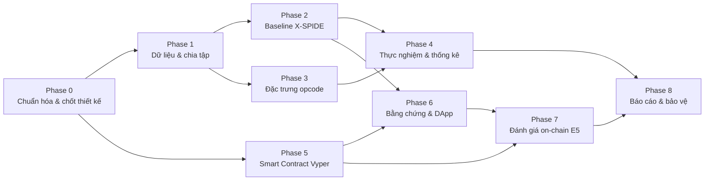

# KẾ HOẠCH THỰC HIỆN DỰ ÁN X-SPIDE-G (bản điều chỉnh theo phản biện)

**Đề tài:** X-SPIDE-G – Graph-Enhanced Explainable Ponzi Detection and On-Chain Risk Attestation for Ethereum Smart Contracts
**Môn học:** IS355 – Blockchain Technology · Nhóm 4 – DICTATOR
**Phiên bản kế hoạch:** v2.0 (13/11/2026). Bản này thay thế phần "Methodology / Next Steps" trong Proposal và Week 3.

> **Nguyên tắc xuyên suốt**
> 1. Không công bố kết quả nào khi chưa chạy thật. Mọi con số trong báo cáo phải truy được về script, seed và commit tương ứng.
> 2. Kết quả âm tính (đặc trưng đồ thị không giúp tăng hiệu năng) vẫn là kết quả hợp lệ, miễn được đo nghiêm túc.
> 3. Mỗi Phase có **tiêu chí hoàn thành (exit criteria)**. Chưa đạt tiêu chí thì không chuyển sang Phase phụ thuộc.

---

## Mục lục

- [0. Tổng quan thay đổi so với bản thảo cũ](#0-tổng-quan-thay-đổi-so-với-bản-thảo-cũ)
- [1. Sơ đồ phụ thuộc giữa các Phase](#1-sơ-đồ-phụ-thuộc-giữa-các-phase)
- [Phase 0 – Chuẩn hóa bản thảo & chốt thiết kế](#phase-0--chuẩn-hóa-bản-thảo--chốt-thiết-kế)
- [Phase 1 – Thu thập, kiểm định dữ liệu & chia tập chống rò rỉ](#phase-1--thu-thập-kiểm-định-dữ-liệu--chia-tập-chống-rò-rỉ)
- [Phase 2 – Tái hiện baseline X-SPIDE](#phase-2--tái-hiện-baseline-x-spide)
- [Phase 3 – Trích xuất đặc trưng opcode: bigram, đồ thị thống kê, đồ thị ngữ nghĩa](#phase-3--trích-xuất-đặc-trưng-opcode-bigram-đồ-thị-thống-kê-đồ-thị-ngữ-nghĩa)
- [Phase 4 – Thực nghiệm đối chứng, kiểm định thống kê & giải thích](#phase-4--thực-nghiệm-đối-chứng-kiểm-định-thống-kê--giải-thích)
- [Phase 5 – Thiết kế & cài đặt Smart Contract Vyper (đa xác nhận)](#phase-5--thiết-kế--cài-đặt-smart-contract-vyper-đa-xác-nhận)
- [Phase 6 – Gói bằng chứng chuẩn hóa & DApp Streamlit](#phase-6--gói-bằng-chứng-chuẩn-hóa--dapp-streamlit)
- [Phase 7 – Đánh giá on-chain (E5): so sánh thiết kế, gas, độ trễ](#phase-7--đánh-giá-on-chain-e5-so-sánh-thiết-kế-gas-độ-trễ)
- [Phase 8 – Tổng hợp, báo cáo, demo & bảo vệ](#phase-8--tổng-hợp-báo-cáo-demo--bảo-vệ)
- [Phụ lục A – Bảng thực nghiệm tổng hợp](#phụ-lục-a--bảng-thực-nghiệm-tổng-hợp)
- [Phụ lục B – Sổ đăng ký rủi ro](#phụ-lục-b--sổ-đăng-ký-rủi-ro)
- [Phụ lục C – Cấu trúc repository đề xuất](#phụ-lục-c--cấu-trúc-repository-đề-xuất)
- [Phụ lục D – Câu hỏi bảo vệ cần chuẩn bị](#phụ-lục-d--câu-hỏi-bảo-vệ-cần-chuẩn-bị)

---

## 0. Tổng quan thay đổi so với bản thảo cũ

| # | Vấn đề trong bản thảo | Thay đổi trong kế hoạch này | Phase |
|---|---|---|---|
| 1 | Đồ thị opcode (đỉnh là mnemonic, cạnh có trọng số) tương đương ma trận bigram, nên tính mới yếu | Thêm baseline **bigram** (E3b/E4b) và nhóm đặc trưng **đồ thị ngữ nghĩa** dựa trên CFG mức basic block (E3c/E4c); bổ sung tài liệu về hướng n-gram | 0, 3, 4 |
| 2 | Quản trị tập trung (1 owner, 1 auditor tự chốt, owner thu hồi được quyết định), không trả lời được câu hỏi "tại sao cần blockchain" | Chuyển sang **đa xác nhận, ngưỡng k-of-n**; owner không sửa được xác nhận; viết mô hình mối đe dọa (threat model) và mục "Why blockchain?" | 0, 5 |
| 3 | Chưa kiểm định dữ liệu, chưa biết độ phủ bytecode, có rủi ro thiên lệch do hợp đồng đã self-destruct | Phase 1 kiểm tra và khôi phục bytecode từ nhiều nguồn, báo cáo độ phủ theo từng lớp | 1 |
| 4 | Năng lực thống kê thấp (khoảng 100 mẫu Ponzi trong mỗi tập test, chỉ 5 seed) | CV lặp có nhóm 5×5, kiểm định theo cặp, đặt trước ngưỡng hiệu ứng tối thiểu (MDE) | 0, 4 |
| 5 | Câu chữ kiểu "ghi chú soạn thảo" còn sót, định nghĩa thực nghiệm và đánh số tài liệu tham khảo không thống nhất | Phase 0 làm sạch bản thảo, thống nhất định nghĩa E0–E6 | 0 |
| 6 | Streamlit chạy phía server nên không có cách ký giao dịch an toàn | Tách trang ký bằng ethers.js + MetaMask; chỉ dùng khóa test có nhãn rõ ràng trên Anvil | 6 |
| 7 | Hash bằng chứng mất ý nghĩa nếu file gốc bị mất | Thêm `evidenceURI` (IPFS CID hoặc Git commit) vào event | 5, 6 |
| 8 | RQ3 chỉ "đo gas", trong khi gas vốn tất định | E5 chuyển thành so sánh **3 thiết kế** (storage / chỉ event / Merkle batch) trên L1 và L2 testnet, có ngưỡng chấp nhận | 7 |
| 9 | Gom clone chỉ dựa trên hash chính xác | Bỏ CBOR rồi mới hash, kết hợp gom cụm gần trùng bằng MinHash; phân tích độ nhạy | 1, 4 |
| 10 | Dataset 2 có thể không độc lập với X-SPIDE | Kiểm tra trùng lặp trước, rồi mới quyết định dùng làm external test hay chỉ làm sanity check | 1, 4 |

### Câu hỏi nghiên cứu (phát biểu lại)

- **RQ1 – Tái hiện:** Baseline LightGBM của X-SPIDE có tái hiện được không? Hiệu năng thay đổi bao nhiêu khi chuyển từ cách chia ngẫu nhiên (như bài báo gốc) sang cách chia có nhóm theo clone?
- **RQ2 – Đặc trưng cấu trúc:** So với baseline 99 đặc trưng, việc thêm (a) bigram opcode, (b) thống kê đồ thị chuyển tiếp, (c) đặc trưng đồ thị ngữ nghĩa từ CFG có làm **ΔPR-AUC ≥ 0,02** với ý nghĩa thống kê không? Mỗi loại đặc trưng tốn bao nhiêu thời gian trích xuất trên một hợp đồng?
- **RQ3 – Xác nhận on-chain:** Cơ chế đa xác nhận k-of-n có đảm bảo được các thuộc tính an toàn đã định nghĩa không? Trong ba thiết kế lưu trữ, thiết kế nào đạt ngưỡng chi phí và độ trễ đặt trước?

---

## 1. Sơ đồ phụ thuộc giữa các Phase



**Hai luồng chạy song song sau Phase 0:**
- **Luồng ML:** P1 → P2 → P3 → P4
- **Luồng Blockchain:** P5 → P6 → P7

Hai luồng gặp nhau ở P6 (DApp cần mô hình từ P2/P4) và ở P8.

**Vai trò (gán theo chức năng, nhóm tự phân công):**

| Mã | Vai trò | Phụ trách chính |
|---|---|---|
| R-LEAD | Điều phối & báo cáo | P0, P8, quản lý rủi ro |
| R-DATA | Dữ liệu & baseline | P1, P2 |
| R-FEAT | Đặc trưng opcode/đồ thị | P3 |
| R-EVAL | Thực nghiệm & thống kê | P4, P7 (phần phân tích) |
| R-SC | Smart Contract | P5, P7 |
| R-APP | DApp & tích hợp | P6 |

**Ước lượng công sức** (ngày làm việc của vai trò chính): P0: 3–4 · P1: 5–7 · P2: 3–4 · P3: 5–7 · P4: 5–7 · P5: 5–7 · P6: 4–6 · P7: 3–4 · P8: 5–7. Nhờ chạy song song, tổng thời gian dự kiến khoảng 6 tuần.

---

## Phase 0 – Chuẩn hóa bản thảo & chốt thiết kế

**Mục tiêu:** Có bản thiết kế thống nhất, không mâu thuẫn, đặt trước các tiêu chí đánh giá, và trả lời được câu hỏi "tại sao cần blockchain" trước khi viết code.

**Đầu vào:** Proposal, Week 3, bản phản biện.

### Công việc chi tiết

**0.1. Làm sạch bản thảo Week 3**
- [ ] Xóa toàn bộ câu chữ kiểu ghi chú soạn thảo: "supplied proposal", "drafting environment", "violate the rubric", "actual Week 3 task to confirm", "confirm actual contribution".
- [ ] Thay câu "Dataset 1 row-level samples: not copied here…" bằng 3–5 dòng dữ liệu thật, sau khi hoàn thành mục 1.2.
- [ ] Rà soát lại câu "Academic integrity statement" cho khớp thực tế. Đối chiếu số liệu ProvAuditChain (32.796 / 140.109 / khoảng 173.000 gas, 10,15 s, 5,9 audit/phút) với bản toàn văn; nếu không xác minh được thì chỉ giữ số liệu có trong abstract.
- [ ] Sửa phần chú thích thừa ở mục phạm vi thời gian tìm tài liệu ("2018–2026… one 2018 paper included…").

**0.2. Thống nhất tài liệu tham khảo**
- [ ] Dùng một danh sách tham khảo chung cho mọi báo cáo về sau (theo thứ tự ở Week 3: [1] X-SPIDE, [2] TOSEM, [3] ICSE, [4] ProvAuditChain, [5] Chen 2018, [6] Bartoletti 2020, [7]–[11] repo/tài liệu).
- [ ] **Bổ sung nhánh opcode n-gram/chuỗi lệnh** (tối thiểu 1–2 công trình; cần tự đọc bản gốc và kiểm chứng trước khi trích dẫn). Ứng viên:
  - Fan, Fu, Xu, Zhu, *"Expose Your Mask: Smart Ponzi Schemes Detection on Blockchain"*, IJCNN 2020 (đặc trưng chuỗi opcode).
  - Chen et al., *SADPonzi* (thực thi ký hiệu, symbolic execution): làm đối chứng cho hướng phân tích ngữ nghĩa.
- [ ] Cập nhật mục 1.2 (review), Bảng 1 (so sánh) và mục 1.4 (khoảng trống nghiên cứu). Phát biểu lại G1: *"X-SPIDE không khai thác thứ tự lệnh; các công trình n-gram khai thác thứ tự cục bộ nhưng không khai thác cấu trúc luồng điều khiển với chi phí thấp."*

**0.3. Thống nhất định nghĩa thực nghiệm** (dùng nguyên văn trong mọi tài liệu, xem [Phụ lục A](#phụ-lục-a--bảng-thực-nghiệm-tổng-hợp))
- [ ] E0 = tái hiện theo cách chia của bài báo gốc; E1 = 99 đặc trưng, chia có nhóm (baseline chính); E2 = tập đặc trưng chọn lọc; E3/E3b/E3c = chỉ đồ thị / chỉ bigram / chỉ đồ thị ngữ nghĩa; E4/E4b/E4c = 99 đặc trưng cộng từng loại tương ứng; E5 = on-chain; E6 = dữ liệu ngoài.
- [ ] Sửa Hình 1 trong Week 3: thay chữ "vote" bằng "k-of-n attestations" cho khớp thiết kế mới.

**0.4. Viết mô hình mối đe dọa (threat model) & mục "Why blockchain?"**
- [ ] Liệt kê các tác nhân: *Model operator* (người chạy mô hình), *Auditor* (kiểm toán viên), *Owner/Admin* (quản trị), *Public verifier* (bên thứ ba kiểm chứng).
- [ ] Liệt kê các mối đe dọa và cơ chế ngăn chặn:

| Mối đe dọa | Database + chữ ký số | Blockchain registry (thiết kế mới) |
|---|---|---|
| Operator sửa điểm hoặc bằng chứng sau khi đã công bố | Phát hiện được nếu có chữ ký, nhưng admin DB có thể xóa bản ghi | `evidenceHash` + timestamp của block là bất biến và công khai |
| Auditor chối bỏ quyết định đã đưa ra | Chống được bằng chữ ký | Giao dịch có chữ ký, ghi vào log công khai |
| Admin viết lại hoặc xóa lịch sử | **Không chống được** nếu không có hệ thống transparency log bên ngoài | Owner **không có hàm** sửa hoặc xóa xác nhận; lịch sử chỉ được ghi thêm (append-only) |
| Một auditor đơn lẻ thông đồng | Không chống được | Cần k-of-n auditor đồng ý mới chốt |
| Bên thứ ba muốn kiểm chứng mà không tin server của nhóm | Phải tin server | Tự đọc chain, tính lại hash từ file tại `evidenceURI` |

- [ ] Nói rõ **giới hạn**: blockchain không chứng minh dự đoán là đúng, không chống được việc nhiều auditor cùng thông đồng, và không đảm bảo file off-chain luôn còn (có giải pháp giảm thiểu bằng IPFS pin cộng bản sao trên Git).

**0.5. Đăng ký trước tiêu chí đánh giá** (pre-registration, ghi vào `docs/preregistration.md` và commit **trước khi** chạy E3–E4)
- [ ] Chỉ số chính: **PR-AUC lớp Ponzi**. Chỉ số phụ: F1, Precision, Recall, ROC-AUC, Recall khi Precision ≥ 0,90.
- [ ] Ngưỡng hiệu ứng tối thiểu: **ΔPR-AUC ≥ 0,02** so với E1, đồng thời CI 95% không chứa 0.
- [ ] Phương pháp kiểm định: CV lặp có nhóm 5×5; t-test hiệu chỉnh Nadeau–Bengio cộng Wilcoxon signed-rank; hiệu chỉnh Holm cho nhiều phép so sánh.
- [ ] Cách chọn ngưỡng phân loại cho F1: chọn ngưỡng làm F1 lớn nhất trên tập validation bên trong; **không bao giờ** chọn trên tập test.
- [ ] Ngưỡng chấp nhận cho on-chain (xem Phase 7).

**0.6. Chốt thiết kế Smart Contract ở mức đặc tả** (chi tiết ở Phase 5)
- [ ] Đa xác nhận, mặc định k = 2 trên n = 3 auditor.
- [ ] Owner chỉ quản lý danh sách auditor và tham số k; không sửa hoặc xóa case và xác nhận.
- [ ] Owner trên Sepolia là ví multisig (Safe) hoặc ghi rõ đây là giới hạn của bản demo.

### Sản phẩm bàn giao
- `docs/design_v2.md` (thiết kế thống nhất), `docs/threat_model.md`, `docs/preregistration.md`
- Week 3 bản đã sửa (v1.1)

### Tiêu chí hoàn thành
- Không còn câu chữ kiểu ghi chú soạn thảo; định nghĩa E0–E6 giống nhau ở mọi tài liệu.
- `preregistration.md` đã commit, có timestamp **trước** commit chạy E3 đầu tiên.
- Có tối thiểu 1 công trình theo hướng n-gram trong phần tổng quan.

---

## Phase 1 – Thu thập, kiểm định dữ liệu & chia tập chống rò rỉ

**Mục tiêu:** Có tập dữ liệu sạch, biết chính xác độ phủ bytecode theo từng lớp, có ID nhóm clone và các lần chia tập cố định, dùng chung cho mọi thực nghiệm.

### Công việc chi tiết

**1.1. Tải và lưu nguồn gốc dữ liệu**
- [ ] Clone repo X-SPIDE [7]. Ghi lại commit hash và kiểm kê các file (`DS_deployed_bytecode.csv`, `DS_full_bytecode.csv`, file đặc trưng, nhãn…).
- [ ] Tải `Ponzi.zip` và `non-Ponzi.zip` của PonziGuard [8], cùng `ponzi-addresses.csv` của Blockchain@Unica [9].
- [ ] Ghi `data/manifest.json`: URL, commit, SHA-256 từng file, ngày tải, giấy phép (nếu có).
- [ ] Không commit dữ liệu thô lên Git nếu giấy phép không rõ; chỉ commit manifest và script tải.

**1.2. Kiểm tra schema & nhãn**
- [ ] Đếm số dòng, số cột, kiểu dữ liệu; đối chiếu với bài báo (7.446 mẫu: 880/6.566; tập chỉ có deployed opcode: 6.621 mẫu: 669/5.952).
- [ ] Chuẩn hóa địa chỉ (chữ thường, có `0x`, đúng 42 ký tự); tìm địa chỉ trùng lặp và nhãn mâu thuẫn.
- [ ] Trích 3–5 dòng thật mỗi lớp để đưa vào báo cáo.
- [ ] Ghi kết quả vào `reports/data_audit.md`.

**1.3. Khôi phục và kiểm tra độ phủ bytecode** (theo thứ tự ưu tiên; mỗi mẫu ghi cột `bytecode_source`)
1. [ ] Bytecode có sẵn trong repo X-SPIDE.
2. [ ] `eth_getCode(address, "latest")` qua RPC công khai. Nếu kết quả là `0x`, nhiều khả năng hợp đồng đã self-destruct.
3. [ ] Với hợp đồng đã hủy: lấy bytecode từ Google BigQuery `bigquery-public-data.crypto_ethereum.contracts` (cột `bytecode`, kèm `block_number` và `block_timestamp`, dùng luôn cho chia tập theo thời gian), hoặc gọi `eth_getCode` tại block trước thời điểm hủy qua archive node.
4. [ ] Nếu vẫn không có: đánh dấu `missing`, không tự tạo dữ liệu.
- [ ] Lập **bảng độ phủ theo lớp**: số mẫu có bytecode / tổng số, cho Ponzi và non-Ponzi, theo từng nguồn.
- [ ] Kiểm tra thiên lệch: so sánh phân phối các đặc trưng giao dịch giữa nhóm có bytecode và nhóm thiếu (kiểm định KS hoặc so sánh trung vị).

**1.4. Tiền xử lý bytecode**
- [ ] Tách metadata CBOR ở cuối: đọc 2 byte cuối làm độ dài, giải mã CBOR, chỉ cắt khi giải mã hợp lệ. Hợp đồng biên dịch trước khoảng Solidity 0.4.7 có thể **không có** metadata, cần xử lý trường hợp này.
- [ ] Ghi cờ `metadata_stripped` (true/false/none).
- [ ] Tính `code_hash = keccak256(runtime_bytecode_stripped)`.

**1.5. Gom nhóm clone**
- [ ] **Mức 1, trùng chính xác:** gom theo `code_hash`, thu được `group_exact`.
- [ ] **Mức 2, gần trùng:** shingle 5-gram trên chuỗi opcode đã chuẩn hóa, dùng MinHash LSH (`datasketch`, 128 permutation), nối các cặp có Jaccard ≥ 0,9 bằng union-find, thu được `group_near`.
- [ ] Thống kê kích thước nhóm, số nhóm lẫn cả hai nhãn (cảnh báo nhãn mâu thuẫn), và tỷ lệ mẫu Ponzi nằm trong các nhóm lớn hơn 1.

**1.6. Kiểm tra trùng lặp giữa các dataset**
- [ ] So X-SPIDE với PonziGuard và X-SPIDE với Blockchain@Unica theo địa chỉ, `code_hash` và `group_near`.
- [ ] **Quy tắc ra quyết định cho Dataset 2:** nếu sau khi loại trùng còn ít nhất 30 mẫu Ponzi thì dùng làm external test (E6). Nếu ít hơn, hạ cấp thành sanity check và nêu rõ trong báo cáo.

**1.7. Chia tập cố định**
- [ ] Định nghĩa **S_full** (mọi mẫu, dùng cho E0, E1-full) và **S_code** (mẫu có bytecode hợp lệ, dùng cho E1–E4 để so sánh công bằng).
- [ ] Dùng `StratifiedGroupKFold(n_splits=5)` với `groups = group_near` (chính) và lặp 5 lần với 5 seed, được **25 fold có cặp**. Lưu `splits/S_code_group_near_seed{s}_fold{k}.json`.
- [ ] Lưu thêm bộ chia theo `group_exact` để phân tích độ nhạy (S1).
- [ ] Nếu có `block_number` đáng tin cậy: tạo **holdout theo thời gian** (20% hợp đồng triển khai muộn nhất làm test) cho phân tích S3.
- [ ] Bộ chia kiểu bài báo gốc (ngẫu nhiên, phân tầng) chỉ dùng cho E0.

### Sản phẩm bàn giao
- `data/manifest.json`, `data/processed/contracts.parquet` (address, label, đặc trưng, bytecode_source, code_hash, group_exact, group_near, block_number)
- `reports/data_audit.md` (schema, nhãn, độ phủ theo lớp, thiên lệch, trùng lặp giữa các dataset, mẫu dòng thật)
- `splits/*.json`

### Tiêu chí hoàn thành
- Biết chính xác |S_code| theo lớp. Nếu số mẫu Ponzi trong S_code dưới 400, kích hoạt rủi ro R1 (xem Phụ lục B).
- Không fold nào có cùng `group_near` nằm ở cả train và test (có unit test kiểm tra).
- Đã ra quyết định cho Dataset 2 và ghi lại lý do.

---

## Phase 2 – Tái hiện baseline X-SPIDE

**Mục tiêu:** Trả lời RQ1 và tạo baseline E1 làm mốc cho mọi so sánh.

### Công việc chi tiết

**2.1. E0 – Tái hiện theo đúng bài báo**
- [ ] Chạy lại script hoặc notebook gốc nếu có. Nếu không có, cài đặt lại LightGBM với 47 đặc trưng theo mô tả trong bài.
- [ ] Dùng đúng cách chia và grid search như bài báo; so sánh với số liệu công bố (Acc 0,969; P 0,870; R 0,864; F1 0,867; ROC-AUC 0,977).
- [ ] Báo cáo **độ lệch tái hiện** cho từng chỉ số, kèm giải thích nếu lệch quá 0,02.

**2.2. E1 – Baseline 99 đặc trưng, chia có nhóm**
- [ ] Chạy trên **S_code** và trên **S_full** (E1-full, để tham chiếu).
- [ ] Tối ưu siêu tham số bằng **CV lồng (nested)**: vòng trong là `StratifiedGroupKFold(3)` trên tập train, có ngân sách cố định (ví dụ 30 trial Optuna, hoặc grid nhỏ cố định). **Dùng chung ngân sách cho mọi bộ đặc trưng** ở Phase 4 để so sánh công bằng.
- [ ] Xử lý mất cân bằng lớp: thử `scale_pos_weight` hoặc `is_unbalance`, chọn bên trong vòng trong.
- [ ] Chọn ngưỡng phân loại trên tập validation bên trong; ghi PR-AUC, F1, P, R, ROC-AUC, Recall@P≥0,90 và ma trận nhầm lẫn cho từng fold.

**2.3. E2 – Tập đặc trưng chọn lọc**
- [ ] Chạy RFE hoặc chọn đặc trưng **bên trong từng fold train** (không dùng lại danh sách 47 đặc trưng của bài báo cho chia có nhóm, vì danh sách đó được chọn trên toàn bộ dữ liệu).
- [ ] So sánh với E1 trên cùng 25 fold.

**2.4. Lưu mô hình**
- [ ] Lưu mô hình cuối (huấn luyện trên toàn bộ train của bộ chia demo) và `model_card.json` (dữ liệu, đặc trưng, siêu tham số, chỉ số, commit). Tính `modelVersionHash = keccak256(model_file_bytes || feature_schema_json)` để Phase 6 dùng.

### Sản phẩm bàn giao
- `results/E0_reproduction.csv`, `results/E1_folds.csv`, `results/E2_folds.csv`
- `reports/rq1_reproduction.md`: bảng so sánh với bài báo, phân tích hiệu năng giảm khi chuyển sang chia có nhóm
- `models/baseline_v1/` kèm `model_card.json`

### Tiêu chí hoàn thành
- E0 có kết quả cuối cùng, kể cả khi lệch so với bài báo (độ lệch được báo cáo trung thực).
- E1 chạy xong 25 fold trên S_code, có toàn bộ chỉ số từng fold.

---

## Phase 3 – Trích xuất đặc trưng opcode: bigram, đồ thị thống kê, đồ thị ngữ nghĩa

**Mục tiêu:** Tạo ba nhóm đặc trưng cấu trúc, được kiểm thử kỹ và đo chi phí, để Phase 4 so sánh công bằng.

### Công việc chi tiết

**3.1. Bộ disassembler EVM** (`src/features/disasm.py`)
- [ ] Tự viết bộ disassembler tối giản (bảng opcode gồm cả `PUSH0` = `0x5F`), hoặc dùng thư viện sau khi đã kiểm tra nó hỗ trợ `PUSH0` và opcode không hợp lệ.
- [ ] Bỏ qua 1–32 byte dữ liệu tức thời của `PUSH1–PUSH32`; nếu dữ liệu `PUSH` bị cắt cụt ở cuối thì ghi log.
- [ ] Byte không hợp lệ được ánh xạ thành `INVALID_xx` và được đếm.
- [ ] **Unit test:** 5 đoạn bytecode viết tay có kết quả mong đợi, 3 hợp đồng thật đối chiếu với Etherscan, bytecode có và không có CBOR, dữ liệu `PUSH32` cắt cụt.

**3.2. Chuẩn hóa mnemonic** (để giảm số chiều; áp dụng thống nhất cho mọi nhóm đặc trưng)
- [ ] `PUSH1..PUSH32` thành `PUSH`, `DUP1..16` thành `DUP`, `SWAP1..16` thành `SWAP`, `LOG0..4` thành `LOG`. Giữ nguyên `PUSH0`.
- [ ] Có cờ cấu hình để chạy thêm phiên bản không chuẩn hóa (phân tích độ nhạy).

**3.3. Nhóm F-BIGRAM** (baseline cho tính mới)
- [ ] Đếm cặp opcode liên tiếp, chuẩn hóa theo độ dài (tần suất tương đối).
- [ ] Chọn top-k = 200 bigram theo tần suất xuất hiện trong văn bản (document frequency), **chỉ tính trên fold train** (fit bên trong pipeline để tránh rò rỉ).

**3.4. Nhóm F-GSTAT** (đồ thị chuyển tiếp như trong bản thảo)
- [ ] Đồ thị có hướng có trọng số (`networkx.DiGraph`): đỉnh là mnemonic, cạnh là cặp lệnh liên tiếp, trọng số là tần suất.
- [ ] Đặc trưng: `|V|`, `|E|`, mật độ (có tính self-loop), trung bình và max của weighted in/out degree, tổng số chuyển tiếp, Shannon entropy của phân phối chuyển tiếp, tỷ lệ self-loop. **Bản chuẩn hóa theo độ dài** để giảm tương quan với kích thước hợp đồng.

**3.5. Nhóm F-GSEM** (đồ thị ngữ nghĩa; đây là phần đóng góp mới)
- [ ] **Tách basic block:** bắt đầu block tại `JUMPDEST`; kết thúc sau `JUMP`, `JUMPI`, `STOP`, `RETURN`, `REVERT`, `INVALID`, `SELFDESTRUCT`.
- [ ] **Cạnh của CFG:** cạnh nối tiếp (fall-through, sau `JUMPI` và giữa các block liền nhau), cộng cạnh nhảy tĩnh khi gặp mẫu `PUSHn <dest>; JUMP/JUMPI` và `<dest>` là một `JUMPDEST` hợp lệ.
- [ ] Ghi lại **tỷ lệ lệnh nhảy không giải được** (nhảy động, thường là địa chỉ trả về của hàm nội bộ Solidity) và nêu rõ đây là giới hạn của phương pháp.
- [ ] Danh sách đặc trưng:

| Đặc trưng | Ý nghĩa liên quan Ponzi |
|---|---|
| `n_blocks`, `n_cfg_edges`, `cyclomatic = E − N + 2` | Độ phức tạp luồng điều khiển |
| `n_scc_cycles` (số thành phần liên thông mạnh có kích thước > 1 hoặc có self-loop) | Có vòng lặp |
| `n_loops_with_call`, `has_loop_with_call` | **Vòng lặp chi trả** cho danh sách nhà đầu tư |
| `n_loops_with_sstore` | Cập nhật danh sách hoặc số dư trong vòng lặp |
| `path_callvalue_to_call` (có đường đi trên CFG từ block chứa `CALLVALUE` đến block chứa `CALL`) | Tiền vào có dẫn đến tiền ra |
| `n_blocks_with_call`, `call_block_ratio` | Mật độ chuyển tiền |
| `pagerank_CALL`, `pagerank_SSTORE` (trên đồ thị chuyển tiếp) | Vai trò trung tâm của các lệnh chuyển tiền và ghi trạng thái |
| `has_selfdestruct`, `selfdestruct_reachable` | Khả năng rút tiền và hủy hợp đồng |
| `unresolved_jump_ratio` | Chỉ số chất lượng của CFG |

- [ ] **Unit test:** hợp đồng Solidity nhỏ, tự biên dịch, có 1 vòng `for` chứa `transfer`, phải cho kết quả `has_loop_with_call = 1`; hợp đồng không có vòng lặp phải cho kết quả bằng 0.

**3.6. Đo chi phí trích xuất**
- [ ] Đo thời gian trên một hợp đồng cho từng nhóm (disasm, bigram, gstat, gsem): trung vị, p95, cấu hình máy (CPU/RAM).
- [ ] Ghi số hợp đồng trích xuất lỗi và nguyên nhân.

### Sản phẩm bàn giao
- `src/features/{disasm,bigram,gstat,gsem}.py` kèm `tests/`
- `data/processed/features_{bigram,gstat,gsem}.parquet` (khóa là address)
- `results/feature_extraction_cost.csv`

### Tiêu chí hoàn thành
- Toàn bộ unit test pass; tỷ lệ trích xuất lỗi trên S_code dưới 1% (hoặc đã giải thích nguyên nhân).
- Ba file đặc trưng có đúng |S_code| dòng.

---

## Phase 4 – Thực nghiệm đối chứng, kiểm định thống kê & giải thích

**Mục tiêu:** Trả lời RQ2 bằng các so sánh có cặp, có kiểm định thống kê, đúng như đã đăng ký trước ở mục 0.5.

### Công việc chi tiết

**4.1. Chạy ma trận thực nghiệm** trên **S_code**, cùng 25 fold, cùng ngân sách tối ưu, cùng quy trình chọn ngưỡng.
- [ ] E1 (99), E2 (chọn lọc), E3 (GSTAT), E3b (BIGRAM), E3c (GSEM), E4 (99+GSTAT), E4b (99+BIGRAM), E4c (99+GSEM), E4d (99+BIGRAM+GSEM).
- [ ] Toàn bộ biến đổi có học tham số (chọn top-k bigram, scaler nếu có, chọn đặc trưng) đều nằm **bên trong pipeline** và fit trên fold train.
- [ ] Ghi kết quả từng fold vào `results/E{x}_folds.csv` (cột: seed, fold, PR-AUC, F1, P, R, ROC-AUC, Recall@P≥0,9, threshold, train_time, n_features).

**4.2. Kiểm định thống kê** (đúng như `preregistration.md`)
- [ ] Với mỗi so sánh E_x so với E1 và E4c so với E4b: tính Δ theo từng fold, rồi báo cáo trung bình ± SD và CI 95% theo t-test hiệu chỉnh Nadeau–Bengio.
- [ ] Wilcoxon signed-rank trên 25 cặp; hiệu chỉnh Holm cho toàn bộ họ so sánh.
- [ ] Quy tắc kết luận:
  - "Cải thiện" khi ΔPR-AUC ≥ 0,02, CI 95% hoàn toàn lớn hơn 0 và p sau hiệu chỉnh Holm nhỏ hơn 0,05.
  - "Không khác biệt có ý nghĩa" khi CI chứa 0.
  - Các trường hợp còn lại là "chưa kết luận được".
- [ ] **So sánh then chốt cho tính mới:** E4c so với E4b (đồ thị ngữ nghĩa so với bigram) và E4d so với E4b (đồ thị ngữ nghĩa có bổ sung thêm thông tin ngoài bigram hay không).

**4.3. Phân tích độ nhạy**
- [ ] **S1:** gom theo `group_exact` so với `group_near`, để thấy chênh lệch hiệu năng do rò rỉ clone.
- [ ] **S2:** giữ so với bỏ metadata CBOR.
- [ ] **S3:** holdout theo thời gian (nếu có `block_number`).
- [ ] **S4:** mnemonic chuẩn hóa so với không chuẩn hóa.

**4.4. E6 – Dữ liệu ngoài** (theo quyết định ở mục 1.6)
- [ ] Huấn luyện mô hình **chỉ dùng đặc trưng mã** (opcode frequency + BIGRAM + GSEM, vì đặc trưng giao dịch không tái tạo được) trên X-SPIDE S_code, rồi kiểm thử trên Dataset 2 đã loại trùng.
- [ ] Báo cáo PR-AUC, P, R, F1 kèm CI bootstrap (1.000 lần). Ghi rõ đây là đánh giá khả năng chuyển giao (transfer) có giới hạn.

**4.5. Giải thích (XAI)**
- [ ] SHAP (`TreeExplainer`) **chỉ trên dự đoán ở tập test**, gộp qua các fold.
- [ ] Biểu đồ: beeswarm của E1 và E4c; xếp hạng mức độ quan trọng của đặc trưng GSEM; 3 ví dụ (đúng Ponzi, dương tính giả, âm tính giả) kèm waterfall plot và hình CFG.
- [ ] Kiểm tra tính hợp lý: các đặc trưng như `has_loop_with_call` có đóng góp theo đúng hướng kỳ vọng không? Nếu không, phân tích nguyên nhân.

**4.6. Phân tích lỗi**
- [ ] Đọc thủ công tối thiểu 10 mẫu dương tính giả và 10 mẫu âm tính giả (bytecode hoặc source nếu có trên Etherscan), phân loại nguyên nhân.

### Sản phẩm bàn giao
- `results/model_comparison.csv` (bảng tổng hợp), `results/stat_tests.csv`
- `figures/` (PR curves, SHAP, CFG ví dụ, biểu đồ Δ kèm CI)
- `reports/rq2_results.md`

### Tiêu chí hoàn thành
- Đủ 9 cấu hình × 25 fold; có kết luận cho từng so sánh theo đúng quy tắc đã đăng ký trước.
- Có kết quả S1 và S2 (S3 tùy thuộc dữ liệu).

---

## Phase 5 – Thiết kế & cài đặt Smart Contract Vyper (đa xác nhận)

**Mục tiêu:** Cài đặt `RiskAttestationRegistry` đúng với threat model ở Phase 0: không một bên đơn lẻ nào sửa được lịch sử, case chỉ được chốt khi đủ k-of-n auditor.

**Công cụ:** Vyper 0.4.x, Ape Framework + `ape-foundry` (Anvil), pytest; tùy chọn dùng module của thư viện snekmate cho phần ownable.

### Công việc chi tiết

**5.1. Đặc tả trạng thái** (`docs/contract_spec.md`)

| Biến | Kiểu | Ghi chú |
|---|---|---|
| `owner` | `address` | Multisig trên Sepolia; chỉ quản lý auditor và tham số `threshold` |
| `is_auditor` | `HashMap[address, bool]` | |
| `auditor_count` | `uint256` | |
| `threshold` | `uint256` | k, với 1 ≤ k ≤ auditor_count; mặc định k = 2 |
| `cases` | `HashMap[bytes32, Case]` | `Case{subject: address, subject_chain_id: uint256, evidence_hash: bytes32, model_version_hash: bytes32, registrant: address, created_at: uint256, approve_count: uint256, reject_count: uint256, review_count: uint256, status: uint8}` |
| `attestations` | `HashMap[bytes32, HashMap[address, Attestation]]` | `Attestation{decision: uint8, revision: uint256, timestamp: uint256}` |

**Mã quyết định:** `1 = Approve` (auditor đồng ý với đánh giá rủi ro của mô hình), `2 = Reject` (bác bỏ), `3 = NeedsReview`. Giá trị `0` nghĩa là chưa xác nhận.

**Trạng thái case** (được tính lại sau mỗi lần xác nhận): `0 Open` → `1 Approved` nếu approve ≥ k → `2 Rejected` nếu reject ≥ k → `3 Disputed` nếu đồng thời có ít nhất 1 approve và 1 reject nhưng chưa bên nào đạt k.

**5.2. Đặc tả hàm**

| Hàm | Ai được gọi | Hành vi | Revert khi |
|---|---|---|---|
| `add_auditor(a)` | owner | Thêm auditor, tăng `auditor_count` | đã là auditor; `a` là địa chỉ zero; `a == owner` |
| `remove_auditor(a)` | owner | Gỡ auditor; **các xác nhận cũ vẫn được giữ** (hợp lệ tại thời điểm ký) | không phải auditor; nếu gỡ thì `auditor_count < threshold` |
| `set_threshold(k)` | owner | Đổi k | k = 0 hoặc k > `auditor_count` |
| `register_case(case_id, subject, subject_chain_id, evidence_hash, model_version_hash, evidence_uri)` | auditor | Tạo case; `evidence_uri` chỉ phát trong event, không lưu storage | `case_id` đã tồn tại; hash bằng 0 |
| `attest(case_id, decision, reason_hash)` | auditor | Tạo hoặc thay thế xác nhận **của chính mình**: tăng `revision`, cập nhật các bộ đếm, tính lại trạng thái | case không tồn tại; decision ∉ {1,2,3}; trùng với quyết định hiện tại |
| `verify_evidence(case_id, h)` | ai cũng gọi được (view) | Trả về `evidence_hash == h` | không |
| `get_case`, `get_attestation` | view | Đọc trạng thái | không |

- [ ] **Không có hàm nào** cho phép owner sửa hoặc xóa case, sửa xác nhận, hay đổi `evidence_hash`.
- [ ] Owner không được đồng thời là auditor (tách vai trò).

**5.3. Đặc tả event** (đây là nguồn lịch sử append-only)
- `AuditorAdded(auditor)`, `AuditorRemoved(auditor)`, `ThresholdChanged(old, new)`
- `CaseRegistered(case_id indexed, subject indexed, evidence_hash, model_version_hash, evidence_uri: String[128], registrant)`
- `Attested(case_id indexed, auditor indexed, decision, revision, reason_hash)`
- `StatusChanged(case_id indexed, old_status, new_status)`

**5.4. Biến thể thiết kế cho E5** (cùng giao diện xác nhận, khác cách lưu trữ)
- [ ] **D1 – Storage đầy đủ:** như đặc tả ở trên.
- [ ] **D2 – Chỉ event:** chỉ lưu `case_exists`, `evidence_hash` và các bộ đếm; mọi thông tin khác chỉ phát trong event.
- [ ] **D3 – Merkle batch:** `register_batch(root, n_leaves, batch_uri)`; mỗi lá là `keccak256(abi.encode(case_id, evidence_hash, model_version_hash))`; xác nhận theo lô `attest_batch(root, decision)`; `verify_inclusion(leaf, proof: DynArray[bytes32, 32], root)` là hàm view.

**5.5. Kiểm thử** (`tests/contracts/`, mục tiêu phủ toàn bộ nhánh revert)
- [ ] T1: Tài khoản không phải auditor không gọi được `register_case` và `attest`.
- [ ] T2: Đăng ký trùng `case_id` thì revert.
- [ ] T3: `decision` không hợp lệ (0, 4, 255) thì revert.
- [ ] T4: Logic ngưỡng: với k = 2, n = 3, kiểm tra tất cả chuỗi xác nhận và trạng thái sau mỗi bước (Open, Approved, Rejected, Disputed).
- [ ] T5: Thay thế xác nhận làm tăng `revision`, các bộ đếm và trạng thái cập nhật đúng.
- [ ] T6: Owner không có cách nào sửa case hoặc xác nhận (thử gọi mọi hàm bằng owner).
- [ ] T7: Auditor đã bị gỡ không xác nhận được nữa; xác nhận cũ vẫn còn.
- [ ] T8: `verify_evidence` trả về true với hash đúng và false khi JSON bị sửa 1 byte.
- [ ] T9: Mọi event được phát với đúng tham số.
- [ ] T10: `set_threshold` không hợp lệ, và `remove_auditor` làm `auditor_count < k`, đều revert.
- [ ] T11 (fuzz/property): với chuỗi thao tác ngẫu nhiên, luôn có `approve + reject + review` = số auditor đang có xác nhận khác 0 cho case đó, và trạng thái luôn khớp với hàm tính trạng thái viết bằng Python.
- [ ] T12 (D3): bằng chứng Merkle hợp lệ và không hợp lệ.

**5.6. Rà soát bảo mật**
- [ ] Checklist: phân quyền, kiểm tra đầu vào, không có `raw_call`, không nhận ETH (không có `__default__` payable), không dùng `selfdestruct`, giới hạn độ dài `String`.
- [ ] Chạy công cụ phân tích tĩnh nếu có hỗ trợ Vyper; nếu không, ghi rõ chỉ rà soát thủ công.

**5.7. Triển khai**
- [ ] Anvil: script triển khai, thêm 3 auditor, đặt k = 2.
- [ ] Sepolia: triển khai D1 (và D2, D3 cho E5); owner là Safe multisig, hoặc ghi rõ giới hạn nếu dùng EOA. Xác minh source trên Etherscan Sepolia.
- [ ] L2 testnet (Arbitrum Sepolia hoặc Base Sepolia): triển khai D1 và D3 để so sánh.
- [ ] Xin ETH testnet từ faucet **ngay từ đầu Phase** (faucet có giới hạn mỗi ngày).

### Sản phẩm bàn giao
- `contracts/RiskAttestationRegistry.vy` (D1), `contracts/variants/{D2_EventOnly,D3_MerkleBatch}.vy`
- `tests/contracts/*`, báo cáo coverage
- `deployments.json` (địa chỉ, tx hash, mạng, commit), `docs/contract_spec.md`, `docs/security_review.md`

### Tiêu chí hoàn thành
- T1–T12 pass; đã triển khai D1 trên Anvil và Sepolia, source đã được xác minh.

---

## Phase 6 – Gói bằng chứng chuẩn hóa & DApp Streamlit

**Mục tiêu:** Từ một dự đoán ML, tạo ra bằng chứng có thể tính lại hash; auditor ký giao dịch **không qua server**; bên thứ ba tự kiểm chứng được.

### Công việc chi tiết

**6.1. Đặc tả JSON bằng chứng chuẩn hóa** (`docs/evidence_schema_v1.md`)
- [ ] Các trường: `schema_version`, `source_chain_id`, `subject_address`, `code_hash`, `dataset_id`, `sample_id`, `feature_schema_hash`, `model_version_hash`, `score`, `threshold`, `predicted_label`, `shap_top_k` (top 10 đặc trưng và giá trị SHAP), `shap_digest`, `run_id`, `created_at_utc`.
- [ ] Quy tắc chuẩn hóa: UTF-8; sắp xếp khóa; `separators=(",", ":")`; không dùng `NaN`/`Infinity`; số thực ghi thành **chuỗi 6 chữ số thập phân** (ví dụ `"0.873421"`); địa chỉ viết thường có `0x`; thời gian theo ISO 8601 UTC, đuôi `Z`.
- [ ] Công thức hash:

```python
import json
from eth_utils import keccak
from eth_abi import encode

def canonical_bytes(evidence: dict) -> bytes:
    return json.dumps(evidence, sort_keys=True, separators=(",", ":"),
                      ensure_ascii=False, allow_nan=False).encode("utf-8")

def evidence_hash(evidence: dict) -> bytes:
    return keccak(canonical_bytes(evidence))

def case_id(chain_id: int, subject: str, model_version_hash: bytes, run_id: bytes) -> bytes:
    # abi.encode (không dùng packed) để tránh va chạm
    return keccak(encode(["uint256", "address", "bytes32", "bytes32"],
                         [chain_id, subject, model_version_hash, run_id]))
```

- [ ] **Test vector:** 3 JSON mẫu kèm hash mong đợi trong `tests/evidence/vectors.json`. Có test chứng minh đổi thứ tự khóa thì hash không đổi, còn đổi 1 ký tự giá trị thì hash thay đổi.

**6.2. Lưu trữ bằng chứng off-chain**
- [ ] Đẩy JSON lên IPFS (pin qua dịch vụ miễn phí hoặc chạy node cục bộ) **và** commit vào thư mục `evidence/` trên Git. `evidence_uri` có dạng `ipfs://<CID>`, có bản dự phòng dạng URL Git kèm commit hash.

**6.3. Ứng dụng Streamlit** (`app/`)
- [ ] **Trang 1 – Phân tích:** nhập địa chỉ hoặc chọn mẫu, hiển thị điểm rủi ro, ngưỡng, nhãn dự đoán (kèm cảnh báo "đây là dự đoán, không phải kết luận gian lận"), SHAP waterfall, hình CFG hoặc đồ thị opcode.
- [ ] **Trang 2 – Tạo bằng chứng:** sinh JSON chuẩn hóa, hiển thị `evidence_hash` và `case_id`, đẩy lên IPFS.
- [ ] **Trang 3 – Ký & gửi giao dịch:** mở **trang ký tĩnh** (`signer/index.html`, dùng ethers.js v6 với MetaMask), truyền tham số qua query string (`case_id`, `evidence_hash`, `model_version_hash`, `evidence_uri`, `decision`). Người dùng xác nhận trong MetaMask; Streamlit theo dõi receipt qua Web3.py bằng tx hash.
  - Phương án thay thế: component Streamlit hỗ trợ kết nối ví (cần kiểm tra component còn được bảo trì).
  - Trên Anvil: được dùng tài khoản test của Anvil nạp từ `.env`, giao diện ghi rõ **"TEST KEY – ANVIL ONLY"**. **Không bao giờ** đặt khóa Sepolia hay khóa thật trên server.
- [ ] **Trang 4 – Kiểm chứng công khai:** nhập `case_id`, đọc case và event từ chain, tải JSON từ `evidence_uri`, tính lại hash và so sánh (✅ hoặc ❌), hiển thị lịch sử xác nhận từ các event `Attested` và `StatusChanged`.

**6.4. Kiểm thử tích hợp**
- [ ] Kịch bản đầu cuối trên Anvil: dự đoán → JSON → IPFS → `register_case` → 2 auditor `attest(Approve)` → trạng thái Approved → trang kiểm chứng báo ✅.
- [ ] Kịch bản giả mạo: sửa JSON trên IPFS hoặc Git thì trang kiểm chứng báo ❌.

### Sản phẩm bàn giao
- `src/evidence/`, `app/`, `signer/`, `tests/evidence/`, `docs/evidence_schema_v1.md`
- Video quay màn hình kịch bản đầu cuối (dùng lại ở Phase 8)

### Tiêu chí hoàn thành
- Kịch bản đầu cuối và kịch bản giả mạo đều chạy đúng trên Anvil và Sepolia; không có private key nào nằm trong repo hay trên server, ngoại trừ test key của Anvil.

---

## Phase 7 – Đánh giá on-chain (E5): so sánh thiết kế, gas, độ trễ

**Mục tiêu:** Trả lời RQ3 bằng so sánh giữa các thiết kế, có ngưỡng chấp nhận đặt trước.

### Công việc chi tiết

**7.1. Ngưỡng chấp nhận** (ghi trong `preregistration.md`; đây là mức đề xuất, nhóm có thể điều chỉnh ở Phase 0)
- D1: `register_case` + k lần `attest` ≤ **250.000 gas mỗi case** (với k = 2).
- D3: chi phí khấu hao ≤ **10.000 gas mỗi case** khi lô có từ 100 case trở lên.
- Độ trễ trên Sepolia: trung vị ≤ **2 block** tính từ lúc gửi đến khi có 1 xác nhận.

**7.2. Đo gas** (tất định, đo trên Anvil, rồi đối chiếu ngẫu nhiên vài giao dịch trên Sepolia)
- [ ] `gasUsed` của từng hàm cho D1, D2, D3; tách lần ghi đầu (cold storage) và lần thay thế (warm storage).
- [ ] D3: đo với lô N = 1, 10, 100, 1.000; vẽ đường cong gas mỗi case theo N.

**7.3. Ước tính chi phí** (chuyển gas sang tiền)
- [ ] Công thức: chi phí = gasUsed × gas price × giá ETH, với gas price lấy trung vị trên mainnet và giá ETH **tại một ngày cố định** (ghi rõ nguồn và ngày).
- [ ] L2: lấy phí thực tế từ receipt trên L2 testnet; ghi chú rằng phí L2 gồm cả phần dữ liệu đẩy lên L1, nên chỉ mang tính tham khảo.

**7.4. Đo độ trễ**
- [ ] Mỗi mạng (Sepolia, L2 testnet) gửi 30 giao dịch `attest`, đo thời gian thực tế và số block đến 1 xác nhận; báo cáo trung vị và p95.

**7.5. Kiểm thử thuộc tính an toàn trên testnet**
- [ ] Chạy lại T1, T6, T8 trên Sepolia (non-auditor, owner cố sửa, giả mạo hash) và lưu tx hash của các giao dịch bị revert làm bằng chứng.

**7.6. Phân tích đánh đổi**
- [ ] Bảng so sánh D1, D2, D3 theo các tiêu chí: gas, khả năng truy vấn on-chain, độ phức tạp khi kiểm chứng (D3 cần proof), độ phụ thuộc vào indexer off-chain (D2).
- [ ] So sánh định tính với ProvAuditChain (L2, khoảng 173.000 gas mỗi chu kỳ). Nêu rõ đây **không phải** so sánh trực tiếp, vì khác bài toán và khác cách cài đặt.

### Sản phẩm bàn giao
- `results/E5_gas.csv`, `results/E5_latency.csv`, `figures/gas_vs_batch.png`
- `reports/rq3_onchain.md`

### Tiêu chí hoàn thành
- Mỗi thiết kế có kết luận rõ là đạt hay không đạt ngưỡng, kèm số liệu và tx hash có thể kiểm chứng.

---

## Phase 8 – Tổng hợp, báo cáo, demo & bảo vệ

**Mục tiêu:** Có báo cáo cuối, gói tái lập, slide, video demo và phần chuẩn bị trả lời câu hỏi.

### Công việc chi tiết

**8.1. Báo cáo cuối** (cấu trúc đề xuất)
1. Giới thiệu & RQ1–RQ3
2. Tổng quan tài liệu (đã bổ sung nhánh n-gram) & khoảng trống G1/G2
3. Threat model & "Why blockchain?"
4. Dữ liệu (kiểm định, độ phủ theo lớp, nhóm clone, trùng lặp giữa các dataset)
5. Phương pháp (đặc trưng, pipeline chống rò rỉ, thống kê, Smart Contract, bằng chứng)
6. Kết quả: RQ1 (E0–E2), RQ2 (E3–E4, S1–S4, E6, SHAP, phân tích lỗi), RQ3 (E5)
7. Thảo luận: ý nghĩa, **kết quả âm tính nếu có**, mối đe dọa đến tính hợp lệ (dữ liệu nhãn, CFG gần đúng, khả năng tổng quát hóa)
8. Giới hạn & hướng phát triển
9. Tài liệu tham khảo (danh sách thống nhất)

**8.2. Gói tái lập**
- [ ] `README.md` (cài đặt, lệnh chạy từng Phase), `requirements.txt` hoặc `pyproject.toml` có ghi phiên bản cụ thể, `Makefile` hoặc script `run_all`.
- [ ] Bảng truy vết: mỗi con số trong báo cáo được ánh xạ tới file kết quả, script và commit tương ứng.
- [ ] Kiểm tra cuối: một thành viên khác clone repo sạch và chạy lại được E1 cùng bộ test contract.

**8.3. Slide & demo**
- [ ] Slide: 12–15 trang (vấn đề, khoảng trống, kiến trúc, 3 kết quả chính, demo, giới hạn).
- [ ] Video demo 3–5 phút theo kịch bản ở mục 6.4, gồm cả cảnh kiểm chứng phát hiện giả mạo.
- [ ] Demo trực tiếp trên Anvil, có video dự phòng nếu mạng gặp sự cố.

**8.4. Chuẩn bị bảo vệ**
- [ ] Trả lời bằng văn bản các câu hỏi ở [Phụ lục D](#phụ-lục-d--câu-hỏi-bảo-vệ-cần-chuẩn-bị), có số liệu dẫn chứng.
- [ ] Tập dượt bảo vệ thử ít nhất 1 lần, có người đóng vai phản biện.

### Sản phẩm bàn giao
- Báo cáo cuối (DOCX/PDF), slide, video demo, repo đã gắn tag `v1.0-final`.

### Tiêu chí hoàn thành
- Mọi số liệu trong báo cáo đều truy được nguồn; repo sạch chạy lại được; demo chạy ổn định.

---

## Phụ lục A – Bảng thực nghiệm tổng hợp

| Mã | Mục đích | Tập mẫu | Đặc trưng | Cách chia | Chỉ số chính | RQ |
|---|---|---|---|---|---|---|
| E0 | Tái hiện bài báo | S_full | 47 (theo bài báo) | Như bài báo | P/R/F1/ROC-AUC so với công bố | RQ1 |
| E1-full | Tham chiếu | S_full | 99 | Có nhóm 5×5 | PR-AUC | RQ1 |
| **E1** | **Baseline chính** | S_code | 99 | Có nhóm 5×5 | PR-AUC | RQ1/2 |
| E2 | Đặc trưng chọn lọc | S_code | RFE trong fold | Có nhóm 5×5 | ΔPR-AUC so với E1 | RQ1 |
| E3 | Tín hiệu từ đồ thị thống kê | S_code | GSTAT | Có nhóm 5×5 | PR-AUC | RQ2 |
| E3b | Tín hiệu từ bigram | S_code | BIGRAM | Có nhóm 5×5 | PR-AUC | RQ2 |
| E3c | Tín hiệu từ đồ thị ngữ nghĩa | S_code | GSEM | Có nhóm 5×5 | PR-AUC | RQ2 |
| E4 | Bổ sung GSTAT | S_code | 99 + GSTAT | Có nhóm 5×5 | ΔPR-AUC so với E1 | RQ2 |
| E4b | Bổ sung bigram | S_code | 99 + BIGRAM | Có nhóm 5×5 | ΔPR-AUC so với E1 | RQ2 |
| E4c | Bổ sung GSEM | S_code | 99 + GSEM | Có nhóm 5×5 | ΔPR-AUC so với E1 và so với E4b | RQ2 |
| E4d | GSEM có thêm thông tin ngoài bigram không | S_code | 99 + BIGRAM + GSEM | Có nhóm 5×5 | ΔPR-AUC so với E4b | RQ2 |
| S1–S4 | Độ nhạy | S_code | Theo E1, E4c | Thay đổi yếu tố tương ứng | Δ | RQ2 |
| E5 | On-chain | — | — | D1/D2/D3 × Anvil/Sepolia/L2 | gas, chi phí, độ trễ, thuộc tính an toàn | RQ3 |
| E6 | Dữ liệu ngoài | Dataset 2 đã loại trùng | Chỉ đặc trưng mã | Train X-SPIDE, test Dataset 2 | PR-AUC + CI bootstrap | RQ2 |

---

## Phụ lục B – Sổ đăng ký rủi ro

| Mã | Rủi ro | Khả năng | Tác động | Dấu hiệu nhận biết | Phương án dự phòng |
|---|---|---|---|---|---|
| R1 | Số mẫu Ponzi có bytecode quá ít (dưới 400) | Trung bình | Cao | Kết quả mục 1.3 | Khôi phục từ BigQuery hoặc archive node; dùng CV lặp 10×5; mở rộng CI, báo cáo chỉ là "chưa kết luận được" |
| R2 | Thiên lệch do hợp đồng đã self-destruct | Cao | Trung bình | Kiểm định KS ở mục 1.3 cho thấy khác biệt | Báo cáo thiên lệch; chạy E1-full song song để so sánh |
| R3 | Đặc trưng đồ thị không cải thiện kết quả | Trung bình | Thấp (nếu báo cáo tốt) | Kết quả mục 4.2 | Báo cáo kết quả âm tính kèm phân tích nguyên nhân; nhấn mạnh S1 (tác động của rò rỉ clone) như một đóng góp |
| R4 | CFG có quá nhiều lệnh nhảy không giải được | Trung bình | Trung bình | `unresolved_jump_ratio` > 50% | Chỉ dùng đặc trưng GSEM không phụ thuộc cạnh nhảy; ghi rõ giới hạn |
| R5 | Repo X-SPIDE thiếu file hoặc file hỏng | Thấp | Cao | Kết quả mục 1.1 | Liên hệ tác giả; tái tạo đặc trưng opcode từ bytecode; giới hạn phạm vi |
| R6 | Dataset 2 trùng lặp nhiều | Cao | Thấp | Kết quả mục 1.6 | Hạ cấp thành sanity check |
| R7 | Faucet Sepolia hoặc L2 không đủ ETH | Trung bình | Trung bình | Không gửi được giao dịch | Xin ETH sớm; dùng nhiều faucet; giảm số giao dịch đo độ trễ (tối thiểu 15) |
| R8 | Tích hợp ký ví với Streamlit gặp khó | Trung bình | Trung bình | Thử nghiệm ở mục 6.3 thất bại | Dùng trang ký ethers.js độc lập (phương án chính) |
| R9 | Lỗi logic ngưỡng hoặc trạng thái trong contract | Thấp | Cao | T4, T11 fail | Kiểm thử property/fuzz; đối chiếu với hàm tính trạng thái viết bằng Python |
| R10 | Thiếu thời gian cuối kỳ | Trung bình | Cao | Chậm tiêu chí hoàn thành quá 3 ngày | Cắt theo thứ tự: S4 → E6 → D2 → L2 testnet; **không cắt** E1, E4b, E4c, kiểm thử T1–T8 |

---

## Phụ lục C – Cấu trúc repository đề xuất

```
x-spide-g/
├── README.md
├── pyproject.toml / requirements.txt
├── Makefile
├── ape-config.yaml
├── docs/
│   ├── design_v2.md
│   ├── threat_model.md
│   ├── preregistration.md
│   ├── contract_spec.md
│   ├── evidence_schema_v1.md
│   └── security_review.md
├── data/
│   ├── manifest.json
│   ├── raw/            # không commit nếu giấy phép không rõ
│   └── processed/
├── splits/
├── src/
│   ├── data/           # tải, kiểm tra, khôi phục bytecode, gom clone, chia tập
│   ├── features/       # disasm, bigram, gstat, gsem
│   ├── models/         # pipeline, tối ưu, đánh giá
│   ├── stats/          # Nadeau–Bengio, Wilcoxon, Holm, bootstrap
│   └── evidence/       # JSON chuẩn hóa, hash, IPFS
├── contracts/
│   ├── RiskAttestationRegistry.vy
│   └── variants/
├── scripts/            # deploy, benchmark gas/latency
├── app/                # Streamlit
├── signer/             # trang ký ethers.js
├── tests/
│   ├── features/
│   ├── contracts/
│   └── evidence/
├── evidence/           # bản sao JSON bằng chứng
├── results/
├── figures/
├── models/
├── reports/
└── deployments.json
```

---

## Phụ lục D – Câu hỏi bảo vệ cần chuẩn bị

| # | Câu hỏi | Phần trả lời dựa trên |
|---|---|---|
| 1 | Đồ thị opcode khác gì đếm bigram? | E4c so với E4b, E4d so với E4b (Phase 4.2); định nghĩa F-GSEM (3.5) |
| 2 | Nếu owner có quyền quản trị, blockchain giải quyết vấn đề tin cậy nào? | Threat model (0.4); owner không có hàm sửa (5.2); kiểm thử T6 trên Sepolia (7.5) |
| 3 | Nếu F1 chỉ tăng 0,01 thì kết luận thế nào? | Ngưỡng MDE và quy tắc kết luận đã đăng ký trước (0.5, 4.2) |
| 4 | Hợp đồng đã self-destruct thì lấy bytecode ở đâu? Có lệch mẫu không? | Mục 1.3 (nguồn khôi phục, bảng độ phủ, kiểm định KS); rủi ro R2 |
| 5 | Auditor ký giao dịch thế nào? Private key nằm ở đâu? | Mục 6.3 (trang ký ethers.js + MetaMask, chỉ test key cho Anvil) |
| 6 | File JSON mất thì hash còn ý nghĩa gì? | Mục 6.2 (IPFS pin + bản sao Git), `evidence_uri` trong event |
| 7 | Kết quả có bị thổi phồng do clone không? | S1: so sánh `group_exact` với `group_near` (4.3) |
| 8 | Vì sao không đo trên mainnet? | Chi phí và đạo đức (không gắn nhãn Ponzi công khai cho địa chỉ thật); gas tất định nên ước tính được chi phí mainnet (7.3) |
