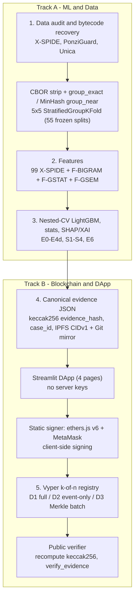
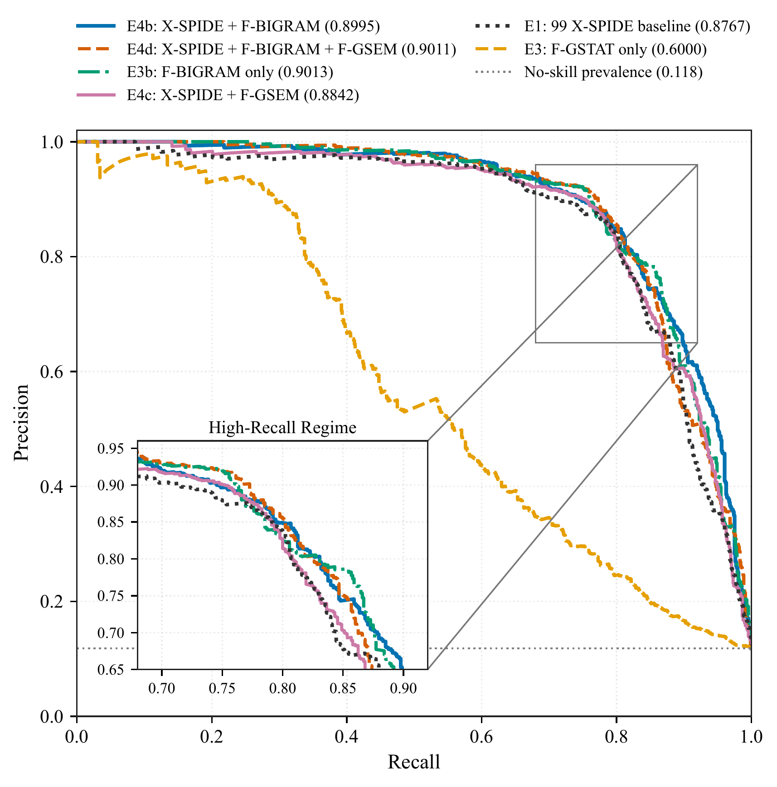
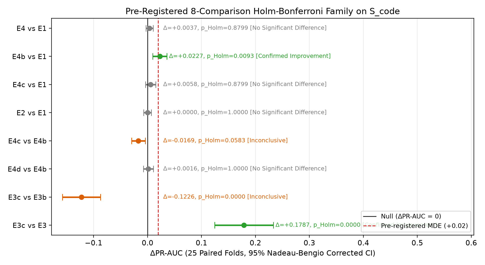
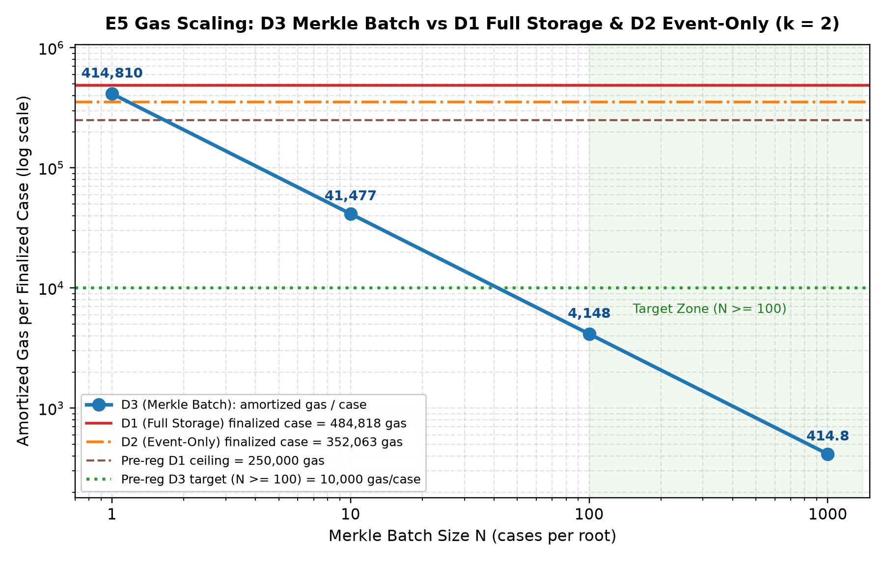
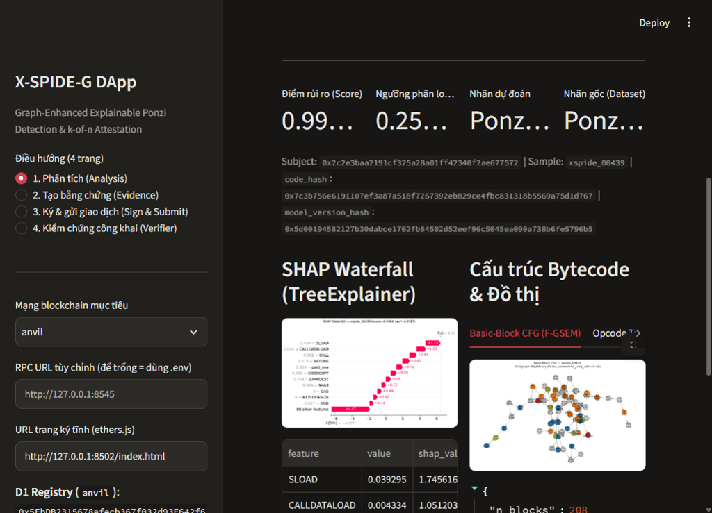
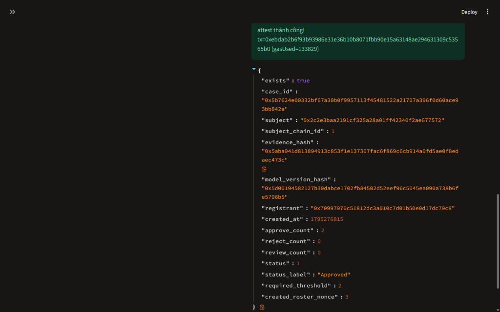
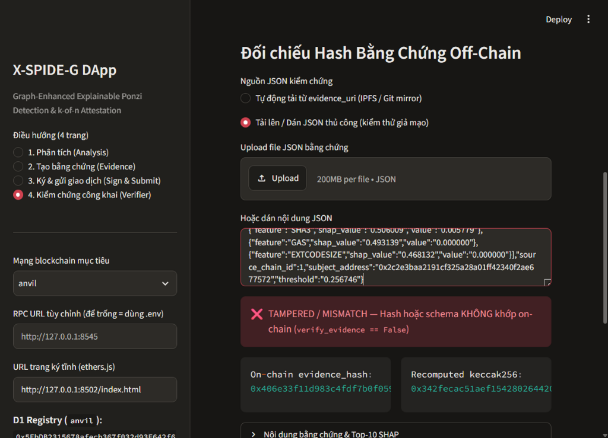

<div align="center">

# X-SPIDE-G

**Graph-Enhanced Explainable Ponzi Detection and On-Chain Risk Attestation for Ethereum Smart Contracts**

*IS355 – Blockchain Technology (`IS355.R11.CTTT.2`) · Group 4 – DICTATOR · University of Information Technology (UIT), VNU-HCM*


[📄 IEEE Paper (PDF)](paper/main.pdf) · [📘 Final Report](reports/final_report.md) · [🎬 Demo Video](demo/X-SPIDE-G_demo.mp4) · [🧪 Pre-Registration](docs/preregistration.md) · [🔗 Traceability Matrix](reports/traceability_matrix.md)

</div>

---

## Table of Contents

1. [Overview](#1-overview)
2. [Key Findings](#2-key-findings)
3. [System Architecture](#3-system-architecture)
4. [Research Questions & Experiment Matrix](#4-research-questions--experiment-matrix)
5. [Data, Clone Audit & Anti-Leakage Splits](#5-data-clone-audit--anti-leakage-splits)
6. [Feature Families](#6-feature-families)
7. [ML Evaluation Protocol & Statistics](#7-ml-evaluation-protocol--statistics)
8. [Results](#8-results)
9. [Smart Contracts (Vyper `D1`/`D2`/`D3`)](#9-smart-contracts-vyper-d1d2d3)
10. [Canonical Evidence & DApp](#10-canonical-evidence--dapp)
11. [Threat Model & "Why Blockchain?"](#11-threat-model--why-blockchain)
12. [Deployed Contracts](#12-deployed-contracts)
13. [Repository Structure](#13-repository-structure)
14. [Installation & Quick Start](#14-installation--quick-start)
15. [Reproducing Each Phase](#15-reproducing-each-phase)
16. [Configuration & Secrets](#16-configuration--secrets)
17. [Testing](#17-testing)
18. [Limitations & Negative Results](#18-limitations--negative-results)
19. [Documentation Index](#19-documentation-index)
20. [Team](#20-team)
21. [Citation & References](#21-citation--references)

---

## 1. Overview

Smart Ponzi schemes disguise investor-funded redistribution loops as staking, yield, or gaming DApps on Ethereum. Published ML detectors report very high headline scores, but two practical problems remain:

1. **Clone leakage.** Ethereum bytecode is heavily cloned. Random train/test splits place near-identical Ponzi contracts on both sides, which inflates reported metrics. Ordered opcode information (n-grams, control flow) is also ignored by unigram-frequency models.
2. **No tamper-evident provenance.** Off-chain model predictions and SHAP explanations live in mutable databases, with no neutral multi-auditor quorum and no client-controlled signing.

**X-SPIDE-G** addresses both with a single, pre-registered pipeline:

| Track | What it does |
|---|---|
| **A – ML & Data** | Re-audits the X-SPIDE corpus (7,446 contracts, 880 Ponzi), strips CBOR compiler metadata, clusters clones (exact `keccak256` + MinHash-LSH near-duplicates), reproduces the X-SPIDE LightGBM baseline, and evaluates three bytecode feature families (`F-BIGRAM`, `F-GSTAT`, `F-GSEM`) under strict `5 × 5` clone-grouped nested CV with Nadeau–Bengio / Holm statistics. |
| **B – Blockchain & DApp** | Anchors canonical SHAP-backed risk evidence in a **k-of-n (default 2-of-3) Vyper `RiskAttestationRegistry`**, in three storage variants (full / event-only / Merkle-batch), evaluated for gas, USD cost, latency and security on local EVM, Ethereum Sepolia and Arbitrum Sepolia. Signing is done **client-side** (`ethers.js v6` + MetaMask); the server holds no live keys. |

> **Scientific principles.** (1) No result is reported without an executed script, fixed seed and verifiable commit/tx hash. (2) Negative results are valid and reported verbatim. (3) All hypotheses, thresholds and statistical rules were frozen in [`docs/preregistration.md`](docs/preregistration.md) before the structural-feature (`E3`–`E4d`) and on-chain (`E5`) experiments were run.

> **Disclaimer.** Risk scores are *indicators, not legal fraud verdicts*. A `2-of-3 Approved` on-chain status means two authorized reviewers agreed with the recorded ML assessment, not that a contract is proven fraudulent. Testnets are used exclusively for evaluation.

---

## 2. Key Findings

| RQ | Finding | Key numbers |
|---|---|---|
| **RQ1** – Clone leakage | **59.09 %** of Ponzi contracts (`520/880`) have near-duplicate bytecode. Moving from random 5-fold CV (`E0`) to clone-grouped `5 × 5` CV (`E1`) removes optimism. | PR-AUC `0.9149 → 0.8767` (**−0.0382**), F1 `0.8589 → 0.8118` (**−0.0471**) |
| **RQ2** – Structural features | Explicit in-fold top-200 **opcode bigrams** give a *Confirmed Improvement*. Lightweight static **CFG semantics** (`F-GSEM`) do **not** reach the pre-registered MDE. | `E4b vs E1`: **+0.0227** PR-AUC, 95 % NB CI `[+0.0096, +0.0358]`, `p_Holm = 4.77e-7` · `E4c vs E1`: `+0.0058`, CI `[−0.0037, +0.0152]` (n.s.) |
| **RQ3** – On-chain registry | Full-storage `D1` **fails** the 250k-gas/case ceiling. Merkle-batch `D3` **passes** by a wide margin. Latency target met on Sepolia; ~1.2 s on Arbitrum Sepolia. | `D1` `427,461` gas (FAIL) · `D2` `294,706` (−31.06 %) · `D3` `3,574.53`/case @ N=100, `357.46` @ N=1000 (PASS ≤ 10,000) |

Additional facts: median end-to-end feature extraction `16.58 ms/contract` (0 errors on 7,446); `100 %` revert-branch coverage on all three contracts; verified deployments on two public testnets; 1-byte evidence tamper is rejected on-chain (`verify_evidence → False`).

---

## 3. System Architecture



**Trust boundary.** The ML/DApp service is *untrusted*: it cannot sign for auditors and cannot rewrite history. Final state lives in the immutable EVM registry; any third party can recompute the evidence hash from the JSON artifact.

---

## 4. Research Questions & Experiment Matrix

| RQ | Question |
|---|---|
| **RQ1** | Can the published X-SPIDE LightGBM baseline be reproduced, and how much does performance shift under CBOR-stripped, clone-grouped validation? |
| **RQ2** | Do opcode bigrams (`F-BIGRAM`), transition-graph statistics (`F-GSTAT`) or basic-block CFG semantics (`F-GSEM`) improve PR-AUC over the 99-feature baseline by **ΔPR-AUC ≥ 0.02** (MDE) under `5 × 5` grouped CV? What is the per-contract extraction cost? Are SHAP attributions domain-faithful? |
| **RQ3** | Does the k-of-n Vyper registry enforce role separation and append-only immutability (`T1`–`T12`), and which of `D1`/`D2`/`D3` meets the pre-registered gas and latency thresholds? |

| ID | Purpose | Subset | Features | Setup |
|---|---|---|---|---|
| `E0` | Paper reproduction | `S_full` | 47 (paper) / 99 | Paper random split & random 5-fold |
| `E1-full`, **`E1`** | Grouped baseline (**primary**) | `S_full` / `S_code` | 99 | `group_near` `5 × 5` CV |
| `E2` | In-fold feature selection | `S_code` | RFECV in-fold | `group_near` `5 × 5` CV |
| `E3` / `E3b` / `E3c` | Code-only: GSTAT / BIGRAM / GSEM | `S_code` | 16 / 200 / 15 | `group_near` `5 × 5` CV |
| `E4` / `E4b` / `E4c` / `E4d` | Baseline + GSTAT / BIGRAM / GSEM / BIGRAM+GSEM | `S_code` | 115 / 299 / 114 / 314 | `group_near` `5 × 5` CV |
| `S1`–`S4` | Sensitivity: `group_exact`; ±CBOR; temporal holdout; ±opcode normalization | `S_code` | `E1`, `E4c` (`E4b`) | see [reports/rq2_results.md](reports/rq2_results.md) |
| `E5` | On-chain benchmark | — | — | `D1`/`D2`/`D3` × local EVM / Sepolia / Arbitrum Sepolia |
| `E6` | External transfer (conditional → sanity check) | PonziGuard (deduped) | code-only | Train `S_code`, test external |

---

## 5. Data, Clone Audit & Anti-Leakage Splits

**Corpus.** X-SPIDE official release (commit `dcf6027c2bd1…`): `7,446` unique valid contracts, **`880` Ponzi / `6,566` non-Ponzi**, 0 label conflicts, 99 baseline features (`23` account/transaction + `76` opcode-frequency). Deployed bytecode coverage is 100 %, so `|S_code| = |S_full| = 7,446`. PonziGuard/XBlock and Blockchain@Unica are used only for overlap checks and an external sanity check.

**Clone pipeline** (`src/data/`):

1. **CBOR metadata stripping** – strict decoding of the trailing Solidity/Vyper metadata (`6,417` stripped; `1,029` pre-0.4.7 / no footer).
2. **`group_exact`** – `keccak256(stripped_runtime_bytecode)` → `6,145` groups (25.6 % of Ponzi in multi-groups, 10 mixed-label groups).
3. **`group_near`** – 5-gram normalized-opcode shingles, MinHash (`128` permutations), LSH Jaccard ≥ **0.90**, union-find → **`4,711` groups** (max size 99, 24 mixed-label groups, **520/880 = 59.09 % of Ponzi** in multi-member families).

**Frozen splits** (`splits/`, 55 JSONs, leak-free invariant unit-tested): `25` × `S_code_group_near`, `25` × `S_code_group_exact`, `5` × `S_full_E0_random`; seeds `42..46`.

**Selection-bias audit (Risk R2).** The 516 rows dropped from the raw 8k table differ significantly from the kept ones (e.g. `lifetime` median 15 vs 2 days, KS = 0.138; `tx_out` KS = 0.247). See [reports/data_audit.md](reports/data_audit.md).

> `S3` (temporal holdout) was **not run**: `block_number` is absent and BigQuery credentials were unavailable (documented as `N/A`).

Raw/processed datasets are **not committed** (`data/raw/`, `data/processed/` are git-ignored); only [`data/manifest.json`](data/manifest.json) (URLs, commit hashes, SHA-256) and download/audit scripts are versioned.

---

## 6. Feature Families

Implemented in `src/features/` on CBOR-stripped bytecode via a linear-sweep EVM disassembler (supports `PUSH0`, truncated `PUSH` handling; `PUSH*/DUP*/SWAP*/LOG*` normalized):

| Family | Dim. | Description |
|---|---:|---|
| **Baseline (X-SPIDE)** | 99 | 23 account/transaction features + 76 normalized opcode unigram frequencies. |
| **`F-BIGRAM`** | 200 | Relative frequency of consecutive normalized opcode pairs; **top-200 by document frequency selected strictly inside each training fold** (`BigramTopKVectorizer`). |
| **`F-GSTAT`** | 16 | Transition-multigraph statistics: density, reciprocity, degree entropy, top-1 concentration, self-loop ratio, `/L`-normalized variants. |
| **`F-GSEM`** | 15 | Basic-block CFG (stack-local `JUMP/JUMPI` resolution): `n_blocks`, `n_cfg_edges`, cyclomatic complexity, `n_scc_cycles`, `has_loop_with_call`, `n_loops_with_call`, `n_loops_with_sstore`, `path_callvalue_to_call`, `call_block_ratio`, `unresolved_jump_ratio`, `has_selfdestruct`, `selfdestruct_reachable`, `pagerank_CALL`, `pagerank_SSTORE`, … |

**Extraction cost** (i5-12450H, 15.6 GB, Python 3.12.13; 7,446 contracts, 0 errors; [`results/feature_extraction_cost.csv`](results/feature_extraction_cost.csv)):

| Stage | Median (ms) | p95 (ms) |
|---|---:|---:|
| `disasm` | 3.90 | 14.62 |
| `bigram` | 3.61 | 10.88 |
| `gstat` | 1.91 | 5.65 |
| `gsem` | 6.64 | 18.67 |
| **end-to-end** | **16.58** | **60.21** |

---

## 7. ML Evaluation Protocol & Statistics

- **Model:** LightGBM, with **30 Optuna TPE trials** per outer fold over a `3`-fold inner `StratifiedGroupKFold` (identical budget for every configuration). `RFECV` (`E2`) and bigram top-k are fit *inside* the fold via `sklearn.Pipeline`.
- **Threshold:** τ* maximizes F1 on inner out-of-fold predictions; the outer test fold is never used for tuning.
- **Metrics:** primary **PR-AUC** (minority class ≈ 11.8 %); secondary F1, precision, recall, ROC-AUC, `Recall@Precision ≥ 0.90`.
- **Inference (pre-registered, 8 comparisons):** Nadeau–Bengio corrected resampled paired *t*-test (`df = 24`, ρ = 0.25), exact Wilcoxon signed-rank, Holm–Bonferroni step-down.
- **Decision rule (MDE = 0.02):**
  - **Confirmed Improvement** ⇔ `ΔPR-AUC ≥ 0.02` ∧ NB 95 % CI lower bound `> 0` ∧ `p_Holm < 0.05`
  - **No Significant Difference** ⇔ NB 95 % CI contains 0
  - **Inconclusive** otherwise

---

## 8. Results

### 8.1 RQ1 – Baseline reproduction & clone leakage (`E0`–`E2`)

| Run | Split | Feats | PR-AUC | ROC-AUC | F1 |
|---|---|---:|---:|---:|---:|
| Published X-SPIDE [1] | paper 85/15 random | 47 | — | 0.9770 | 0.8670 |
| `E0` | random 5-fold (`S_full`) | 99 | 0.9149 | 0.9768 | 0.8589 |
| **`E1`** | `group_near` 5×5 (`S_code`) | 99 | **0.8767 ± 0.0254** | 0.9631 | 0.8118 ± 0.0275 |
| `E2` (in-fold RFECV) | `group_near` 5×5 | 71.4 | 0.8768 ± 0.0237 | 0.9638 | 0.8095 ± 0.0264 |

The frozen demo artifact [`models/baseline_v1/`](models/baseline_v1) (seed 42 / fold 0, τ* = `0.256746`) reaches PR-AUC `0.8956`, F1 `0.8222`. Detailed reproduction gaps vs. the paper: [reports/rq1_reproduction.md](reports/rq1_reproduction.md).

### 8.2 RQ2 – Feature ablations (`5 × 5` grouped CV, 25 folds)

| Exp | Feature set | #Feats | PR-AUC | Δ vs `E1` | F1 | ROC-AUC |
|---|---|---:|---:|---:|---:|---:|
| `E1` | 99 baseline | 99 | 0.8767 ± 0.0254 | — | 0.8118 | 0.9631 |
| `E3` | `F-GSTAT` only | 16 | 0.6000 ± 0.0629 | −0.2767 | 0.5364 | 0.8402 |
| `E3b` | `F-BIGRAM` only | 200 | **0.9013 ± 0.0191** | +0.0246 | 0.8247 | 0.9736 |
| `E3c` | `F-GSEM` only | 15 | 0.7787 ± 0.0418 | −0.0980 | 0.6972 | 0.9253 |
| `E4` | 99 + `F-GSTAT` | 115 | 0.8805 ± 0.0242 | +0.0037 | 0.8140 | 0.9641 |
| **`E4b`** | 99 + `F-BIGRAM` | 299 | 0.8995 ± 0.0212 | **+0.0227** | **0.8263** | **0.9738** |
| `E4c` | 99 + `F-GSEM` | 114 | 0.8825 ± 0.0233 | +0.0058 | 0.8125 | 0.9649 |
| `E4d` | 99 + `F-BIGRAM` + `F-GSEM` | 314 | 0.9010 ± 0.0216 | +0.0243 | 0.8259 | 0.9734 |

Pre-registered hypothesis tests (Holm family of 8; `p_Holm` from exact Wilcoxon; full table in [`results/stat_tests.csv`](results/stat_tests.csv)):

| Comparison | ΔPR-AUC | 95 % NB CI | `p_Holm` | Verdict |
|---|---:|---|---:|---|
| `E4b vs E1` | **+0.0227** | `[+0.0096, +0.0358]` | `4.77e-7` | **Confirmed Improvement** |
| `E3c vs E3` | +0.1787 | `[+0.1242, +0.2332]` | `4.77e-7` | **Confirmed Improvement** |
| `E4 vs E1` | +0.0037 | `[−0.0027, +0.0102]` | `1.38e-2` | No Significant Difference |
| `E4c vs E1` | +0.0058 | `[−0.0037, +0.0152]` | `8.10e-3` | No Significant Difference |
| `E4d vs E4b` | +0.0016 | `[−0.0075, +0.0107]` | `1.00` | No Significant Difference |
| `E2 vs E1` | +0.0000 | `[−0.0070, +0.0071]` | `1.00` | No Significant Difference |
| `E4c vs E4b` | −0.0169 | `[−0.0298, −0.0041]` | `2.98e-6` | Inconclusive (degradation) |
| `E3c vs E3b` | −0.1226 | `[−0.1578, −0.0874]` | `4.77e-7` | Inconclusive (degradation) |

> Naive Wilcoxon alone would flag `E4`/`E4c` vs `E1` as significant (`p_Holm < 0.05`) because it treats the 25 overlapping CV folds as independent. The Nadeau–Bengio CI corrects for this and both effects stay far below the 0.02 MDE.

<p align="center">
  
  
</p>

**Sensitivity (`S1`–`S4`).**
- `S1` – weakening grouping to `group_exact` inflates PR-AUC by **+0.028** (`E1` `0.9051`, `E4c` `0.9097`): near-clone grouping matters.
- `S2` (CBOR stripping, max |Δ| = 0.0028) and `S4` (raw vs normalized opcodes, max |Δ| = 0.0025): negligible.
- `S3` (temporal): `N/A` (see §5).

**External sanity check (`E6`).** Only `10` non-overlapping unique PonziGuard Ponzi runtimes remain (< 30), so Risk **R6** downgrades `E6` to `SANITY_CHECK_ONLY`: PR-AUC `0.6535` (95 % bootstrap CI `[0.3965, 0.9141]`), `n_test = 107`.

**Explainability & error audit.** OOF TreeExplainer SHAP on `E4c` ranks `call_block_ratio` (0.283), `n_loops_with_call` (0.206), `n_blocks_with_call` (0.171), `unresolved_jump_ratio` (0.152) highest, consistent with Ponzi payout-loop logic. Manual audit of 12 FP + 12 FN ([`results/error_analysis_cases.csv`](results/error_analysis_cases.csv)) links errors to legitimate distributor payout loops and mixed-label clone clusters (14 FP / 38 FN). Figures: [`figures/`](figures) (SHAP beeswarm/waterfall, CFG visualizations).

**Why did `F-GSEM` underperform `F-BIGRAM`?** Solidity 0.4–0.5 bytecode frequently routes dispatchers and loop exits through indirect stack/memory jumps (median `19.18 %` unresolved jumps; `526/7,446 = 7.06 %` of contracts > 50 %), which fragments static loop back-edges. Short bigrams (`CALLVALUE→ISZERO→JUMPI`, `SLOAD→CALL`) capture the same idioms without jump-resolution loss. Full discussion: [reports/rq2_results.md](reports/rq2_results.md).

### 8.3 RQ3 – On-chain gas, cost, latency & security (`E5`)

Deterministic gas is measured on a Cancun-rules `PyEVMBackend` (native `anvil.exe` is blocked by Windows Application Control on the dev machine); live spot-checks run on Sepolia and Arbitrum Sepolia. USD reference: `0.084427 gwei` median Ethereum mainnet gas price (blocks `26412234..26412333`) × `ETH = $1,900.68` (fixed anchor `2026-11-14`).

| Variant / operation | Cancun PyEVM gas | Sepolia live (EIP-8037) | Mainnet ref. | Pre-registered target | Verdict |
|---|---:|---:|---:|---|---|
| `D1` deploy | 1,068,183 | 7,365,849 | \$0.171 | — | — |
| `D1` finalized case (`register` + 2×`attest`) | **427,461** | 1,648,029 | \$0.0686 | ≤ 250,000 | **FAIL** (+70.98 %) |
| `D2` finalized case | 294,706 | 987,566 | \$0.0473 | ≤ 250,000 | **FAIL** (−31.06 % vs `D1`) |
| `D3` batch, per case, `N = 10` | 35,741.7 | — | — | — | — |
| `D3` batch, per case, **`N = 100`** | **3,574.53** | 13,142.73 | \$0.000574 | ≤ 10,000 | **PASS** |
| `D3` batch, per case, **`N = 1,000`** | **357.46** | — | \$0.000057 | ≤ 10,000 | **PASS** |

- **Latency** (30 sequential `attest` txs per network): Sepolia median **`10.357 s` / 1.00 block** (p95 `11.217 s`) → **PASS** (≤ 2 blocks). Arbitrum Sepolia median **`1.226 s`** (p95 `1.675 s`).
- **Security proofs:** `T1`/`T6`/`T8` exploit attempts revert (owner cannot `attest`, non-auditor cannot register) and tamper checks pass on live Sepolia, without mutating the main `D1` instance.
- **Caveats:** Sepolia (post-Glamsterdam/EIP-8037) repricing makes state creation ~3.35×–6.90× costlier than Cancun, so `D3` at `N = 100` is `13,142.73` gas/case there and passes only for `N ≥ 132`. Arbitrum Sepolia reports `gasUsedForL1 = 0x0`, so its USD figures are testnet references only.
- **Related work comparison** with ProvAuditChain [4] is qualitative (not head-to-head).

<p align="center"></p>

Full report: [reports/rq3_onchain.md](reports/rq3_onchain.md) · data: [`E5_gas.csv`](results/E5_gas.csv), [`E5_latency.csv`](results/E5_latency.csv), [`E5_summary.json`](results/E5_summary.json).

---

## 9. Smart Contracts (Vyper `D1`/`D2`/`D3`)

All contracts are written in **Vyper `0.4.3`** and share the same governance model: **k-of-n** attestation (default `k = 2`, `n = 3`), strict `owner ≠ auditor`, **zero admin override** (no function can edit/delete cases, hashes or past attestations), no `payable`/`__default__`, no `raw_call`/`delegatecall`/`selfdestruct`, and bounded `String[128]` URIs.

| Variant | File | Stored state | Purpose |
|---|---|---|---|
| **`D1`** | [`contracts/RiskAttestationRegistry.vy`](contracts/RiskAttestationRegistry.vy) | Full `Case` (10 fields) + per-auditor `Attestation` | Primary full-storage baseline |
| **`D2`** | [`contracts/variants/D2_EventOnly.vy`](contracts/variants/D2_EventOnly.vy) | Compact case (`exists`, `evidence_hash`, tallies, `status`); metadata in events | Minimal-storage variant |
| **`D3`** | [`contracts/variants/D3_MerkleBatch.vy`](contracts/variants/D3_MerkleBatch.vy) | `Batch` keyed by Merkle `root` + batch-level attestation | Gas amortization (OpenZeppelin-compatible sorted-pair `keccak256` trees) |

**Roles & functions**

| Role | Functions |
|---|---|
| `owner` | `add_auditor`, `remove_auditor` (keeps history), `set_threshold` |
| `auditor` | `register_case(case_id, subject, subject_chain_id, evidence_hash, model_version_hash, evidence_uri)`, `attest(case_id, decision, reason_hash)` · `D3`: `register_batch`, `attest_batch` |
| public (view) | `verify_evidence(case_id, h) → bool`, `get_case`, `get_attestation` · `D3`: `verify_inclusion(leaf, proof, root)`, `compute_leaf` |

**Decision / status enums.** Decision `0 Unset · 1 Approve · 2 Reject · 3 NeedsReview`. Status is recomputed on every attestation: `1 Approved` if `approve ≥ k`; else `2 Rejected` if `reject ≥ k`; else `3 Disputed` if both ≥ 1; else `0 Open`.

**Events (append-only ledger):** `AuditorAdded`, `AuditorRemoved`, `ThresholdChanged`, `CaseRegistered`, `Attested`, `StatusChanged` (+ `BatchRegistered`, `BatchAttested`, `BatchStatusChanged` in `D3`).

**Verification suite `T1`–`T12`** (`tests/contracts/`, `PyEVMBackend`):

| ID | Target | ID | Target |
|---|---|---|---|
| `T1` | Non-auditor `register_case`/`attest` reverts | `T7` | Removed auditor reverts; history intact |
| `T2` | Duplicate `case_id` reverts | `T8` | `verify_evidence`: exact → `True`, 1-byte tamper → `False` |
| `T3` | Invalid decision reverts | `T9` | All 6 event types emit exact args |
| `T4` | Exhaustive `k=2, n=3` quorum sequences | `T10` | Invalid `set_threshold` / `remove_auditor` revert |
| `T5` | Attestation replacement increments `revision` | `T11` | Hypothesis differential fuzz vs. Python reference |
| `T6` | Owner cannot alter/delete anything | `T12` | `D3` Merkle leaf/proof (valid, tampered, unregistered) |

**Coverage:** every explicit `assert` revert guard is exercised – `D1` 16/16, `D2` 16/16, `D3` 14/14 (100 %). See [docs/contract_spec.md](docs/contract_spec.md), [docs/security_review.md](docs/security_review.md), [reports/contract_coverage.md](reports/contract_coverage.md). Third-party Vyper static analyzers (e.g. Slither) were **not** run; assurance comes from manual audit, exhaustive sequences, and differential fuzzing.

---

## 10. Canonical Evidence & DApp

**Canonical evidence bundle** ([`docs/evidence_schema_v1.md`](docs/evidence_schema_v1.md), `src/evidence/`):

- Deterministic JSON: UTF-8, `sort_keys=True`, `separators=(",",":")`, `allow_nan=False`, reals as fixed **6-decimal strings**, lowercase addresses/hashes, UTC `…Z` timestamps.
- `evidence_hash = keccak256(canonical_bytes(evidence))`
- `case_id = keccak256(abi.encode(chain_id, subject, model_version_hash, run_id))` (strict `abi.encode`, never `encodePacked`)
- `model_version_hash = keccak256(model_file_bytes ‖ feature_schema_json)` (recorded in [`model_card.json`](models/baseline_v1/model_card.json))
- `shap_digest = keccak256(canonical(shap_top_k))` over the top-10 SHAP contributors
- **Persistence:** deterministic IPFS **CIDv1** (`ipfs://bafkrei…`; pinned via Kubo/Pinata if configured, otherwise explicitly marked `local_content_addressed_unpinned`) **plus** a Git mirror in [`evidence/`](evidence) (`<case_id>.json` + `cid_index.json`).
- **Public verification:** fetch bytes → `keccak256` → compare with on-chain `evidence_hash` and `verify_evidence(...)`; any 1-byte change flips to `❌ TAMPERED`.

**4-page Streamlit DApp** (`app/streamlit_app.py`):

| Page | Function |
|---|---|
| 1. Risk Analysis | Score a dataset sample, custom bytecode or RPC-fetched address with frozen `baseline_v1`; SHAP waterfall, static CFG & transition-graph views; explicit *"prediction, not legal verdict"* notice |
| 2. Evidence Packaging | Build canonical JSON, `case_id`, `evidence_hash`, CIDv1, Git mirror |
| 3. Sign & Submit | Multi-auditor quorum flow; Anvil test keys only under an explicit `TEST KEY – ANVIL ONLY` guard; Sepolia/Arbitrum signing via the client-side signer link |
| 4. Public Verifier | Quorum status, event history, ✅ verified / ❌ tampered (with a *Simulate 1-byte tamper* button) |

**Client-side signer** ([`signer/index.html`](signer/index.html), vendored `ethers.js v6`): a static page that signs with MetaMask in the browser, so **no live private key ever touches the server**.

<p align="center">
  
  
  
</p>

The full walkthrough (holdout contract `xspide_00439`, score `0.998390 ≥ τ* = 0.256746`) is in [`demo/X-SPIDE-G_demo.mp4`](demo/X-SPIDE-G_demo.mp4) (3:34, 1080p), [`demo/screenshots/`](demo/screenshots) (10 PNGs) and [`reports/demo_script.md`](reports/demo_script.md).

---

## 11. Threat Model & "Why Blockchain?"

| Actor | Role | Cannot |
|---|---|---|
| **Model operator / DApp** (untrusted) | Runs inference, packages evidence | Sign for auditors; rewrite anchored history |
| **Auditors** (`n = 3`, `k = 2`) | Register cases, vote `Approve/Reject/NeedsReview` | Finalize alone; be the owner |
| **Owner** | Manages auditor roster & threshold | Register/attest, edit/delete cases or attestations |
| **Public verifier** | Reads chain state + evidence JSON | Write anything |

| Threat | Signed DB only | X-SPIDE-G registry | Proof |
|---|---|---|---|
| Operator alters score/SHAP after publication | Undetectable without external anchor | Recomputed `keccak256` ≠ on-chain `evidence_hash` | `T8`, DApp page 4 |
| Single compromised auditor | Accepted immediately | Stays `Open` until `k = 2` agree | `T4`, `T5` |
| Owner tries direct attestation | Can override rows | Reverts (not an auditor) | `T6` (Sepolia tx `0x56764e897eec…`) |
| Replay / overwrite of `case_id` | Possible with upsert | Duplicate reverts; roots append-only | `T2`, `T12` |

**Explicit non-goals:** no on-chain inference, no storage of arbitrary JSON on-chain, no legal finality, no defense against ≥ `k` colluding auditors, and availability of off-chain JSON depends on IPFS pinning / the Git mirror. Details: [docs/threat_model.md](docs/threat_model.md).

---

## 12. Deployed Contracts

Source of truth: [`deployments.json`](deployments.json). Each deployment has `3` auditors and `threshold = 2`.

| Network | Chain ID | Variant | Address | Etherscan |
|---|---:|---|---|---|
| Ethereum Sepolia | `11155111` | `D1` | `0x14895F5e1f7F1aC5C58b35dA6d57674Aa5951b77` | Pass – Verified |
| Ethereum Sepolia | `11155111` | `D2` | `0x693632c45108A9ca25a7F9d693c00554EeDD1EB1` | Pass – Verified |
| Ethereum Sepolia | `11155111` | `D3` | `0xf04fd7BD0Ee4DBf28d19D7D02988ac01fD989eF2` | Pass – Verified |
| Arbitrum Sepolia | `421614` | `D1` | `0x14895F5e1f7F1aC5C58b35dA6d57674Aa5951b77` | Pass – Verified |
| Arbitrum Sepolia | `421614` | `D3` | `0x693632c45108A9ca25a7F9d693c00554EeDD1EB1` | Pass – Verified |
| Anvil (local PyEVM RPC) | `31337` | `D1`/`D2`/`D3` | `0x5FbDB…0aa3` / `0x5FC8d…5707` / `0x61017…D788` | Local dev |

> **Governance limitation.** Live deployments use an EOA owner (`0x950e0416b13153d542d07Bf7f9AB586B0e903465`, recorded as `owner_type = "eoa_demo_limit"`) instead of a Safe multisig. The owner can never alter history, but a compromised owner key could change the auditor roster for *future* attestations. Live Sepolia auditor accounts hold `0 ETH`; Sepolia writes via the DApp use the MetaMask signer once funded from a faucet (read-only verification is live).

---

## 13. Repository Structure

```text
.
├── app/streamlit_app.py            # 4-page Streamlit DApp
├── signer/                         # Static ethers.js v6 + MetaMask signer (index.html, vendor/)
├── contracts/
│   ├── RiskAttestationRegistry.vy  # D1 – full storage
│   ├── variants/                   # D2_EventOnly.vy, D3_MerkleBatch.vy
│   └── artifacts/                  # Compiled ABI/bytecode JSON
├── src/
│   ├── data/                       # download, CBOR strip, clones (exact + MinHash), splits, audit, pipeline
│   ├── features/                   # disasm, bigram (F-BIGRAM), gstat (F-GSTAT), gsem (F-GSEM), pipeline
│   ├── models/                     # E0–E2 (run_phase2), tuning (Optuna), E3–E4d + S1–S4 + E6, SHAP/XAI
│   ├── stats/                      # Nadeau–Bengio, Wilcoxon, Holm
│   ├── contracts/                  # compiler, Python reference model, Merkle, E5 benchmark
│   └── evidence/                   # canonical JSON, IPFS/Git storage, inference, chain client
├── scripts/                        # run_all, deploy/verify contracts, run_phase6/7, local RPC, DApp launcher, report builders
├── tests/                          # data / features / models / stats / contracts / evidence / deliverables
├── splits/                         # 55 frozen CV split JSONs
├── models/baseline_v1/             # Frozen LightGBM baseline + model_card.json + feature_schema.json
├── data/manifest.json              # Pinned dataset sources (raw/processed data git-ignored)
├── results/                        # CSV/JSON outputs for E0–E6, stats, XAI, traceability
├── figures/                        # PR curves, SHAP, CFG, ΔPR-AUC CIs, gas-vs-batch
├── evidence/                       # Canonical evidence JSON mirror + cid_index.json
├── reports/                        # Phase reports (audit, RQ1/2/3, final report, QA, demo script, traceability)
├── docs/                           # design_v2, threat_model, preregistration, contract_spec, security_review, evidence_schema_v1
├── paper/                          # IEEEtran LaTeX source, references.bib, main.pdf (9 pages)
├── demo/                           # 1080p walkthrough video + 10 screenshots
├── deployments.json                # Recorded deployments & verification status
├── Makefile · pyproject.toml · requirements.txt · ape-config.yaml · .env.example
```

---

## 14. Installation & Quick Start

**Requirements:** Python **3.12** (pinned environment generated with 3.12.13); internet access only for dataset download / live testnet steps. Results were produced on Windows (PowerShell) with a 12-thread CPU and 15.6 GB RAM.

```powershell
# 1. Create environment and install pinned dependencies
python -m venv .venv
.\.venv\Scripts\python.exe -m pip install -r requirements.txt
.\.venv\Scripts\python.exe -m pip install -e . --no-deps
```

```bash
# Linux / macOS equivalent
python3.12 -m venv .venv && source .venv/bin/activate
pip install -r requirements.txt && pip install -e . --no-deps
```

> `requirements.txt` contains a Windows-only gated `pywin32` line (used for report generation); it is skipped on other platforms.

```powershell
# 2. Clean-clone bootstrap: download public datasets, verify manifest SHA-256,
#    rebuild processed parquet, reproduce frozen E1, run contract + evidence tests
.\.venv\Scripts\python.exe -m scripts.run_all --mode clean-clone

# 3. Non-destructive verification of committed artifacts (E1 refit, E5 gas determinism, tests)
.\.venv\Scripts\python.exe -m scripts.run_all --mode verify

# 4. Launch the DApp (Streamlit :8501, signer :8502, local PyEVM RPC :8545)
.\.venv\Scripts\python.exe -m scripts.run_dapp --with-anvil-rpc
```

`make` shortcuts are available (`make help`): `install`, `verify`, `clean-clone-e1`, `test`, `dapp`, `phase1` … `phase8-trace`.

---

## 15. Reproducing Each Phase

| Phase | Deliverable | Command |
|---|---|---|
| 0 | Design freeze, threat model, pre-registration | [`docs/`](docs) |
| 1 | Data audit, CBOR strip, clone clusters, 55 splits | `python -m src.data.download` → `python -m src.data.pipeline --skip-rpc` |
| 2 | `E0`–`E2`, frozen `baseline_v1` | `python -m src.models.run_phase2` |
| 3 | `F-BIGRAM` / `F-GSTAT` / `F-GSEM` + cost table | `python -m src.features.pipeline` |
| 4 | `E3`–`E4d`, `S1`–`S4`, `E6`, stats | `python -m src.models.run_phase4_experiments` |
| 4 (XAI) | SHAP, CFG figures, error audit | `python -m src.models.phase4_xai` |
| 5 | Contracts + `T1`–`T12` + coverage | `python -m pytest tests/contracts --cov=src/contracts --cov-report=term-missing -v` |
| 5 | Deploy / verify | `python -m scripts.deploy_contracts --network <local-evm\|sepolia\|arbitrum-sepolia>` · `python -m scripts.verify_contracts --network arbitrum-sepolia --variants D1 D3` |
| 6 | Evidence + DApp E2E demo | `python -m scripts.run_phase6_e2e_demo` |
| 7 | `E5` (offline, deterministic) | `python -m scripts.run_phase7_e5 --skip-live` |
| 8 | Traceability matrix, report/slides builders | `python -m scripts.build_phase8_traceability` |
| All | Sequential full run | `python -m scripts.run_all --mode full [--run-live-e5]` |

(Prefix each with `.\.venv\Scripts\python.exe` on Windows, e.g. `.\.venv\Scripts\python.exe -m src.models.run_phase2`.)

> ⚠️ Full ML runs are long (the 25-fold, 30-trial Optuna experiments take hours; mean per-fold train time ranges from ~73 s to ~857 s depending on configuration). `run_phase7_e5` **without** `--skip-live` sends real testnet transactions and overwrites live E5 metrics; `--mode verify` is the safe, non-destructive option.

---

## 16. Configuration & Secrets

Copy [`.env.example`](.env.example) to `.env` (git-ignored) and fill in only what you need. Optional IPFS pinning variables (`IPFS_API_URL`, `PINATA_JWT`) are read by `src/evidence/storage.py` and are not part of the template:

| Variable group | Purpose |
|---|---|
| `ANVIL_*` | Local dev RPC and the **well-known public Foundry test keys** (`TEST KEY – ANVIL ONLY`) |
| `SEPOLIA_*` | RPC URL, deployer key, owner address/type, 3 auditor addresses, `ETHERSCAN_API_KEY` |
| `L2_*` | L2 network name (`arbitrum-sepolia` / Base Sepolia), RPC URL, deployer, owner, auditors |

> 🔐 **Never commit a real `.env` or any Sepolia/mainnet private key.** The DApp server never needs live keys; use the browser signer for any non-Anvil network.

---

## 17. Testing

```powershell
.\.venv\Scripts\python.exe -m pytest -v                                   # full suite (100+ tests)
.\.venv\Scripts\python.exe -m pytest tests/contracts -v                   # T1–T12, fuzz, Merkle, E5, deploy scripts
.\.venv\Scripts\python.exe -m pytest tests/evidence -v                    # canonical vectors, tamper, security, Anvil E2E
```

Coverage of the suite by area: data & clone splits (leak-free invariant), disassembler / bigram / GSTAT / GSEM, Phase 2 & 4 outputs, statistical routines, contracts, evidence vectors, and Phase 8 deliverables.

> **Windows note.** On machines with *Application Control* policies, importing native DLLs (e.g. `scikit-learn`/`shap`) or running `anvil.exe` can be blocked. The repo therefore ships a local **PyEVM JSON-RPC bridge** (`scripts/local_rpc_server.py`) in place of Anvil; `tests/evidence/test_integration_e2e.py` needs `shap` to import successfully.

---

## 18. Limitations & Negative Results

All of the following are reported *without* post-hoc changes to pre-registered thresholds:

1. **`F-GSEM` failed the MDE** (`E4c` +0.0058, `E4d vs E4b` +0.0016) despite plausible SHAP attributions; static CFG recovery is limited by indirect jumps.
2. **`D1` fails the 250k-gas ceiling** (427,461); `D2` also fails (294,706). Only `D3` batching meets the budget. On Sepolia with EIP-8037 repricing, `D3` needs `N ≥ 132`.
3. **`S3` temporal holdout infeasible** (`block_number` missing, no BigQuery access).
4. **`E6` downgraded to a sanity check** (Risk R6; only 10 non-overlapping Ponzi contracts, wide CI).
5. **Label & clone noise:** 10 exact-clone and 24 near-clone groups contain conflicting labels, directly causing FP/FN.
6. **Selection bias (R2)** from the 8k-table filtering; labels derive from the X-SPIDE corpus.
7. **Governance & infra:** EOA owner on testnets (`eoa_demo_limit`); Anvil replaced by PyEVM bridge on the dev machine; Arbitrum Sepolia has no L1 fee data; no Slither run; IPFS evidence may be unpinned locally.
8. **Scope:** testnet-only; the project does not publish accusations against live mainnet contracts.

**Future work:** Safe 2-of-3 multisig owner and `D3`-based anchoring on Arbitrum One; symbolic/abstract-interpretation CFG lifting (Gigahorse/Vandal-style) and post-2024 timestamped corpora for `S3`; redundant pinning (Pinata/Web3.Storage) and EIP-712 off-chain quorum signature aggregation.

---

## 19. Documentation Index

| Topic | Document |
|---|---|
| Unified design (RQs, architecture, experiment matrix) | [docs/design_v2.md](docs/design_v2.md) |
| Threat model & "Why Blockchain?" | [docs/threat_model.md](docs/threat_model.md) |
| Pre-registered protocol & acceptance criteria | [docs/preregistration.md](docs/preregistration.md) |
| Phase 1 data audit | [reports/data_audit.md](reports/data_audit.md) · [JSON](reports/data_audit_summary.json) |
| Phase 2 RQ1 reproduction | [reports/rq1_reproduction.md](reports/rq1_reproduction.md) |
| Phase 3 extraction cost | [results/feature_extraction_cost.csv](results/feature_extraction_cost.csv) |
| Phase 4 RQ2 results & XAI | [reports/rq2_results.md](reports/rq2_results.md) |
| Phase 5 contract spec / security / coverage | [docs/contract_spec.md](docs/contract_spec.md) · [docs/security_review.md](docs/security_review.md) · [reports/contract_coverage.md](reports/contract_coverage.md) |
| Phase 6 evidence schema | [docs/evidence_schema_v1.md](docs/evidence_schema_v1.md) · [tests/evidence/vectors.json](tests/evidence/vectors.json) |
| Phase 7 RQ3 on-chain report | [reports/rq3_onchain.md](reports/rq3_onchain.md) |
| Phase 8 final synthesis | [reports/final_report.md](reports/final_report.md) · [paper/main.pdf](paper/main.pdf) · [traceability](reports/traceability_matrix.md) · [defense Q&A](reports/defense_qa.md) · [demo script](reports/demo_script.md) |
| Frozen baseline model card | [models/baseline_v1/model_card.json](models/baseline_v1/model_card.json) |

**Project status:** all phases (0–8) are complete and tagged **`v1.0-final`**; every headline claim is mapped to a script/output in the 39-row [traceability matrix](results/traceability_matrix.csv).

---

## 20. Team

**Group 4 – DICTATOR** · IS355 – Blockchain Technology · Faculty of Information Systems, UIT – VNU-HCM

| Member | Student ID | Role | Main contributions |
|---|---|---|---|
| Phạm Vũ Gia Minh | 23520948 | Leader | Architecture freeze, Phase 1 clone audit/splits, Phase 5/7 Vyper & Sepolia `E5`, Phase 8 synthesis |
| Vũ Thế Vinh | 23521801 | Member | Phase 2 `E0`–`E2`, in-fold Optuna & RFECV pipeline, `baseline_v1` freeze |
| Hoàng Phan Anh Sơn | 23521354 | Member | Phase 3 disassembly, CFG builder, `F-BIGRAM`/`F-GSTAT`/`F-GSEM`, extraction benchmark |
| Nguyễn Thiện Nhân | 23521084 | Member | Phase 4 ablations, Nadeau–Bengio & Holm stats, `S1`–`S4`, OOF SHAP & error audit |
| Võ Minh Quân | 23521274 | Member | Phase 6 canonical JSON, IPFS CIDv1 + Git mirror, Streamlit DApp, `ethers.js` signer, demo |

Repository: <https://github.com/gminh715/IS355_DICTATOR_X-SPIDE-G> (release `v1.0-final`). No open-source license file is currently included; please contact the authors before reuse.

---

## 21. Citation & References

```bibtex
@misc{xspideg2026,
  title  = {X-SPIDE-G: Clone-Leakage-Free Smart Ponzi Detection and Auditable On-Chain Risk Attestation},
  author = {Pham, Vu Gia Minh and Vu, The Vinh and Hoang, Phan Anh Son and Nguyen, Thien Nhan and Vo, Minh Quan},
  year   = {2026},
  note   = {IS355 Blockchain Technology, UIT -- VNU-HCM. Release v1.0-final},
  url    = {https://github.com/gminh715/IS355_DICTATOR_X-SPIDE-G}
}
```

Key references (full list in [reports/final_report.md](reports/final_report.md) and [paper/references.bib](paper/references.bib)):

1. L. Pennella, F. Pinelli, L. Galletta, "X-SPIDE: An eXplainable ML Pipeline for Detecting Smart Ponzi Contracts in Ethereum," *IEEE Access*, vol. 13, 2025. doi:10.1109/ACCESS.2025.3569565 — [code & dataset](https://github.com/LucaPennella/x-spide-smart-ponzi-detection)
2. R. Liang et al., "Towards Effective Detection of Ponzi Schemes on Ethereum with Contract Runtime Behavior Graph," *ACM TOSEM*, 34(4), 2025. doi:10.1145/3707458
3. R. Liang et al., "PonziGuard," *ICSE*, 2024. doi:10.1145/3597503.3623318
4. G. C. Akor et al., "ProvAuditChain: A Gas-Efficient On-Chain Provenance Framework for AI-Driven Smart Contract Audits," *ICTC*, 2025.
5. W. Chen et al., "Detecting Ponzi Schemes on Ethereum: Towards Healthier Blockchain Technology," *WWW*, 2018. doi:10.1145/3178876.3186046
6. M. Bartoletti et al., "Dissecting Ponzi schemes on Ethereum," *FGCS*, 102, 2020.
7. S. Fan et al., "Expose Your Mask: Smart Ponzi Schemes Detection on Blockchain," *IJCNN*, 2020.
8. W. Chen et al., "SADPonzi," *Proc. ACM Meas. Anal. Comput. Syst.*, 5(2), 2021.

---
