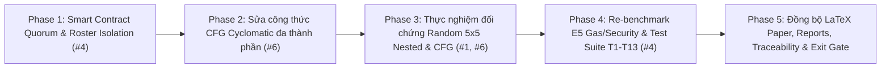

# Kế Hoạch Triển Khai Hướng B (v1.1) — Khắc Phục Tận Gốc Trong Mã Nguồn, Smart Contract & Thực Nghiệm

**Dự án:** X-SPIDE-G (`IS355_DICTATOR_X-SPIDE-G`)  
**Baseline hiện tại:** Commit `fb67000` (`2026-11-21`)  
**Mục tiêu:** Giải quyết **tận gốc trong mã nguồn, hợp đồng Vyper và thiết kế thực nghiệm** các phát hiện còn tồn đọng từ báo cáo `logic_audit_2026-11-14.md` (đặc biệt là **Mục #4**, phần công thức code của **Mục #6**, và phép đối chứng tách biệt giao thức của **Mục #1**), thay vì chỉ dừng ở việc ghi nhận giới hạn (*Threats to Validity*) trong văn bản.

---

## 1. Phân loại trạng thái khởi điểm (Tại Commit `fb67000`)

> [!NOTE]
> Các mục **#2** (Holm–Bonferroni trên Nadeau–Bengio $p_{\text{Holm,NB}}$), **#3** (Verifier đối chiếu đủ 4 trường định danh `subject`, `chain_id`, `model_version_hash`, `case_id`), **#5** (Đóng băng `created_at_utc` và chặn ghi đè file evidence đã neo on-chain), và **#7** (Sửa giải thích gas `reject_count`/`review_count`, danh sách đặc trưng `F-GSTAT`, tách latency `D1.attest` khỏi `D3`, đổi `finality` thành `receipt inclusion latency`) **đã được sửa triệt để trong code và tài liệu** ở commit `d154e64` và `fb67000`. Kế hoạch Hướng B dưới đây tập trung xử lý dứt điểm **3 hạng mục còn giữ logic gốc trong code/thực nghiệm (#4, #6, #1)** và đồng bộ lại toàn bộ hệ thống.



---

## 2. Chi Tiết Từng Phase Triển Khai

### Phase 1: Thiết kế lại State Machine Quorum & Roster Isolation trong Hợp đồng Vyper (Xử lý tận gốc Mục #4)

#### 1.1. Vấn đề tồn tại trong code hiện tại
Trong [RiskAttestationRegistry.vy](file:///C:/Users/minhg/Desktop/Blockchain/contracts/RiskAttestationRegistry.vy#L109-L241), [D2_EventOnly.vy](file:///C:/Users/minhg/Desktop/Blockchain/contracts/variants/D2_EventOnly.vy#L104-L231) và [D3_MerkleBatch.vy](file:///C:/Users/minhg/Desktop/Blockchain/contracts/variants/D3_MerkleBatch.vy#L103-L220):
1. `_compute_status` kiểm tra `if approve_count >= threshold` trước `elif reject_count >= threshold`, dẫn tới khi cả hai cùng đạt ngưỡng thì hợp đồng trả về `STATUS_APPROVED` thay vì `STATUS_DISPUTED`.
2. `self.threshold` là biến toàn cục không được snapshot vào từng `Case`/`Batch` khi đăng ký; việc `owner` hạ ngưỡng làm ảnh hưởng trực tiếp tới các case cũ.
3. `remove_auditor(a)` không trừ phiếu của auditor bị loại trên các case đang mở (`STATUS_OPEN` / `STATUS_DISPUTED`), trong khi `add_auditor(a_new)` lại cho phép auditor mới bỏ phiếu vào các case đã tạo trước khi `a_new` được bổ nhiệm (tạo kẽ hở để `owner` thêm ví Sybil can thiệp vào case cũ).

#### 1.2. Giải pháp kỹ thuật trong mã nguồn
Cập nhật cả 3 hợp đồng (`D1`, `D2`, `D3`) và mô hình tham chiếu Python [reference.py](file:///C:/Users/minhg/Desktop/Blockchain/src/contracts/reference.py):

1. **Loại bỏ thiên kiến ưu tiên `STATUS_APPROVED` trong `_compute_status`:**
   ```vyper
   @internal
   @pure
   def _compute_status(approve_count: uint256, reject_count: uint256, req_threshold: uint256) -> uint8:
       if approve_count >= req_threshold and reject_count >= req_threshold:
           return STATUS_DISPUTED
       elif approve_count >= req_threshold:
           return STATUS_APPROVED
       elif reject_count >= req_threshold:
           return STATUS_REJECTED
       elif approve_count >= 1 and reject_count >= 1:
           return STATUS_DISPUTED
       return STATUS_OPEN
   ```
2. **Đóng băng ngưỡng (`case_threshold`) và bảo vệ chống thêm ví Sybil vào case cũ:**
   - Thêm mapping `auditor_added_at: public(HashMap[address, uint256])` ghi nhận `block.timestamp` (hoặc số thứ tự `roster_nonce`) khi `add_auditor(a)` được gọi.
   - Lưu `required_threshold: uint256` (ngưỡng `self.threshold` tại thời điểm đăng ký) vào struct `Case` (`D1`), `CompactCase` (`D2`), và `Batch` (`D3`).
   - Trong `attest` / `attest_batch`: bắt buộc `self.auditor_added_at[msg.sender] <= self.cases[case_id].created_at` (hoặc `case_roster_nonce`), đảm bảo **auditor mới được `owner` thêm vào không bao giờ được bỏ phiếu trên các case đã tồn tại trước đó**.
3. **Vô hiệu hóa phiếu của auditor đã bị loại trên các case chưa chốt:**
   - Thêm hàm `revoke_removed_auditor_vote(case_id: bytes32, removed_auditor: address)` (ai cũng có thể gọi hoặc tự động kích hoạt): nếu `!self.is_auditor[removed_auditor]` và `self.attestations[case_id][removed_auditor].decision != DECISION_UNSET`, hợp đồng trừ bộ đếm tương ứng (`approve_count` / `reject_count` / `review_count`), đặt `decision = DECISION_UNSET`, tăng `revision`, và tính lại `status` theo `required_threshold` của case đó.
4. **Ràng buộc đa số nghiêm ngặt ($k > n/2$) tùy chọn hoặc bắt buộc:**
   - Giữ bất biến `k >= 1 and k <= self.auditor_count`, đồng thời nhờ quy tắc (1), (2), (3) ở trên, ngay cả khi $k \le n/2$, trạng thái hòa ngưỡng sẽ luôn chuyển về `STATUS_DISPUTED` chứ không bao giờ thiên vị `STATUS_APPROVED`.

#### 1.3. File cần chỉnh sửa & Kiểm thử (Exit Gate Phase 1)
- **Files:**
  - [RiskAttestationRegistry.vy](file:///C:/Users/minhg/Desktop/Blockchain/contracts/RiskAttestationRegistry.vy)
  - [D2_EventOnly.vy](file:///C:/Users/minhg/Desktop/Blockchain/contracts/variants/D2_EventOnly.vy)
  - [D3_MerkleBatch.vy](file:///C:/Users/minhg/Desktop/Blockchain/contracts/variants/D3_MerkleBatch.vy)
  - [reference.py](file:///C:/Users/minhg/Desktop/Blockchain/src/contracts/reference.py)
  - [test_registry_d1_d2_d3.py](file:///C:/Users/minhg/Desktop/Blockchain/tests/contracts/test_registry_d1_d2_d3.py)
- **Kiểm thử mới (`T13`):**
  - `test_t13_quorum_rotation_sybil_and_tie_safety`:
    1. Đăng ký case ở `k=2, n=3`.
    2. `owner` hạ `set_threshold(1)` và thêm `auditor_4`: xác nhận `case.required_threshold` vẫn là `2` và `auditor_4` gọi `attest` trên case cũ bị `revert ("Auditor added after case creation")`.
    3. `auditor_1` đã vote `Approve`, sau đó bị `remove_auditor(auditor_1)`: gọi `revoke_removed_auditor_vote` trừ `approve_count` về `0` và cập nhật lại `status`.
    4. Khi cả `approve_count >= k` và `reject_count >= k` (với $k=1, n=2$), `status` trả về `STATUS_DISPUTED` (`3`), không phải `STATUS_APPROVED` (`1`).

---

### Phase 2: Chuẩn hóa Công thức CFG Cyclomatic Đa Thành Phần trong Code (Xử lý tận gốc Mục #6)

#### 2.1. Vấn đề tồn tại trong code hiện tại
Trong [gsem.py](file:///C:/Users/minhg/Desktop/Blockchain/src/features/gsem.py#L253):
- Công thức hiện tại là `cyclomatic = float(n_edges - n_blocks + 2)` (giả định đồ thị có $P = 1$ thành phần liên thông).
- Khi hợp đồng có các lệnh `JUMP`/`JUMPI` động không giải quyết được tĩnh (`unresolved_jump_ratio > 0`), đồ thị CFG bị tách thành $P > 1$ thành phần liên thông yếu (`weakly_connected_components`), khiến $|E_C| - |V_C| + 2 < 0$ trên `54.61%` hợp đồng.

#### 2.2. Giải pháp kỹ thuật trong mã nguồn
1. **Cập nhật [gsem.py](file:///C:/Users/minhg/Desktop/Blockchain/src/features/gsem.py#L251-L254):**
   - Tính số thành phần liên thông yếu $P = \text{nx.number\_weakly\_connected\_components}(graph)$ (với $P \ge 1$ khi `n_blocks > 0`).
   - Sử dụng công thức McCabe chuẩn cho đồ thị có $P$ thành phần liên thông:
     ```python
     n_components = nx.number_weakly_connected_components(graph)
     cyclomatic = float(n_edges - n_blocks + 2 * n_components)
     ```
     *(Lưu ý lý thuyết đồ thị: Với mọi đồ thị có $V$ đỉnh, $E$ cạnh và $P$ thành phần liên thông yếu, ta luôn có $E \ge V - P$, suy ra $M_C = E - V + 2P \ge P \ge 1$. Giá trị `cyclomatic` sẽ luôn dương $\ge 1$ và đo đúng số chu trình độc lập cộng số thành phần liên thông).*
2. **Cập nhật Unit Tests trong [test_gsem.py](file:///C:/Users/minhg/Desktop/Blockchain/tests/features/test_gsem.py):**
   - Kiểm chứng trên cả CFG liên thông ($P=1$) và CFG phân mảnh do nhảy gián tiếp ($P > 1$) rằng `cyclomatic >= 1.0` với mọi hợp đồng có `n_blocks >= 1`.

#### 2.3. Xử lý môi trường Windows App Control (`cbor2`)
> [!TIP]
> Trên máy Windows hiện tại, Chính sách App Control chặn file `.pyd` C-extension `_cbor2` trong `.venv`. Trước khi chạy lại pipeline đặc trưng và pytest toàn bộ, cài lại `cbor2` ở chế độ pure-Python:
> ```powershell
> $env:CBOR2_BUILD_C_EXTENSION="0"
> uv pip install --python .venv\Scripts\python.exe --no-binary cbor2 --force-reinstall cbor2
> ```

---

### Phase 3: Thực Nghiệm Đối Chứng Tách Biệt Giao Thức (`E0` vs `E1`) & Cập Nhật Ablation CFG (Xử lý tận gốc Mục #1 & #6)

#### 3.1. Bổ sung thí nghiệm đối chứng `E1_S0_random_5x5` (Giải quyết triệt để Mục #1)
Để trả lời câu hỏi *"Trong mức giảm `-0.0382` PR-AUC từ `E0` (`0.9149`) xuống `E1` (`0.8767`), bao nhiêu phần trăm đến từ việc đổi giao thức tuning/thresholding và bao nhiêu phần trăm đến từ việc chặn clone leakage?"*:
1. **Tạo 25 split ngẫu nhiên có phân tầng (`S_code_random_seed{42..46}_fold{0..4}.json`):**
   - Dùng `StratifiedKFold(n_splits=5, shuffle=True, random_state=seed)` với cùng 5 seed `42, 43, 44, 45, 46` trên tập `S_code` (`7,446` hợp đồng).
2. **Chạy `E1_S0_random_5x5` với giao thức giống hệt `E1` 100%:**
   - Cùng 99 đặc trưng X-SPIDE, cùng 25 outer folds, cùng 30 trials Optuna TPE, cùng 3-fold inner CV tối ưu PR-AUC, cùng quy tắc chọn ngưỡng $\tau^*$ tối đa hóa inner OOF F1.
3. **Bảng phân rã nhân quả 3 bậc (Controlled Causal Decomposition Table) cho RQ1:**
   | Cặp so sánh | Thay đổi duy nhất | Tham số giữ cố định 100% | Ý nghĩa nhân quả |
   |---|---|---|---|
   | `E0 (Random 5-fold)` $\to$ `E1_S0_random_5x5` | Giao thức tuning (`GridSearch` + ngưỡng `0.5` $\to$ `5×5 Nested Optuna` + $\tau^*$) | Cùng chia ngẫu nhiên (`StratifiedKFold`), cùng 99 đặc trưng | **Hiệu ứng giao thức đánh giá thuần túy** |
   | `E1_S0_random_5x5` $\to$ `E1_S1_group_exact` | Chặn rò rỉ exact-clone (`random` $\to$ `group_exact`) | Cùng 5×5 Nested Optuna (30 trials) + $\tau^*$ | **Hiệu ứng rò rỉ Exact-Clone thuần túy** |
   | `E1_S1_group_exact` $\to$ `E1 (group_near)` | Chặn rò rỉ near-clone (`group_exact` $\to$ `group_near` MinHash $J \ge 0.90$) | Cùng 5×5 Nested Optuna (30 trials) + $\tau^*$ | **Hiệu ứng rò rỉ Near-Clone thuần túy (`-0.0283`)** |
   | `E1_S0_random_5x5` $\to$ `E1 (group_near)` | Chặn toàn bộ clone leakage (`random` $\to$ `group_near`) | Cùng 5×5 Nested Optuna (30 trials) + $\tau^*$ | **Tổng hiệu ứng rò rỉ Clone thuần túy dưới cùng giao thức** |

#### 3.2. Cập nhật kết quả `F-GSEM` sau khi sửa `cyclomatic` (Giải quyết triệt để Mục #6)
1. Trích xuất lại bảng đặc trưng `F-GSEM` trên 7,446 hợp đồng (~64 giây).
2. Chạy lại các cấu hình có sử dụng `F-GSEM` (`E3c`, `E4c`, `E4d`, `E4c_S1`, `E4c_S2`, `E4c_S4`, `E6`) hoặc kiểm định paired delta trên 25 folds để cập nhật:
   - `results/E3c_folds.csv`, `results/E4c_folds.csv`, `results/E4d_folds.csv`
   - `results/model_comparison.csv`, `results/stat_tests.csv`, `results/sensitivity_summary.csv`
   - `results/xai_gsem_summary.json` và các hình SHAP (`figures/shap_beeswarm_E4c.png`, `figures/shap_gsem_importance.png`, `paper/figures/shap_gsem_importance.pdf`).

---

### Phase 4: Biên Dịch Lại Contract v1.1 & Chạy Lại Benchmark On-Chain `E5` (Hoàn tất Mục #4 & #7)

1. **Biên dịch lại ABI & Bytecode (`Vyper 0.4.3`):**
   - Chạy `src/contracts/compiler.py` cập nhật `contracts/artifacts/RiskAttestationRegistry.json`, `D2_EventOnly.json`, `D3_MerkleBatch.json`.
2. **Chạy toàn bộ kiểm thử hợp đồng (`T1`–`T13`) & Độ phủ nhánh (`100%` revert-branch coverage):**
   - Cập nhật `reports/contract_coverage.md`.
3. **Chạy lại Benchmark Gas PyEVM Cancun (`E5`):**
   - Đo lại gas chính xác của `D1`, `D2`, `D3` ($N \in \{1, 10, 100, 1000\}$) sau khi thêm trường `required_threshold` và `auditor_added_at`.
   - Cập nhật `results/E5_gas.csv`, `results/E5_summary.json`, `figures/gas_vs_batch.png`, và `paper/figures/gas_vs_batch.pdf`.
4. **Chiến lược với Testnet (Sepolia & Arbitrum Sepolia):**
   - **Tùy chọn 4A (Offline/Local PyEVM):** Giữ nguyên các tx hash lịch sử của bản `v1.0` trên Sepolia/Arbitrum Sepolia làm bằng chứng thực thi mạng thực tế và báo cáo số đo gas Cancun mới của bản `v1.1`.
   - **Tùy chọn 4B (Live Testnet Redeploy):** Sử dụng số dư testnet sẵn có (`~0.0189 ETH` Sepolia, `~0.0198 ETH` Arbitrum Sepolia) để deploy và verify hợp đồng `v1.1` mới lên cả 2 mạng.

---

### Phase 5: Đồng Bộ Hóa Tài Liệu, Bài Báo IEEEtran (`paper/main.pdf`) & Kiểm Tra Exit Gate

1. **Cập nhật tự động các bảng số liệu và ma trận truy vết:**
   - Chạy [build_phase8_traceability.py](file:///C:/Users/minhg/Desktop/Blockchain/scripts/build_phase8_traceability.py) $\to$ cập nhật [traceability_matrix.csv](file:///C:/Users/minhg/Desktop/Blockchain/results/traceability_matrix.csv) và [traceability_matrix.md](file:///C:/Users/minhg/Desktop/Blockchain/reports/traceability_matrix.md).
   - Chạy [build_phase8_report_docx.py](file:///C:/Users/minhg/Desktop/Blockchain/scripts/build_phase8_report_docx.py) và [build_phase8_slides_and_video.py](file:///C:/Users/minhg/Desktop/Blockchain/scripts/build_phase8_slides_and_video.py).
2. **Cập nhật văn bản báo cáo & bài báo LaTeX:**
   - Cập nhật [contract_spec.md](file:///C:/Users/minhg/Desktop/Blockchain/docs/contract_spec.md), [security_review.md](file:///C:/Users/minhg/Desktop/Blockchain/docs/security_review.md), [threat_model.md](file:///C:/Users/minhg/Desktop/Blockchain/docs/threat_model.md): chuyển mục Quorum Rotation/Threshold/Tie từ *"Residual Risk"* sang **"Enforced On-Chain Invariant (`T13`)"**.
   - Cập nhật [rq1_reproduction.md](file:///C:/Users/minhg/Desktop/Blockchain/reports/rq1_reproduction.md), [rq2_results.md](file:///C:/Users/minhg/Desktop/Blockchain/reports/rq2_results.md), [rq3_onchain.md](file:///C:/Users/minhg/Desktop/Blockchain/reports/rq3_onchain.md), [final_report.md](file:///C:/Users/minhg/Desktop/Blockchain/reports/final_report.md), [defense_qa.md](file:///C:/Users/minhg/Desktop/Blockchain/reports/defense_qa.md), [README.md](file:///C:/Users/minhg/Desktop/Blockchain/README.md).
   - Cập nhật [main.tex](file:///C:/Users/minhg/Desktop/Blockchain/paper/main.tex) (Eq. 1 cho $M_C = |E_C| - |V_C| + 2P$, bảng RQ1 có thêm `E1_S0_random_5x5`, bảng RQ2/RQ3 cập nhật số mới) và biên dịch lại [main.pdf](file:///C:/Users/minhg/Desktop/Blockchain/paper/main.pdf).
3. **Exit Gate Kiểm Chứng Cuối Cùng:**
   - Chạy `pytest -q` (100% test pass trên toàn bộ `tests/data`, `tests/features`, `tests/models`, `tests/contracts`, `tests/evidence`, `tests/test_phase8_deliverables.py`).
   - Kiểm tra `git diff` và tạo commit chuẩn cho bản `v1.1`.

---

## 3. Ước Lượng Thời Gian Thực Thi & Quyết Định Cần Xác Nhận

| Phase | Nội dung chính | Thời gian chạy máy ước tính | Thay đổi kết quả đã lưu? |
|---|---|---:|---|
| **Phase 1** | Sửa 3 hợp đồng Vyper (`D1`, `D2`, `D3`) + `reference.py` + test `T13` | ~2 phút | Chỉ thay đổi contract artifacts |
| **Phase 2** | Sửa `cyclomatic = E - V + 2P` trong `gsem.py` + cài pure-Python `cbor2` + unit test | ~2 phút | Cập nhật cột `cyclomatic` của `F-GSEM` |
| **Phase 3** | Chạy `E1_S0_random_5x5` (25 folds) + cập nhật các run `F-GSEM` & SHAP | ~15–25 phút CPU | Có thêm dòng `E1_S0` & cập nhật nhẹ `E3c/E4c/E4d` |
| **Phase 4** | Chạy lại benchmark gas PyEVM `E5` (và tùy chọn deploy testnet) | ~1 phút (local) / ~5 phút (testnet) | Cập nhật nhẹ số gas `D1/D2/D3` |
| **Phase 5** | Đồng bộ báo cáo, LaTeX PDF, Traceability Matrix & full `pytest` | ~3 phút | Đồng bộ toàn bộ tài liệu |
