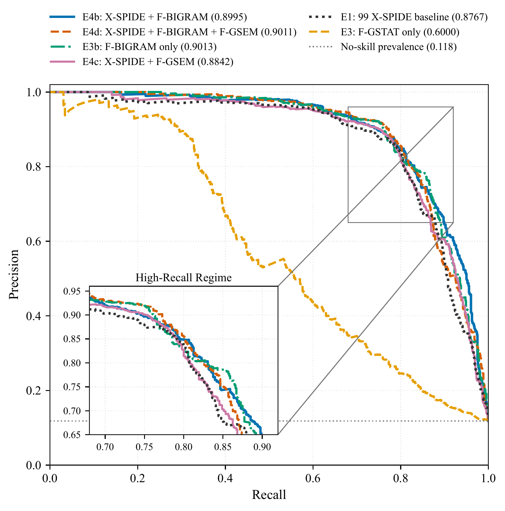
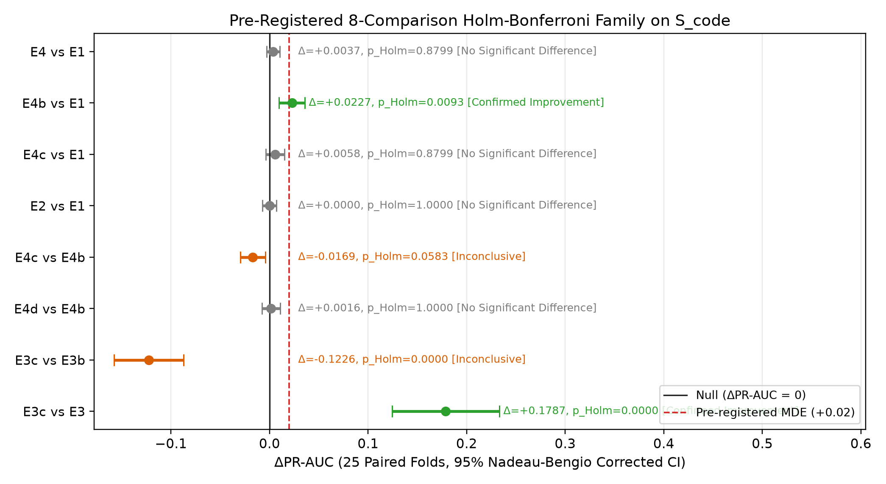
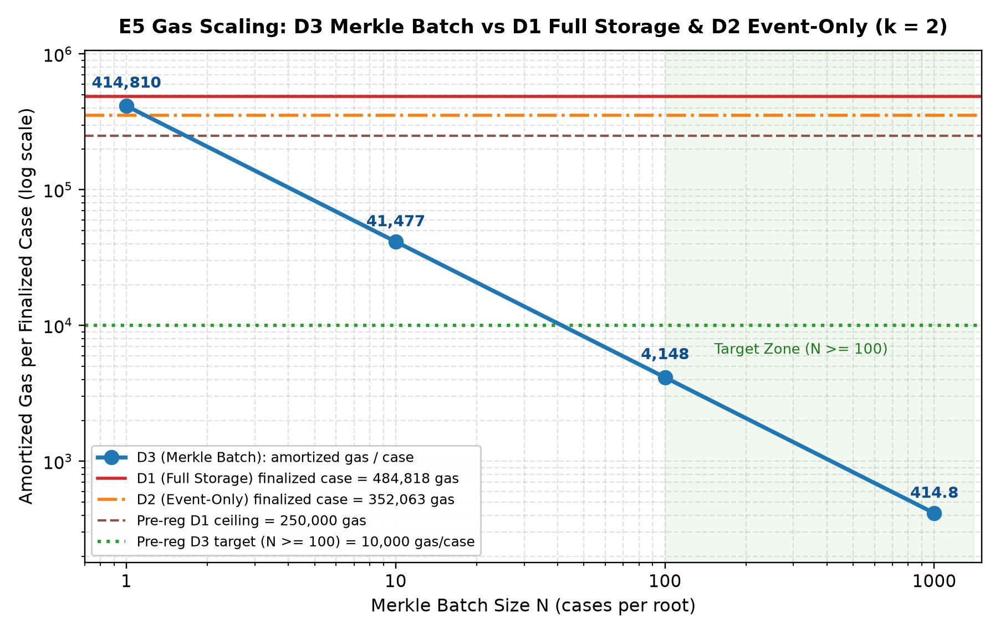

# X-SPIDE-G: Graph-Enhanced Explainable Ponzi Detection and On-Chain Risk Attestation for Ethereum Smart Contracts

**Course:** IS355 – Blockchain Technology (`IS355.R11.CTTT.2`)  
**Institution:** University of Information Technology – VNU-HCM, Faculty of Information Systems  
**Group:** 4 – DICTATOR  
**Repository:** https://github.com/gminh715/IS355_DICTATOR_X-SPIDE-G (Release tag: `v1.0-final`)  
**Companion Artifacts:** [4_DICTATOR_IS355_Final_Report.pdf](../4_DICTATOR_IS355_Final_Report.pdf) · [4_DICTATOR_IS355_Final_Report.docx](../4_DICTATOR_IS355_Final_Report.docx) · [Traceability Matrix](traceability_matrix.md) · [Defense Q&A](defense_qa.md)

| No. | Full Name | Student ID | Role | Primary Project Contributions |
|---|---|---|---|---|
| 1 | Phạm Vũ Gia Minh | 23520948 | Leader (`23520948@gm.uit.edu.vn`) | Architecture freeze, Phase 1 clone audit/splits, Phase 5/7 Vyper & Sepolia E5, Phase 8 synthesis |
| 2 | Vũ Thế Vinh | 23521801 | Member (`23521801@gm.uit.edu.vn`) | Phase 2 X-SPIDE E0–E2 reproduction, in-fold Optuna & RFECV pipeline, `baseline_v1` freeze |
| 3 | Hoàng Phan Anh Sơn | 23521354 | Member (`23521354@gm.uit.edu.vn`) | Phase 3 `F-BIGRAM` / `F-GSTAT` / `F-GSEM` bytecode disassembly, CFG builder & extraction benchmark |
| 4 | Nguyễn Thiện Nhân | 23521084 | Member (`23521084@gm.uit.edu.vn`) | Phase 4 25-fold ablations, Nadeau–Bengio & Holm stats, S1–S4 sensitivity, OOF SHAP & error audit |
| 5 | Võ Minh Quân | 23521274 | Member | Phase 6 canonical JSON, IPFS CIDv1 + Git mirror, 4-page Streamlit DApp, `ethers.js v6` signer, demo |

> **Academic Integrity & Pre-Registration Disclosure:** All hypotheses, Minimum Detectable Effect thresholds ($\Delta\text{PR-AUC} \ge 0.02$), Holm–Bonferroni families, and on-chain gas/latency pass criteria were frozen in [docs/preregistration.md](../docs/preregistration.md) prior to Phase 4 and Phase 7 execution. Negative or constrained results—specifically `F-GSEM` failing MDE/significance (`E4c`, `E4d`), `S3` temporal holdout infeasibility due to missing `block_number`, Risk `R6` downgrade of PonziGuard `E6` to sanity check, and `D1` exceeding the 250,000-gas single-case ceiling—alongside testnet boundaries (`owner_type='eoa_demo_limit'`, `gasUsedForL1=0x0`, and Sepolia EIP-8037 state-creation repricing) are reported verbatim without post-hoc threshold modifications.

---

## Executive Summary

X-SPIDE-G audits and extends the X-SPIDE Ethereum smart Ponzi detection pipeline `[1]` while anchoring multi-auditor risk attestations on-chain:

- **RQ1 (Clone Leakage Quantification):** After stripping Solidity CBOR compiler metadata `[13]` and clustering 5-gram opcodes via MinHash LSH ($t=0.90$), **59.09%** of Ponzi contracts (`520/880`) in X-SPIDE share near-duplicate bytecodes (`DATA-04`). Moving from an ungrouped 5-fold random split (`E0`: `PR-AUC = 0.9149`, `F1 = 0.8589`) to leak-free 5×5 `StratifiedGroupKFold` (`E1`: `PR-AUC = 0.8767 ± 0.0254`, `F1 = 0.8118 ± 0.0275`) reveals a **-0.0382 PR-AUC** (`-0.0471 F1`) leakage inflation (`RQ1-03`).
- **RQ2 (N-Gram vs. Static CFG Features & XAI):** Within the pre-registered 8-test Holm–Bonferroni family (Nadeau–Bengio $df = 24$, $\text{MDE} \ge 0.02$ PR-AUC), explicit in-fold top-200 opcode bigrams (`F-BIGRAM`, `E4b`: `0.8995 ± 0.0212`) yield a **Confirmed Improvement** (**+0.0227 PR-AUC**, 95% NB CI `[+0.0096, +0.0358]`, `p_Holm = 4.77e-07`, `STAT-E4b_vs_E1`), and code-only bigrams (`E3b`) reach `0.9013 ± 0.0191` (`RQ2-E3b`). Conversely, 15 static basic-block CFG semantic features (`F-GSEM`, `E4c`: `0.8825`, $\Delta = +0.0058$, 95% NB CI `[-0.0037, +0.0152]`) produce **No Significant Difference** (`STAT-E4c_vs_E1`) despite ranking high in TreeExplainer SHAP (`call_block_ratio`, `n_loops_with_call`).
- **RQ3 (Vyper k-of-n On-Chain Registry & E5 Benchmark):** Across three verified Vyper `0.4.3` contracts (`D1` full storage, `D2` compact event-only, `D3` Merkle batch), deterministic Cancun PyEVM measurement shows single-case `D1` consumes **427,461 gas** (**FAIL** vs. `<= 250,000` ceiling, `$0.068594` at `0.084427 gwei` / `$1,900.68` ETH), `D2` saves `31.06%` (`294,706` gas), and `D3` amortizes cost to **3,574.53 gas/case** at `N=100` (`$0.000574`) and **357.46 gas/case** at `N=1,000` (**PASS** vs. `<= 10,000`, `RQ3-03`). Live `n=30` confirmation latency passes on Ethereum Sepolia (median `10.357 s` / `1.00 block`) and achieves `1.226 s` median finality on Arbitrum Sepolia (`RQ3-04`), accompanied by live `T1`/`T6` revert and `T8` tamper-rejection proofs (`RQ3-05`) and a 4-page DApp with zero-server-key `ethers.js v6` MetaMask signing.

---

## 1. Introduction & Research Questions (RQ1–RQ3)

Smart Ponzi schemes on Ethereum disguise investor-funded redistribution loops as staking, yield, or gaming DApps. While prior ML detectors combining account summaries and opcode frequencies report high headline scores on random splits `[1, 5]`, practical deployment faces two core bottlenecks: (1) near-identical contract clones leak across train/test splits while static unigram opcodes omit control-flow ordering, and (2) off-chain model predictions and explanations lack tamper-evident provenance, neutral quorum governance, and client-controlled cryptographic signing.

| RQ | Research Question | Pre-Registered Benchmarks & Methods |
|---|---|---|
| **RQ1** | How much performance optimism arises from bytecode clone leakage in Ethereum Ponzi datasets, and can strict grouped validation eliminate it? | Compare `E0` random splits against leak-free 5×5 `StratifiedGroupKFold` (`E1`, `E2`) after CBOR stripping + MinHash `group_near` ($t=0.90$). |
| **RQ2** | Do static basic-block CFG semantic features (`F-GSEM`) and transition statistics (`F-GSTAT`) add statistically significant predictive value beyond X-SPIDE unigrams `[1]` and opcode bigrams (`F-BIGRAM`), and are their attributions domain-faithful? | Nested 30-trial Optuna LightGBM + 8-test Holm–Bonferroni + Nadeau–Bengio ($df=24$, $\text{MDE} \ge 0.02$ PR-AUC) + `S1–S4`, `E6`, and OOF SHAP + 24-case error audit. |
| **RQ3** | Can a gas-bounded, k-of-n multi-auditor Vyper attestation architecture anchor deterministic model/XAI evidence on-chain with sub-10k amortized gas/case and acceptable L1/L2 confirmation latency? | Deploy & verify `D1/D2/D3` (Sepolia & Arbitrum Sepolia), benchmark Cancun PyEVM gas (`<= 250k` single, `<= 10k` batch), $n=30$ testnet latency (`<= 2` blocks), `T1–T12` + E2E tamper rejection. |

---

## 2. Literature Review & Research Gaps (G1, G2)

1. **Account + Unigram Opcode Tabular Detectors `[1, 5, 6]`:** Chen et al. `[5]` introduced account statistics + opcode frequencies; Pennella et al. (X-SPIDE `[1, 9]`) built a 99-feature LightGBM + SHAP pipeline. Both evaluate primarily on random `85/15` or 5-fold partitions that expose identical factory clones across training and test sets.
2. **Ordered Opcode N-Gram Representations `[5, 7]`:** Prior bytecode studies noted that consecutive opcode bigrams/n-grams capture EVM dispatcher sequences, `CALLVALUE` guards, and storage update motifs destroyed by unordered histograms. However, static CFG proposals have seldom been benchmarked directly against leakage-free in-fold top-$K$ opcode bigrams.
3. **Static & Runtime Control-Flow Graphs `[2, 3, 8, 10]`:** SADPonzi `[8]` and PonziGuard `[2, 3]` modeled semantic paths and dynamic Contract Runtime Behavior Graphs (CRBGs). Lightweight static CFG extraction from deployed runtime bytecode encounters unresolved indirect `JUMP`/`JUMPI` targets, leaving open whether scalar static CFG descriptors outperform ordered bigrams.
4. **On-Chain AI Audit Provenance `[4]`:** ProvAuditChain `[4]` pioneered hash + IPFS URI anchoring for AI-assisted contract audits, yet leaves multi-auditor $k$-of-$n$ quorum separation, EIP-170 modular batching (`D3`), and zero-server-key browser signing under-explored.

| Gap / Innovation | Literature Limitation | X-SPIDE-G Solution |
|---|---|---|
| **G1 / I1 (Leak-Free Bytecode & N-Gram vs. CFG Benchmark)** | Random splits leak clones; static CFG features uncalibrated against strong bigram baselines under strict nested grouping. | CBOR-stripped MinHash near-clone `StratifiedGroupKFold`, fair extraction benchmark (`FEAT-01`), and pre-registered `F-BIGRAM` vs. `F-GSEM` statistical testing. |
| **G2 / I2 (Quorum & Gas-Amortized Provenance Registry)** | Single-publisher or storage-heavy provenance without client-only signing or batch amortization. | Vyper `0.4.3` `D1/D2/D3` enforcing $k$-of-$n$ separation (`owner` isolated from `auditor`), canonical JSON + IPFS CIDv1 + `ethers.js v6` browser signer. |

---

## 3. Threat Model & "Why Blockchain?"

Per [docs/threat_model.md](../docs/threat_model.md), trust is split across four non-overlapping roles:
- **Owner:** Governance authority managing the authorized auditor whitelist and quorum threshold $k$; contract invariants explicitly forbid the owner from calling `register_case`, `attest`, or editing/deleting historical verdicts. *(Testnet limitation: Sepolia/Arbitrum Sepolia currently use `owner_type='eoa_demo_limit'` rather than a multi-sig Safe).*
- **Auditors ($k$-of-$n$, default $k=2, n=3$):** Independent analysts who register canonical case hashes and cast one vote per address (`Approve`, `Reject`, `NeedsReview`).
- **ML Inference / DApp Service:** Untrusted off-chain producer that holds **zero live private keys** (`RPC`-only view queries + unsigned signer links).
- **Public Verifiers:** Anyone fetching the JSON evidence artifact (`evidence/<case_id>.json` or `ipfs://<cidv1>`), recomputing canonical `keccak256`, and verifying on-chain via view `verify_evidence`.

| Adversarial Threat Scenario | Off-Chain Signed DB Only | X-SPIDE-G Blockchain (`D1`/`D2`/`D3`) | Proof |
|---|---|---|---|
| ML operator alters JSON risk score or SHAP weights post-publication | Undetectable without external anchor | Recomputed `keccak256` fails immutable `evidence_hash` (`False`) | `T8` Sepolia & DApp Page 4 |
| Single compromised auditor rubber-stamps verdict | Accepted immediately | Remains `Pending` (`status=0`) until $k=2$ independent auditors approve | `T3`/`T5` (`k=2`) |
| Compromised governance owner attempts direct attestation | Can impersonate/override DB rows | Reverts (`status=0`: caller is not active auditor) | `T6` Sepolia (`0x56764e897eec...`) |
| Replay / overwrite existing `case_id` | Possible if DB upsert permitted | Reverts on duplicate `case_id`; Merkle roots append-only | `T1`/`T4` Sepolia & Anvil |

**Explicit Non-Goals:** Smart contracts do NOT execute ML inference on-chain, store arbitrary-length JSON on-chain, enforce legal finality, or replace decentralized IPFS pinning if local mirrors disappear.

---

## 4. Data Audit, Clone Clustering & Anti-Leakage Splits

Auditing X-SPIDE commit `dcf6027c2bd1` (`[9]`), PonziGuard (`[10]`), and Blockchain@Unica (`[11]`) established the corpus properties recorded in [reports/data_audit_summary.json](data_audit_summary.json):

- **Bytecode Completeness (`DATA-01`):** `7,446` unique valid contracts (`880` Ponzi, `6,566` non-Ponzi, `0` label conflicts). Runtime hex achieved `100.0%` non-empty coverage (`|S_code| = |S_full| = 7,446`), clearing Risk `R1` (`> 400` Ponzis).
- **Selection Bias in 8k Table (`Risk R2`):** Comparing kept `7,446` contracts against `516` dropped rows from `bytecode_opcode_8k.csv` shows significant distribution shifts (e.g., `lifetime` median `15.0` vs. `2.0` days, `KS = 0.1384`, `p = 1.58e-08`; `tx_out` median `0.0` vs. `1.0`, `KS = 0.2467`, `p = 2.50e-26`).
- **CBOR & Clone Clustering (`DATA-02`, `DATA-03`, `DATA-04`):** Stripping Solidity CBOR trailers trimmed `6,417` contracts (`1,029` pre-`0.4.7` unaffected). Exact `keccak256` grouped contracts into `6,145` clusters (`225/880 = 25.57%` Ponzi in multi-groups; `10` mixed-label clusters). MinHash LSH (5-gram opcodes, $t=0.90$, `128` permutations) collapsed the corpus into `4,711` groups (max size `99`, `24` mixed-label clusters), uncovering that **`520/880` (`59.09%`) Ponzi contracts** share near-duplicate code.
- **Cross-Dataset Overlap (`DATA-05`):** Blockchain@Unica overlapped `161/182` addresses; PonziGuard's `.bin` corpus overlapped X-SPIDE on `78/89` extracted Ponzi runtimes by near-clone cluster, leaving only `10` unique non-overlapping Ponzis (`+ 97` non-Ponzi = `107`), triggering Risk `R6` downgrade of `E6` to `SANITY_CHECK_ONLY`.
- **Frozen Partitions:** `55` split JSONs were frozen (`25` `S_code_group_near`, `25` `S_code_group_exact`, `5` `S_full_E0_random`). `S3` temporal holdout could not run because `block_number` is `100% <NA>` and BigQuery access was unavailable.

---

## 5. Methodology

### 5.1 Bytecode Feature Families & Extraction Cost

Beyond the `99` baseline X-SPIDE features (`23` account + `76` normalized opcode unigram frequencies), Phase 3 implemented linear-sweep EVM disassembly over CBOR-stripped bytecode (`PUSH1..32 -> PUSH`, `DUP1..16 -> DUP`, `SWAP1..16 -> SWAP`, `LOG0..4 -> LOG`):
- **`F-BIGRAM` (`top_k=200` in-fold):** Consecutive normalized opcode bigrams vectorized strictly inside each training fold via `BigramTopKVectorizer`.
- **`F-GSTAT` (16 Transition Features):** Normalized opcode multigraph counts, density, reciprocity, degree entropy, top-1 out/in concentration, and self-loop ratios.
- **`F-GSEM` (15 Static CFG & Semantic Features):** Basic-block CFG recovering stack-local `JUMP`/`JUMPI` targets: `n_blocks`, `n_cfg_edges`, cyclomatic complexity, `n_scc_cycles`, `has_loop_with_call`, `n_loops_with_call`, `n_loops_with_sstore`, `path_callvalue_to_call`, `n_blocks_with_call`, `call_block_ratio`, `unresolved_jump_ratio`, `has_selfdestruct`, `selfdestruct_reachable`, `pagerank_CALL`, and `pagerank_SSTORE`.

Measured on a 12th Gen Intel Core i5-12450H (`15.63 GB` RAM, Python `3.12.13`), end-to-end extraction succeeded on `7,446/7,446` contracts (`0` errors, `554` truncated-PUSH edge cases handled deterministically) with **median `16.584 ms/contract`** (`p95 = 60.213 ms`, `FEAT-01`).

### 5.2 Anti-Leakage ML Pipeline & Statistical Protocol

All 5×5 experiments reuse the identical `25` frozen `StratifiedGroupKFold(n_splits=5)` `group_near` splits (`seeds 42..46`). Inside each outer training fold, Optuna executes `30` TPE trials over `3`-fold inner `StratifiedGroupKFold` maximizing PR-AUC (with strictly nested `RFECV` or `BigramTopKVectorizer`), selects threshold $\tau^*$ maximizing OOF F1, and evaluates once on the outer test fold. Inference applies **Nadeau–Bengio** correlated paired $t$-tests ($df = 24$), Wilcoxon checks, and **Holm–Bonferroni** adjustment across the pre-registered `8`-test family, requiring $\Delta\text{PR-AUC} \ge 0.02$, `95%` NB CI strictly $> 0$, and $p_\text{Holm} < 0.05$ for `Confirmed Improvement`.

### 5.3 Smart Contract Architecture & Canonical Evidence Pipeline

Three Vyper `0.4.3` contracts implement $k$-of-$n$ governance (`k=2` of `n=3`) with `0%` auditor/owner privilege overlap: `D1 RiskAttestationRegistry` (`35` unit/fuzz tests + 100% branch coverage), `D2_EventOnly`, and `D3_MerkleBatch` (OpenZeppelin sorted-pair `keccak256` Merkle trees). Phase 6 produces deterministic canonical JSON (`keccak256` `evidence_hash`, ABI `case_id`, `shap_digest`, IPFS CIDv1 + `evidence/<case_id>.json` mirror), exposed via a 4-page Streamlit DApp and standalone client-side `ethers.js v6` + MetaMask signer ([signer/index.html](../signer/index.html)).

| Network (`chainId`) | Variant | Verified Address (`Pass - Verified`) | Role / Threshold |
|---|---|---|---|
| Ethereum Sepolia (`11155111`) | `D1` | `0x14895F5e1f7F1aC5C58b35dA6d57674Aa5951b77` | `k=2, n=3`, `owner=eoa_demo_limit` |
| Ethereum Sepolia (`11155111`) | `D2` | `0x693632c45108A9ca25a7F9d693c00554EeDD1EB1` | `k=2, n=3`, `owner=eoa_demo_limit` |
| Ethereum Sepolia (`11155111`) | `D3` | `0xf04fd7BD0Ee4DBf28d19D7D02988ac01fD989eF2` | `k=2, n=3`, `owner=eoa_demo_limit` |
| Arbitrum Sepolia (`421614`) | `D1` | `0x14895F5e1f7F1aC5C58b35dA6d57674Aa5951b77` | `k=2, n=3`, `owner=eoa_demo_limit` |
| Arbitrum Sepolia (`421614`) | `D3` | `0x693632c45108A9ca25a7F9d693c00554EeDD1EB1` | `k=2, n=3`, `owner=eoa_demo_limit` |

---

## 6. Experimental Results

### 6.1 RQ1: Baseline Reproduction & Clone-Leakage Quantification (`E0–E2`)

| Run / Configuration | Split Scheme | Features | PR-AUC | ROC-AUC | F1 | P | R |
|---|---|---|---|---|---|---|---|
| Published X-SPIDE `[1]` | Paper 85/15 random | 47 | — | `0.9770` | `0.8670` | `0.8700` | `0.8640` |
| `E0` Random 5-fold (GridBest, `RQ1-01`) | `S_full` random 5-fold | 99 | `0.9149` | `0.9768` | `0.8589` | `0.9158` | `0.8091` |
| `E1` Main Grouped Baseline (`RQ1-02`) | `S_code` 5×5 `group_near` | 99 | `0.8767 ± 0.0254` | `0.9631` | `0.8118 ± 0.0275` | `0.8374` | `0.7909` |
| `E2` In-Fold RFECV (`RQ1-04`) | `S_code` 5×5 `group_near` | `71.4 [39–99]` | `0.8768 ± 0.0237` | `0.9638` | `0.8095 ± 0.0264` | `0.8392` | `0.7848` |

Eliminating near-clone leakage (`E0 -> E1`) reduces PR-AUC by **-0.0382** and F1 by **-0.0471** (`RQ1-03`). Frozen `models/baseline_v1` (seed 42 fold 0, $\tau^* = 0.256746$) achieves `PR-AUC = 0.8956`, `F1 = 0.8222` (`MOD-01`).

### 6.2 RQ2: Feature Ablations, Statistical Tests, Sensitivity & XAI

| Exp | Feature Set | Feats | PR-AUC (`mean ± std`) | $\Delta$ PR-AUC | F1 (`mean ± std`) | ROC-AUC | `Recall@P>=0.9` |
|---|---|---|---|---|---|---|---|
| `E1` | 99 X-SPIDE baseline | 99 | `0.8767 ± 0.0254` | `+0.0000` | `0.8118 ± 0.0275` | `0.9631` | `0.7141` |
| `E2` | In-fold RFECV over 99 | `71.4` | `0.8768 ± 0.0237` | `+0.0000` | `0.8095 ± 0.0264` | `0.9638` | `0.7148` |
| `E3` | `F-GSTAT` only | 16 | `0.6000 ± 0.0629` | `-0.2767` | `0.5364 ± 0.0703` | `0.8402` | `0.2711` |
| `E3b` | `F-BIGRAM` only (in-fold top-200) | 200 | `0.9013 ± 0.0191` | `+0.0246` | `0.8247 ± 0.0241` | `0.9736` | `0.7520` |
| `E3c` | `F-GSEM` only | 15 | `0.7787 ± 0.0418` | `-0.0980` | `0.6972 ± 0.0425` | `0.9253` | `0.5109` |
| `E4` | 99 X-SPIDE + `F-GSTAT` | 115 | `0.8805 ± 0.0242` | `+0.0037` | `0.8140 ± 0.0243` | `0.9641` | `0.7241` |
| `E4b` | 99 X-SPIDE + `F-BIGRAM` | 299 | `0.8995 ± 0.0212` | **`+0.0227`** | **`0.8263 ± 0.0269`** | **`0.9738`** | `0.7548` |
| `E4c` | 99 X-SPIDE + `F-GSEM` | 114 | `0.8825 ± 0.0233` | `+0.0058` | `0.8125 ± 0.0278` | `0.9649` | `0.7361` |
| `E4d` | 99 + `F-BIGRAM` + `F-GSEM` | 314 | `0.9010 ± 0.0216` | `+0.0243` | `0.8259 ± 0.0273` | `0.9734` | **`0.7634`** |

| Comparison ($df=24$) | $\Delta$ PR-AUC | 95% Nadeau–Bengio CI | NB $t$-stat | NB $p$-val | $p_\text{Holm}$ | Pre-Registered Verdict |
|---|---|---|---|---|---|---|
| `E4b vs E1` (`STAT-E4b_vs_E1`) | **`+0.0227`** | `[+0.0096, +0.0358]` | `+3.57` | `1.55e-03` | `4.77e-07` | **Confirmed Improvement** |
| `E3c vs E3` (`STAT-E3c_vs_E3`) | **`+0.1787`** | `[+0.1242, +0.2332]` | `+6.77` | `5.35e-07` | `4.77e-07` | **Confirmed Improvement** |
| `E4 vs E1` | `+0.0037` | `[-0.0027, +0.0102]` | `+1.19` | `2.46e-01` | `1.38e-02` | No Significant Difference |
| `E4c vs E1` | `+0.0058` | `[-0.0037, +0.0152]` | `+1.26` | `2.20e-01` | `8.10e-03` | No Significant Difference |
| `E4d vs E4b` | `+0.0016` | `[-0.0075, +0.0107]` | `+0.36` | `7.25e-01` | `1.00e+00` | No Significant Difference |
| `E2 vs E1` | `+0.0000` | `[-0.0070, +0.0071]` | `+0.01` | `9.93e-01` | `1.00e+00` | No Significant Difference |
| `E4c vs E4b` | `-0.0169` | `[-0.0298, -0.0041]` | `-2.73` | `1.17e-02` | `2.98e-06` | Inconclusive |
| `E3c vs E3b` | `-0.1226` | `[-0.1578, -0.0874]` | `-7.19` | `1.99e-07` | `4.77e-07` | Inconclusive |

 

- **Sensitivity & E6 Sanity Check:** Weakening grouping from `group_near` to `group_exact` (`S1`) falsely inflates PR-AUC by `+0.0283` on `E1` (`0.9051`) and `+0.0272` on `E4c` (`0.9097`). Both `S2` (CBOR metadata recomputation, max $|\Delta| = 0.0028$) and `S4` (raw vs. normalized opcodes, max $|\Delta| = 0.0025$) show negligible sensitivity. External code-only `E6` on `107` non-overlapping PonziGuard contracts (`10` Ponzi / `97` non-Ponzi) yields `PR-AUC = 0.6535` (95% bootstrap CI `[0.3965, 0.9141]`, `F1 = 0.6667`, `TP=6, FP=2, TN=95, FN=4`, `RQ2-E6`).
- **XAI & Error Audit (`XAI-01`, `XAI-02`):** OOF TreeExplainer on seed-42 `E4c` confirms `call_block_ratio` (`0.2833`), `n_loops_with_call` (`0.2061`), `n_blocks_with_call` (`0.1707`), and `unresolved_jump_ratio` (`0.1520`) align with Ponzi domain logic (`has_loop_with_call` mean SHAP `+0.3191` when present vs. `-0.0305` when absent). Error breakdown yields `TP=685, FP=125, TN=6441, FN=195`, with FPs linked to legitimate distributor payout loops (`xspide_06872`) and mixed-label near-clone clusters (`14` FPs, `38` FNs).

### 6.3 RQ3: Gas, Mainnet USD Estimates, Latency, Security Proofs & Live DApp (`E5`)

| Variant & Operation | Cancun PyEVM Gas | Sepolia Live (EIP-8037) | Mainnet Ref (`@ 0.0844 gwei`) | Stress (`@ 30 gwei`) | Verdict |
|---|---|---|---|---|---|
| `D1` deploy (constructor) | `1,068,183` | `7,365,849` | `$0.171410` | `$60.91` | Deployment |
| `D1` finalized case (`k=2`) | `427,461` | `1,648,029` | `$0.068594` | `$24.37` | **FAIL** (`> 250k`, `+70.98%`) |
| `D1` `remove_auditor` (warm) | `32,542` | — | `$0.005222` | `$1.86` | Revocation |
| `D2` `EventOnly` finalized (`k=2`) | `294,706` | `987,566` | `$0.047291` | `$16.80` | `-31.06%` vs `D1` (**FAIL** `> 250k`) |
| `D3` `MerkleBatch` (`N=100`, `/case`) | `3,574.53` | `13,142.73` | `$0.000574` | `$0.2038` | **PASS** (`<= 10,000`) |
| `D3` `MerkleBatch` (`N=1,000`, `/case`) | `357.46` | — | `$0.000057` | `$0.02038` | **PASS** (`<= 10,000`) |

- **Latency (`RQ3-04`, $n=30$ sequential transactions):** Sepolia confirms in median `10.357 s` (`p95 = 11.217 s`, **`1.00 block`**, **PASS** `<= 2` blocks); Arbitrum Sepolia confirms in median **`1.226 s`** (`p95 = 1.675 s`, `4.0 L2 blocks`, `$0.016278` `D1` / `$0.000136/case` `D3` testnet reference only since `gasUsedForL1 = 0x0`).
- **Live Security Proofs & E2E DApp (`RQ3-05`):** All `5/5` Sepolia `T1`/`T6` exploit attempts reverted (`status=0`, e.g., owner attempting `attest` tx `0x56764e897eec...`), `verify_evidence` passes exact canonical JSON (`True`) and rejects 1-byte mutation (`False`), and live 4-page DApp screenshots captured the complete workflow for `xspide_00439` ([demo/screenshots/](../demo/screenshots)).

---

## 7. Discussion: Negative Results & Threats to Validity

### 7.1 Negative Technical Results

1. **Why Static `F-GSEM` Underperformed `F-BIGRAM`:** Despite clear domain attribution on verified loop+call contracts, scalar `F-GSEM` failed MDE/significance (`E4c = +0.0058`, `E4d vs E4b = +0.0016`) while sparse top-200 `F-BIGRAM` gained a confirmed `+0.0227` PR-AUC (`E3b = 0.9013` code-only). Solidity `0.4–0.5` bytecode frequently routes function dispatchers and loop exits through indirect stack/memory jumps (`median 19.18%` unresolved jumps; `526/7,446` contracts `> 50%`), fragmenting static loop back-edges, whereas short bigrams (`CALLVALUE->ISZERO->JUMPI`, `SLOAD->CALL`) capture control/data idioms cleanly without jump-resolution loss.
2. **Why `D1` Exceeded the `250k` Single-Case Ceiling:** Registering a 10-field `Case` struct plus two cold `Attestation` storage slots incurs three cold `SSTORE` allocations (`427,461` Cancun gas). Honoring pre-registration flags `D1` as `FAIL` for strict `<= 250k` per-case storage and establishes `D3_MerkleBatch` (`3,574.53` gas/case at `N=100`) as the practical scaling mechanism.

### 7.2 Threats to Validity

- **Label & Clone Noise:** `10` exact-clone and `24` near-clone groups carry conflicting Ponzi/non-Ponzi labels, directly accounting for `14` FPs and `38` FNs in seed-42 `E4c`.
- **Construct Limits:** Linear-sweep static disassembly lacks symbolic path resolution (`7.06%` high unresolved-jump rate), while testnet accounting differs from Ethereum mainnet via Sepolia EIP-8037 state-creation repricing and zero testnet L1 fee calldata (`Arbitrum Sepolia`).
- **Temporal & External Scope:** Missing `block_number` prevents `S3` temporal testing against modern proxy/upgradeable Ponzi designs, `bytecode_opcode_8k.csv` filtering causes `Risk R2` shift, and `E6` contains only `10` independent Ponzis (`Risk R6`).

---

## 8. Limitations & Future Work

1. **Multisig Governance & L2 Anchoring:** Replace `eoa_demo_limit` owners with a `2`-of-`3` Safe multisig on Sepolia / Arbitrum One and batch standard risk verdicts via `D3_MerkleBatch`.
2. **Symbolic IR Lifting & Timestamped Corpora:** Upgrade stack-local jump tracking to symbolic/abstract-interpretation CFG lifting (e.g., Gigahorse/Vandal-style IR) and curate post-2024 timestamped Ethereum contracts for `S3` temporal validation.
3. **Managed Pinning & Signature Aggregation:** Pair local Git evidence mirrors with redundant Pinata/Web3.Storage pinning and off-chain EIP-712 quorum signature aggregation.

---

## 9. Unified References

- `[1]` L. Pennella, F. Pinelli, and L. Galletta, “X-SPIDE: An eXplainable Machine Learning Pipeline for Detecting Smart Ponzi Contracts in Ethereum,” *IEEE Access*, vol. 13, pp. 85037–85055, 2025. https://doi.org/10.1109/ACCESS.2025.3569565
- `[2]` R. Liang, J. Chen, C. Wu et al., “Towards Effective Detection of Ponzi Schemes on Ethereum with Contract Runtime Behavior Graph,” *ACM Trans. Softw. Eng. Methodol.*, vol. 34, no. 4, Art. 106, 2025. https://doi.org/10.1145/3707458
- `[3]` R. Liang, J. Chen, K. He et al., “PonziGuard: Detecting Ponzi Schemes on Ethereum with Contract Runtime Behavior Graph (CRBG),” in *Proc. ICSE*, 2024, Art. 64, pp. 1–12. https://doi.org/10.1145/3597503.3623318
- `[4]` G. C. Akor, L. A. C. Ahakonye, J. M. Lee, and D.-S. Kim, “ProvAuditChain: A Gas-Efficient On-Chain Provenance Framework for AI-Driven Smart Contract Audits,” in *Proc. ICTC*, 2025, pp. 1155–1157.
- `[5]` W. Chen, Z. Zheng, J. Cui, E. C.-H. Ngai, P. Zheng, and Y. Zhou, “Detecting Ponzi Schemes on Ethereum: Towards Healthier Blockchain Technology,” in *Proc. WWW*, 2018, pp. 1409–1418. https://doi.org/10.1145/3178876.3186046
- `[6]` M. Bartoletti, S. M. Carta, T. Cimoli, and R. Saia, “Dissecting Ponzi schemes on Ethereum: Identification, analysis, and impact,” *Future Gener. Comput. Syst.*, vol. 102, pp. 259–277, 2020.
- `[7]` S. Fan, S. Fu, H. Xu, and C. Zhu, “Expose Your Mask: Smart Ponzi Schemes Detection on Blockchain,” in *Proc. IJCNN*, 2020, pp. 1–7.
- `[8]` W. Chen, X. Li, Y. Sui, N. He, H. Wang, L. Wu, and X. Luo, “SADPonzi: Detecting and Characterizing Ponzi Schemes in Ethereum Smart Contracts,” *Proc. ACM Meas. Anal. Comput. Syst.*, vol. 5, no. 2, Art. 14, Jun. 2021.
- `[9]` L. Pennella, “X-SPIDE Official Source Code and Dataset,” GitHub, 2025. https://github.com/LucaPennella/x-spide-smart-ponzi-detection
- `[10]` R. Liang et al., “PonziGuard Dataset and Tools,” GitHub. https://github.com/PonziDetection/PonziGuard/tree/main/dataset
- `[11]` Blockchain@Unica, “Ethereum Ponzi Address List,” GitHub. https://github.com/blockchain-unica/ethereum-ponzi/blob/master/ponzi-addresses.csv
- `[12]` scikit-learn developers, “StratifiedGroupKFold.” https://scikit-learn.org/stable/modules/generated/sklearn.model_selection.StratifiedGroupKFold.html
- `[13]` Solidity developers, “Contract Metadata.” https://docs.soliditylang.org/en/latest/metadata.html
