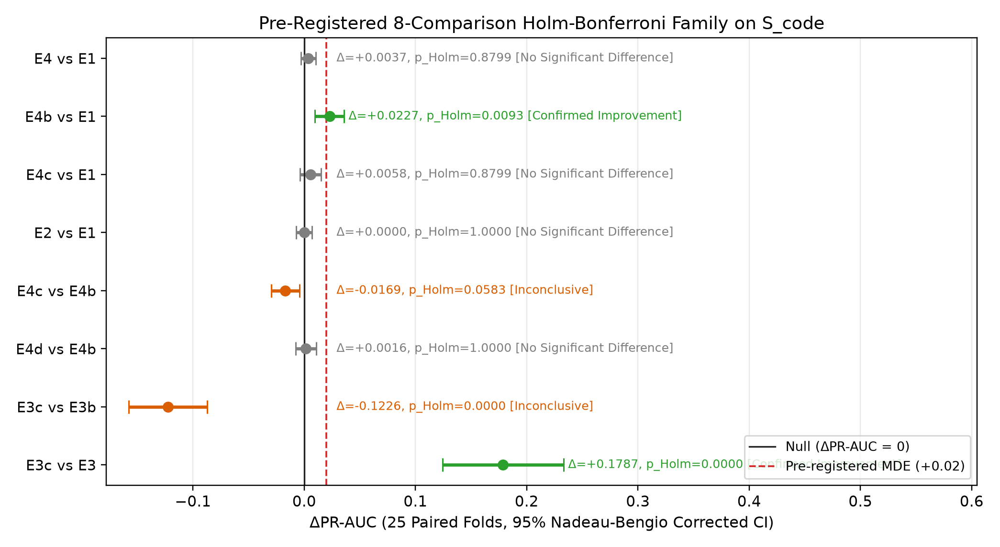
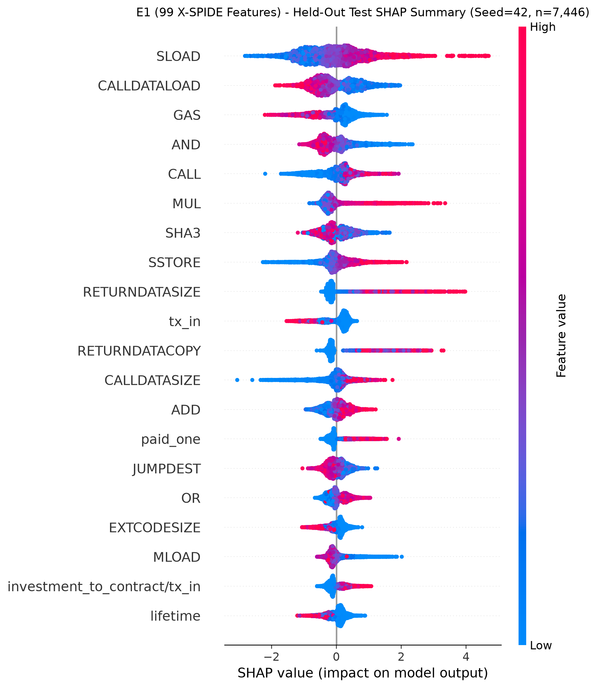
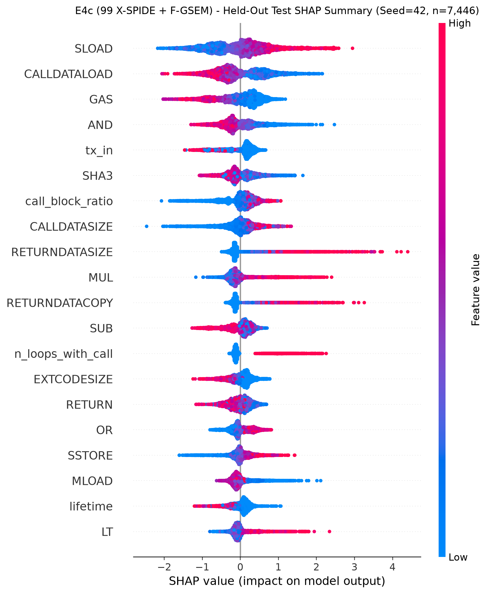
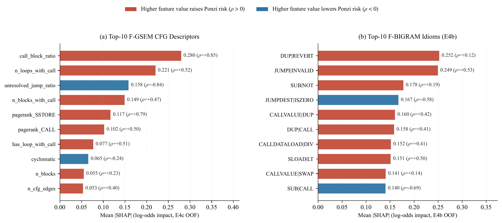
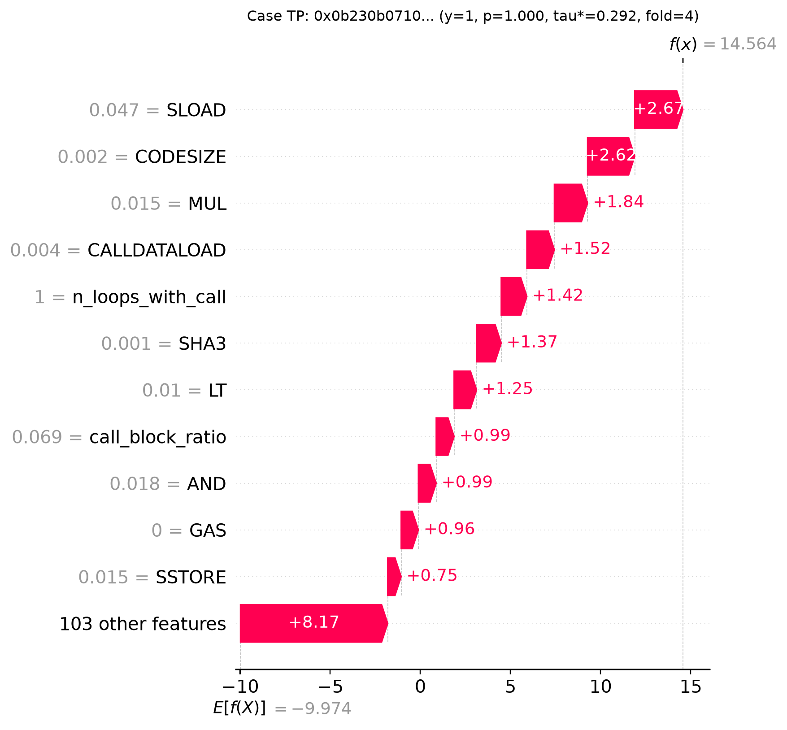
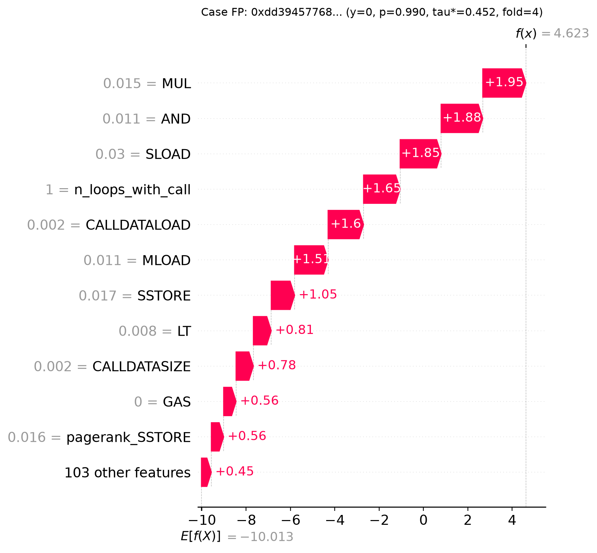
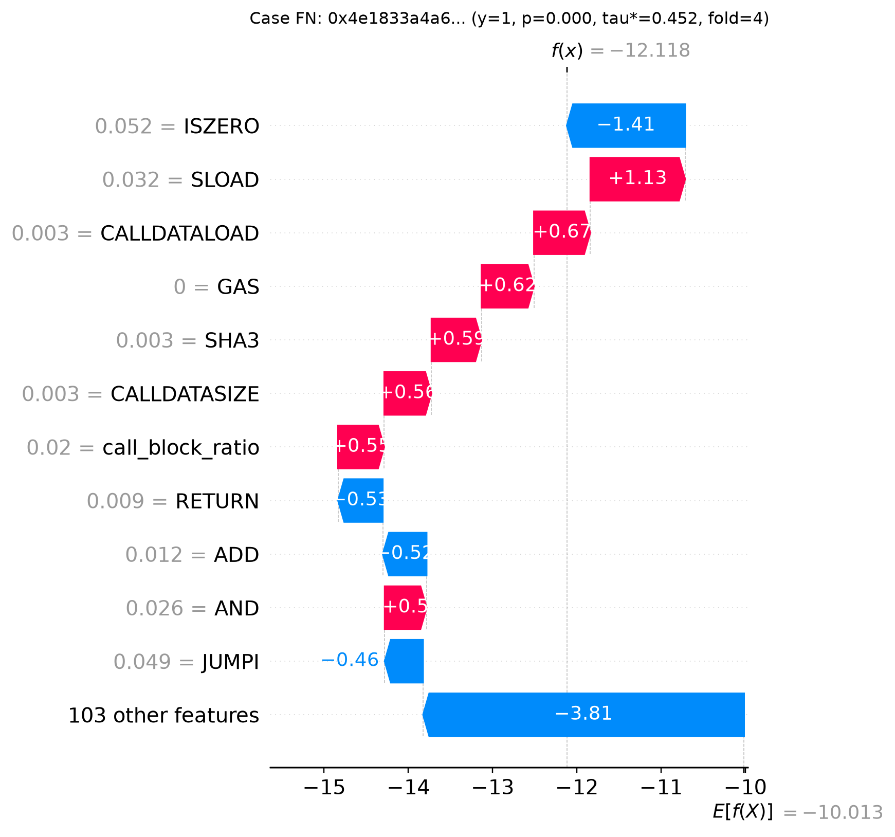
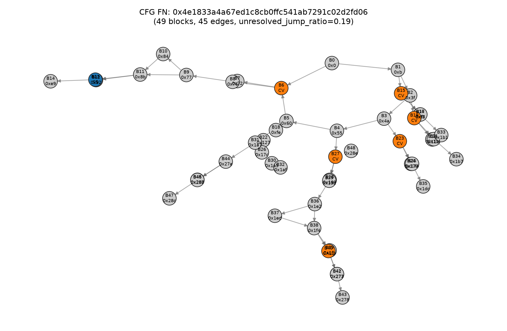

# Phase 4 Results: RQ2 — Static Bytecode Feature Engineering, Statistical Evaluation, Sensitivity Analysis, and Explainability

**Date:** 2026-11-21 *(v1.1 refresh after multi-component McCabe cyclomatic fix $M_C = |E_C| - |V_C| + 2P$ and `S0` random 5×5 control)*  
**Scope:** Phase 4 (`E1`–`E4d` main comparison, pre-registered Holm-Bonferroni hypothesis tests, `S0`–`S4` sensitivity checks, conditional `E6` PonziGuard sanity check, feature extraction benchmarking, OOF SHAP explainability, and manual FP/FN error analysis)  
**Benchmark Dataset:** `S_code` (`|S_code| = 7,446` deployed contracts: `880` Ponzi [11.82%], `6,566` Non-Ponzi [88.18%])  
**Evaluation Protocol:** 5-repeat × 5-fold `StratifiedGroupKFold` (`group_near`, 4,711 clusters; seeds `42..46`), 30-trial inner Optuna TPE tuning (3-fold inner `StratifiedGroupKFold`) per outer fold, LightGBM, OOF `F1`-maximizing threshold `tau*` (primary metric: `PR-AUC`, MDE `ΔPR-AUC >= 0.02`, Nadeau–Bengio corrected resampled t-test + Wilcoxon signed-rank + Holm–Bonferroni over 8 pre-registered comparisons per `docs/preregistration.md`).

---

## 1. Executive Summary

1. **Sequential opcode bigrams (`F-BIGRAM`) deliver a confirmed, large improvement over the 99-feature X-SPIDE baseline (`E1`), even without account transaction features:**
   - Adding top-200 in-fold opcode bigrams to `E1` (`E4b`: `PR-AUC = 0.8995 ± 0.0212`, `F1 = 0.8263 ± 0.0269`) achieves a pre-registered **Confirmed Improvement** (`ΔPR-AUC = +0.0227 >= 0.02`, 95% Nadeau–Bengio CI `[+0.0096, +0.0358]`, `NB p = 0.00155`, `p_Holm,NB = 0.00927`, `Wilcoxon p_Holm,W = 4.77e-7`).
   - Crucially for **zero-history / pre-deployment detection**, the pure code-only bigram model `E3b` (`200` in-fold bigrams only, `0` account features) attains `PR-AUC = 0.9013 ± 0.0191` (`F1 = 0.8247 ± 0.0241`, `ROC-AUC = 0.9736`), outperforming `E1` (`0.8767`) by `+0.0246` (`95% NB CI [+0.0064, +0.0428]`, auxiliary comparison).
2. **Transparent negative / inconclusive verdict for compact static CFG semantics (`F-GSEM`) relative to `F-BIGRAM` (persisting after `v1.1` multi-component McCabe fix $M_C = |E_C| - |V_C| + 2P$):**
   - Among compact 15–16 feature structural representations without account features, semantic CFG + SCC + opcode PageRank (`E3c`: `PR-AUC = 0.7832 ± 0.0421`) yields a **Confirmed Improvement** over naive transition graph statistics (`E3`: `0.6000 ± 0.0629`, `ΔPR-AUC = +0.1832`, `95% NB CI [+0.1271, +0.2394]`, `p_Holm,NB = 4.04e-6`, `p_Holm,W = 4.77e-7`).
   - However, adding `F-GSEM` to `E1` (`E4c`: `PR-AUC = 0.8842 ± 0.0237`, `Δ = +0.0075`) still does **not** achieve statistical significance under Nadeau–Bengio (`95% NB CI [-0.0029, +0.0179]`, `NB p = 0.1509`, `p_Holm,NB = 0.6036`) and falls short of the pre-registered MDE (`0.02`). Furthermore, `E4c` trails `E4b` (`Δ = -0.0152`, `95% NB CI [-0.0275, -0.0030]`, `p_Holm,NB = 0.0853`, **Inconclusive** relative to `E4b`), and combining `F-GSEM` on top of `99 + F-BIGRAM` (`E4d`: `PR-AUC = 0.9011 ± 0.0191`) yields virtually no marginal gain over `E4b` (`Δ = +0.0017`, `95% NB CI [-0.0091, +0.0125]`, **No Significant Difference**).
3. **Methodology & Robustness (`S0`–`S4`, `R4`, `R6`):**
   - Under an identical 5×5 nested Optuna + $\tau^*$ protocol (`S0` + `S1`), random splitting (`E1_S0_random_5x5`: `0.9251 ± 0.0110`) inflates `PR-AUC` by `+0.0484` over `group_near` (`0.8767`), decomposing into `+0.0201` exact-clone leakage (`E1_S0 -> E1_S1_group_exact`) and `+0.0283` near-clone leakage (`E1_S1 -> E1`; `E4c_S1`: `0.9104` vs `0.8842`, `+0.0261`).
   - Results are invariant to CBOR metadata stripping (`S2`, `|ΔPR-AUC| <= 0.0032`, all `NB p >= 0.53`) and normalized vs raw mnemonics (`S4`, `|ΔPR-AUC| <= 0.0025`, all `NB p >= 0.59`). `S3` (temporal holdout) is documented as N/A because `block_number` is absent and BigQuery credentials are unavailable locally.
   - GSEM static CFG resolution is healthy (`unresolved_jump_ratio`: median `0.1918`, mean `0.2498`, `526 / 7,446 = 7.06% > 0.50`), so Risk `R4` (`> 0.50` in `> 30%`) is **not** triggered. End-to-end bytecode feature extraction succeeds with `0` errors across all `7,446` contracts (median `13.885 ms/contract`, `p95 = 50.839 ms`, total `136.94 s`).
   - On external PonziGuard contracts (`E6`), Risk `R6` is triggered (`10` unique non-overlapping Ponzi hashes `< 30`), yielding a wide-CI sanity check of `PR-AUC = 0.6169 [0.3497, 0.8784]`, `F1 = 0.5882 [0.2857, 0.8240]` (`TP=5, FP=2, TN=95, FN=5`).

---

## 2. Main Experiment Comparison on `S_code` (`25`-Fold `StratifiedGroupKFold`)

All 9 main configurations were trained and evaluated on identical `S_code_group_near` 25-fold partitions (`seeds 42..46 × folds 0..4`). No folds triggered the `Recall@P>=0.9` fallback rule (`p90_fallback_folds = 0` across all 225 runs). Source: `results/model_comparison.csv`.

| Config | Feature Set | `n_features` | `PR-AUC` | `ΔPR-AUC vs E1` | `F1` | `P` | `R` | `ROC-AUC` | `Recall@P>=0.9` | Mean Train Time (s) |
|---|---|---:|---:|---:|---:|---:|---:|---:|---:|---:|
| `E1` | 99 X-SPIDE baseline | 99 | `0.8767 ± 0.0254` | `0.0000` | `0.8118 ± 0.0275` | `0.8374` | `0.7909` | `0.9631` | `0.7141 ± 0.0991` | `167.6` |
| `E2` | In-fold RFE over 99 X-SPIDE | `71.4 [39–99]` | `0.8768 ± 0.0237` | `+0.0000` | `0.8095 ± 0.0264` | `0.8392` | `0.7848` | `0.9638` | `0.7148 ± 0.0815` | `148.5` |
| `E3` | `F-GSTAT` transition stats only | 16 | `0.6000 ± 0.0629` | `-0.2767` | `0.5364 ± 0.0703` | `0.5788` | `0.5202` | `0.8402` | `0.2711 ± 0.1296` | `126.7` |
| `E3b` | `F-BIGRAM` opcode bigrams only (top-200) | 200 | **`0.9013 ± 0.0191`** | `+0.0246` | `0.8247 ± 0.0241` | `0.8554` | `0.7982` | `0.9736` | `0.7520 ± 0.0623` | `341.7` |
| `E3c` | `F-GSEM` CFG + SCC + PageRank only | 15 | `0.7832 ± 0.0421` | `-0.0935` | `0.7049 ± 0.0395` | `0.7395` | `0.6791` | `0.9269` | `0.5077 ± 0.1071` | `109.6` |
| `E4` | 99 X-SPIDE + `F-GSTAT` | 115 | `0.8805 ± 0.0242` | `+0.0037` | `0.8140 ± 0.0243` | `0.8398` | `0.7920` | `0.9641` | `0.7241 ± 0.0795` | `387.9` |
| `E4b` | 99 X-SPIDE + `F-BIGRAM` | 299 | `0.8995 ± 0.0212` | **`+0.0227`** | `0.8263 ± 0.0269` | **`0.8599`** | `0.7970` | **`0.9738`** | `0.7548 ± 0.0609` | `856.5` |
| `E4c` | 99 X-SPIDE + `F-GSEM` | 114 | `0.8842 ± 0.0237` | `+0.0075` | `0.8144 ± 0.0295` | `0.8435` | `0.7920` | `0.9657` | `0.7370 ± 0.0766` | `147.8` |
| `E4d` | 99 X-SPIDE + `F-BIGRAM` + `F-GSEM` | 314 | `0.9011 ± 0.0191` | `+0.0244` | **`0.8267 ± 0.0241`** | `0.8537` | **`0.8039`** | `0.9738` | **`0.7677 ± 0.0496`** | `287.4` |

**Note on pooled OOF PR curves (`figures/pr_curves.png`):** Pooled average precision (`AP`) computed after concatenating raw OOF probabilities across seed-42 folds (`E1 = 0.8706`, `E4b = 0.8968`, `E4c = 0.8788`, `E4d = 0.8909`, `E3b = 0.8943`, `E3c = 0.7740`) differs slightly from the mean per-fold `PR-AUC` in the table above (`seed=42` per-fold mean `PR-AUC`: `E1 = 0.8782`, `E4b = 0.8985`, `E4c = 0.8836`, `E4d = 0.8948`, `E3b = 0.8988`, `E3c = 0.7841`). Because Optuna independently selects `imbalance_mode` (`scale_pos_weight`, `is_unbalance`, or `none`) per fold, uncalibrated probability scales vary across folds when concatenated globally, whereas within-fold `PR-AUC` and `tau*` thresholding remain unaffected.

---

## 3. Pre-Registered Statistical Hypothesis Tests (`results/stat_tests.csv`)

Statistical inference uses the **Nadeau–Bengio (1999/2003) corrected resampled paired t-test** (`rho = 0.25` for 5-fold CV overlap) with **Holm–Bonferroni** step-down adjustment applied directly to the Nadeau–Bengio p-values (`p_Holm,NB`) across the 8 pre-registered `PR-AUC` comparisons (`docs/preregistration.md`), reported alongside two-sided Wilcoxon signed-rank p-values (`p_Holm,W`). Under the three-way decision rule, `Confirmed Improvement` requires `ΔPR-AUC >= 0.02` (MDE), `95% NB CI > 0`, and `p_Holm,NB < 0.05`.

### 3.1 Pre-Registered 8-Comparison Holm Family (`PR-AUC`, 25 paired folds)

| Family | Comparison | `mean_a` | `mean_b` | `ΔPR-AUC` (`sd`) | `95% Nadeau–Bengio CI` | `NB t` (`NB p` / `p_Holm,NB`) | `Wilcoxon p` (`p_Holm,W`) | Verdict |
|---|---|---:|---:|---:|---:|---:|---:|---|
| `vs_E1` | `E4 vs E1` | `0.8805` | `0.8767` | `+0.0037` (`0.0058`) | `[-0.0027, +0.0102]` | `1.190` (`0.2457` / `0.7370`) | `0.00460` (`0.01381`) | **No Significant Difference** |
| `vs_E1` | `E4b vs E1` | `0.8995` | `0.8767` | `+0.0227` (`0.0118`) | `[+0.0096, +0.0358]` | `3.571` (`0.00155` / `0.00927`) | `5.96e-8` (`4.77e-7`) | **Confirmed Improvement** |
| `vs_E1` | `E4c vs E1` | `0.8842` | `0.8767` | `+0.0075` (`0.0094`) | `[-0.0029, +0.0179]` | `1.484` (`0.1509` / `0.6036`) | `6.31e-4` (`0.00253`) | **No Significant Difference** |
| `vs_E1` | `E2 vs E1` | `0.8768` | `0.8767` | `+0.0000` (`0.0064`) | `[-0.0070, +0.0071]` | `0.009` (`0.9929` / `1.0000`) | `1.00000` (`1.00000`) | **No Significant Difference** |
| `novelty_critical` | `E4c vs E4b` | `0.8842` | `0.8995` | `-0.0152` (`0.0110`) | `[-0.0275, -0.0030]` | `-2.563` (`0.01706` / `0.08530`) | `1.97e-6` (`9.83e-6`) | **Inconclusive** (degradation vs `E4b`) |
| `novelty_critical` | `E4d vs E4b` | `0.9011` | `0.8995` | `+0.0017` (`0.0097`) | `[-0.0091, +0.0125]` | `0.322` (`0.7504` / `1.0000`) | `0.29961` (`0.59922`) | **No Significant Difference** |
| `code_only` | `E3c vs E3b` | `0.7832` | `0.9013` | `-0.1181` (`0.0309`) | `[-0.1524, -0.0838]` | `-7.104` (`2.41e-7` / `1.93e-6`) | `5.96e-8` (`4.77e-7`) | **Inconclusive** (degradation vs `E3b`) |
| `code_only` | `E3c vs E3` | `0.7832` | `0.6000` | `+0.1832` (`0.0505`) | `[+0.1271, +0.2394]` | `6.734` (`5.78e-7` / `4.04e-6`) | `5.96e-8` (`4.77e-7`) | **Confirmed Improvement** |

**Methodological observation:** In `E4 vs E1` and `E4c vs E1`, naive paired Wilcoxon flags `p_Holm,W < 0.05` (`0.0138` and `0.0025`) because it treats the 25 repeated 5-fold CV measurements as independent, inflating effective sample size. Accounting for shared training data (`rho = 0.25`), the Nadeau–Bengio Holm-adjusted p-values (`p_Holm,NB = 0.7370` and `0.6036`) and 95% CIs (`[-0.0027, +0.0102]` and `[-0.0029, +0.0179]`) confirm no statistically significant difference, and both effect sizes remain far below the `0.02` MDE threshold.

### 3.2 Selected Auxiliary Comparisons (`PR-AUC` & `F1`, Descriptive Only)

- **Code-only bigrams vs mixed X-SPIDE baseline (`E3b vs E1`, auxiliary `PR-AUC`):** `ΔPR-AUC = +0.0246` (`95% NB CI [+0.0064, +0.0428]`, `NB p = 0.0101`, `Wilcoxon p = 4.17e-7`). Top-200 normalized opcode bigrams alone surpass X-SPIDE's 99 code + account features.
- **Full combination vs baseline (`E4d vs E1`, auxiliary `PR-AUC`):** `ΔPR-AUC = +0.0244` (`95% NB CI [+0.0086, +0.0402]`, `NB p = 0.00404`).
- **`F-BIGRAM` vs `F-GSTAT` among code-only baselines (`E3b vs E3`, auxiliary `PR-AUC`):** `ΔPR-AUC = +0.3013` (`95% NB CI [+0.2377, +0.3649]`).
- **Secondary `F1` comparisons vs `E1`:** `E4b vs E1` achieves `ΔF1 = +0.0145` (`95% NB CI [-0.0055, +0.0345]`, `Wilcoxon p = 0.00063`); `E4d vs E1` achieves `ΔF1 = +0.0149` (`95% NB CI [-0.0101, +0.0398]`, `Wilcoxon p = 0.00226`).

---

## 4. Sensitivity Analyses (`S0`–`S4`) & Feature Extraction Cost

### 4.1 Sensitivity Summary (`results/sensitivity_summary.csv`)

| Study | Variant | Reference | Paired Splits | Variant `PR-AUC` | Ref `PR-AUC` | `ΔPR-AUC` | Variant `F1` | `ΔF1` | `NB p` (`PR-AUC`) | Interpretation |
|---|---|---|---:|---:|---:|---:|---:|---:|---:|---|
| `S0_clone_leakage_control` | `E1_S0_random_5x5` | `E1` | `False` | `0.9251 ± 0.0110` | `0.8767` | `+0.0484` | `0.8679` | `+0.0561` | unpaired | Random vs `group_near` under identical 5×5 nested protocol (total pure clone leakage) |
| `S0_exact_clone_control` | `E1_S0_random_5x5` | `E1_S1_group_exact` | `False` | `0.9251 ± 0.0110` | `0.9051` | `+0.0201` | `0.8679` | `+0.0300` | unpaired | Random vs `group_exact` under identical 5×5 nested protocol (pure exact-clone leakage) |
| `S1_split_granularity` | `E1_S1_group_exact` | `E1` | `False` | `0.9051 ± 0.0197` | `0.8767` | `+0.0283` | `0.8379` | `+0.0261` | unpaired | Exact-hash deduplication leaves near-clones across folds (`+0.0283` leakage bias) |
| `S1_split_granularity` | `E4c_S1_group_exact` | `E4c` | `False` | `0.9104 ± 0.0193` | `0.8842` | `+0.0261` | `0.8449` | `+0.0305` | unpaired | Identical near-clone inflation pattern (`+0.0261`) |
| `S2_cbor_metadata` | `E1_S2_cbor_stripped` | `E1` | `True` | `0.8792 ± 0.0258` | `0.8767` | `+0.0024` | `0.8096` | `-0.0022` | `0.5360` | 76 opcodes recomputed from stripped bytecode match raw CSV baseline |
| `S2_cbor_metadata` | `E4c_S2_raw_cbor` | `E4c` | `True` | `0.8811 ± 0.0251` | `0.8842` | `-0.0032` | `0.8180` | `+0.0036` | `0.5414` | `F-GSEM` on raw vs stripped bytecode shows negligible difference |
| `S2_cbor_metadata` | `E4c_S2_cbor_stripped` | `E4c` | `True` | `0.8851 ± 0.0266` | `0.8842` | `+0.0009` | `0.8189` | `+0.0045` | `0.8375` | Full CBOR-stripped pipeline preserves `E4c` performance |
| `S3_temporal_holdout` | `N/A` | `E1/E4c` | `False` | `—` | `—` | `—` | `—` | `—` | `—` | **Not feasible:** `block_number` is 100% `<NA>` in X-SPIDE archives and `bq_available=False` locally |
| `S4_mnemonic_norm` | `E4b_S4_raw_opcodes` | `E4b` | `True` | `0.8969 ± 0.0217` | `0.8995` | `-0.0025` | `0.8226` | `-0.0037` | `0.5906` | Normalized opcodes slightly outperform raw (`+0.0025`, n.s.) |
| `S4_mnemonic_norm` | `E4c_S4_raw_opcodes` | `E4c` | `True` | `0.8843 ± 0.0247` | `0.8842` | `+0.0000` | `0.8216` | `+0.0072` | `0.9920` | Opcode PageRank in `F-GSEM` is insensitive to family normalization |

### 4.2 Feature Extraction Latency & Risk `R4` Audit (`results/feature_extraction_cost.csv`)

Measured on `12th Gen Intel(R) Core(TM) i5-12450H` (12 logical threads, `15.63 GB` RAM, Python `3.12.13`) across all `7,446` `S_code` contracts (`0` extraction failures / `0.0%` error rate across all stages):

| Stage | Contracts | Errors | Median (ms) | Mean (ms) | p95 (ms) | Max (ms) | Total (s) | Notes |
|---|---:|---:|---:|---:|---:|---:|---:|---|
| `disasm` | 7,446 | 0 | `3.305` | `4.951` | `11.999` | `91.241` | `36.87` | `truncated_push_contracts=554`, `invalid_opcode_contracts=1163` |
| `bigram` | 7,446 | 0 | `3.073` | `3.755` | `9.224` | `55.287` | `27.96` | Sparse normalized + raw relative frequencies |
| `gstat` | 7,446 | 0 | `1.618` | `2.143` | `4.761` | `54.092` | `15.96` | 16 transition-graph descriptors |
| `gsem` | 7,446 | 0 | `5.587` | `7.305` | `15.984` | `111.492` | `54.39` | 15 CFG descriptors ($M_C = |E_C|-|V_C|+2P$); `unresolved_jump_ratio > 0.50`: `526/7,446 (7.06%)` |
| `end_to_end` | 7,446 | 0 | **`13.885`** | `18.391` | `50.839` | `150.736` | `136.94` | Complete single-pass bytecode pipeline |

`gsem` jump resolution statistics across all `7,446` contracts give `unresolved_jump_ratio` median `0.1918` and mean `0.2498`, with only `7.06%` (`526/7,446`) exceeding `0.50`. Therefore, **Risk `R4`** (triggered if median `> 0.50` in `> 30%` of contracts) is **not triggered**.

---

## 5. Conditional External Cross-Dataset Sanity Check (`E6`, Risk `R6`)

As documented in `reports/data_audit.md` and `reports/data_audit_summary.json`, PonziGuard overlap deduplication against X-SPIDE `S_code` (via `code_hash` and `group_near` Jaccard similarity) leaves **`10` unique non-overlapping Ponzi hashes** and **`97` unique non-overlapping Non-Ponzi hashes** (`n_test = 107`). Because `10 < 30` Ponzi contracts, **Risk `R6`** is triggered (`R6_SANITY_CHECK_ONLY (<30 non-overlapping Ponzi contracts)`): `E6` is restricted strictly to an exploratory sanity check with 1,000-resample stratified bootstrap 95% CIs rather than a formal external generalization claim.

The `E6` code-only model (`291` features: `76` X-SPIDE opcodes + `200` `F-BIGRAM` + `15` `F-GSEM`) was tuned on all `7,446` X-SPIDE `S_code` contracts (`inner_cv_pr_auc = 0.8946`, `tau* = 0.2523`, `train_time = 356.4s`) and evaluated once on the `107` disjoint PonziGuard contracts (`results/E6_sanity_check.csv`, `results/E6_predictions.csv`):

| Metric | Point Estimate | 95% Bootstrap CI (`n_resamples = 1,000`) | Bootstrap Std |
|---|---:|---|---:|
| `PR-AUC` | `0.6169` | `[0.3497, 0.8784]` | `0.1350` |
| `ROC-AUC` | `0.7804` | `[0.5701, 0.9434]` | `0.0916` |
| `F1` | `0.5882` | `[0.2857, 0.8240]` | `0.1404` |
| `Precision` | `0.7143` | `[0.4163, 1.0000]` | `0.1726` |
| `Recall` | `0.5000` | `[0.2000, 0.8000]` | `0.1590` |
| `Accuracy` | `0.9346` | `[0.8972, 0.9720]` | `0.0209` |

- **Confusion Matrix (`TP=5, FP=2, TN=95, FN=5`):**
  - **True Positives (5/10):** `FastRealisticPyramid` (`0.999966`), `test` (`0.999929`), `NiceGuyTax` (`0.999916`), `TheGame` (`0.999044`), `Coinflip` (`0.964782`).
  - **False Negatives (5/10):** `Etheramid2` (`0.176043`, below `tau* = 0.2523`), `A_Free_Ether_A_Day` (`2.87e-4`), `Free_Ether_A_Day_Funds_Return` (`9.6e-5`), `Best_Bank_with_Interest` (`9.5e-5`), `Bank_With_Interest` (`1.0e-5`) — fixed-interest / time-locked payout schemes assigned sub-`1e-3` probabilities plus one borderline pyramid variant.
  - **False Positives (2/97):** `Ethconomy` (`0.983419`) and `CashBackMoney` (`0.875122`), while `95/97` (`97.9%`) Non-Ponzi contracts are correctly rejected.

---

## 6. Out-of-Fold SHAP Explainability & `F-GSEM` Sanity Check (`Seed=42`, `n=7,446`)

Using LightGBM `TreeExplainer` over held-out test folds for seed `42` (`E1` vs `E4c`), global and `F-GSEM`-specific feature contributions are summarized in `results/xai_gsem_summary.json` and the figures below.

| `E1` Global SHAP Summary | `E4c` Global SHAP Summary |
|---|---|
|  |  |

### `F-GSEM` Ranking and `has_loop_with_call` Directional Sanity Check (`results/xai_gsem_summary.json`)

| Rank | `F-GSEM` Feature | Mean `|SHAP|` | Spearman `ρ(val, SHAP)` | Fraction (`val > 0`) | Mean SHAP (`val > 0`) | Mean SHAP (`val <= 0`) |
|---:|---|---:|---:|---:|---:|---:|
| 1 | `call_block_ratio` | `0.2796` | `+0.848` | `85.39%` | `+0.1198` | `-0.5514` |
| 2 | `n_loops_with_call` | `0.2205` | `+0.515` | `9.84%` | **`+1.1058`** | `-0.1239` |
| 3 | `unresolved_jump_ratio` | `0.1582` | `-0.844` | `99.50%` | `-0.0078` | `+0.3976` |
| 4 | `n_blocks_with_call` | `0.1493` | `+0.470` | `85.39%` | `+0.0336` | `-0.1930` |
| 5 | `pagerank_SSTORE` | `0.1167` | `+0.788` | `95.42%` | `+0.0183` | `-0.3049` |
| 6 | `pagerank_CALL` | `0.1019` | `+0.498` | `85.39%` | `+0.0289` | `-0.1534` |
| 7 | **`has_loop_with_call`** | `0.0769` | `+0.509` | `9.84%` | **`+0.3906`** | **`-0.0424`** |
| 8 | `cyclomatic` ($M_C = |E_C|-|V_C|+2P$) | `0.0653` | `-0.238` | `100.00%` | `+0.0009` | `—` *(0 non-positive)* |

- **`has_loop_with_call` directional sanity check:** Even though binary `has_loop_with_call = 1` (and `n_loops_with_call > 0`) occurs in only `9.84%` of contracts, its conditional SHAP push toward Ponzi is positive (`+0.3906` vs `-0.0424` for `has_loop_with_call`, and `+1.1058` vs `-0.1239` for `n_loops_with_call`, `Spearman ρ = +0.515`). Note that `has_loop_with_call` is strictly a static structural heuristic indicating a `CALL` opcode inside a strongly connected component (SCC), not semantic proof of an investor payout loop. `call_block_ratio` (`mean |SHAP| = 0.2796`) remains the top `F-GSEM` feature, showing that `F-GSEM` structural signals are utilized by LightGBM yet do not provide additional `PR-AUC` gain beyond 200 sequential opcode bigrams (`E4b`/`E4d`).
- **Direction of `unresolved_jump_ratio` (`ρ = -0.844`) & Multi-Component `cyclomatic` ($M_C = |E_C| - |V_C| + 2P$):** In `v1.1`, `cyclomatic` uses the graph-theoretically exact multi-component McCabe definition $M_C = |E_C| - |V_C| + 2P$ where $P \ge 1$ counts weakly connected CFG components (`min = 1.0`, `median = 40.0`, `max = 547.0`, `0 / 7,446` negative values, `frac_gt0 = 100%`). Higher `unresolved_jump_ratio` values push predictions *away* from Ponzi in `E4c` (`ρ = -0.844`), reflecting complex dispatcher/library/proxy contracts vs simpler legacy Ponzi schemes. Note that SHAP attributions describe how `E4c` weights these features rather than proving why `F-GSEM` trails `F-BIGRAM`; the primary structural difference is that `F-GSEM` compresses the graph into 15 coarse scalar summaries whereas `F-BIGRAM` preserves 200 fine-grained local opcode transitions.

---

## 7. Qualitative Error Analysis (`Seed=42`: `99` FP, `202` FN; Audited `12` FP + `12` FN Cases)

On `seed = 42` (`E4c` OOF confusion matrix: `TP=678, FP=99, FN=202, TN=6,467`), **13/99 FPs (13.1%)** and **38/202 FNs (18.8%)** fall inside the `24` mixed-label `group_near` clone clusters identified during Phase 1 (`reports/data_audit.md`). We exported and disassembled all `24` extreme error cases in `results/error_analysis_cases.csv` (`12 FP` + `12 FN`) and inspected the canonical `TP` / `FP` / `FN` SHAP waterfalls and CFGs (`figures/shap_waterfall_*.png`, `figures/cfg_*.png`).

| Canonical TP (`0x0b230b0710...`, `p=1.000`) | Canonical FP (`0xdd39457768...`, `p=0.990`) | Canonical FN (`0x4e1833a4a6...`, `p=0.000`) |
|---|---|---|
|  |  |  |
|  |  |  |

### 7.1 Taxonomy of Audited False Positives (`12` high-confidence cases, `y=0`)

1. **`acct_tx_asymmetry_mimicking_ponzi` (`6/12`):** `xspide_03270` (`0.9990`), `xspide_06258` (`0.9973`), `xspide_01765` (`0.9951`), `xspide_07388` (`0.9934`), `xspide_07193` (`0.9878`), `xspide_04479` (`0.9842`). All six have `n_loops_with_call = 0`, yet `SLOAD`, `MUL`, `CALLDATALOAD`, and `RETURNDATASIZE`/account transaction ratios push log-odds sharply positive.
2. **`benign_contract_with_payout_loop_motif` (`3/12`):** `xspide_02699` (`0x05af7259...`, `y_proba=0.9998`, `M_C=66`, `n_loops_with_call=1`), `xspide_01691` (`0xa623bca1...`, `0.9997`, `M_C=40`, `n_loops_with_call=3`), and canonical `xspide_06872` (`0xdd394577...`, `0.9903`, `M_C=16`, `n_loops_with_call=1`, `cfg_fp.png`). Disassembly and CFG recovery confirm authentic `CALL` inside SCC loops alongside elevated `SLOAD`, `MUL`, and Byzantium `RETURNDATASIZE`/`RETURNDATACOPY`, reflecting benign batch-distribution, refund, or token/dividend contracts whose control-flow topology mimics a pyramid payout loop.
3. **`mixed_label_near_clone_cluster` (`2/12`):** `xspide_01899` (`0.9996`, `near_01953`, `tx_in=35, tx_out=0, paid_one=0.0`) shares exact bytecode with labeled Ponzi `xspide_02246` (`label=1`) and near-clone `xspide_05297` (`label=1`), while `xspide_04698` (`0.9837`) similarly belongs to a mixed-label near-clone family.
4. **`high_unresolved_dynamic_jumps` (`1/12`):** `xspide_04740` (`0x70e2475b...`, `0.9921`, `27` blocks, `26` edges, $P=4$, $M_C=7$) has `unresolved_jump_ratio = 0.5714` (generating `-0.330` SHAP from `F-GSEM`), yet `SLOAD (+2.235)`, `AND (+1.344)`, and `MUL (+1.044)` dominate the prediction. *(More broadly across `S_code`, heavy dispatch routers such as `xspide_07259` `0xf302...6538` reach `r_unres = 0.9290` with `544` blocks, `301` edges, $P=250$, and $M_C=257$.)*

### 7.2 Taxonomy of Audited False Negatives (`12` lowest-probability cases, `y=1`)

1. **`atypical_ponzi_without_static_call_loop` (`9/12`):** `xspide_04097` (canonical `cfg_fn.png`, `0x4e18...fd06`, `p=5.46e-6`), `xspide_03775` (`7.0e-6`), `xspide_04028` (`1.3e-5`), `xspide_05023` (`1.5e-5`), `xspide_07415` (`3.9e-5`), `xspide_03739` (`4.6e-5`), `xspide_07419` (`5.7e-5`), `xspide_04235` (`7.5e-5`), `xspide_03510` (`1.09e-4`). **All 9 have `n_loops_with_call = 0, has_loop_with_call = 0`**; because queue-based, single-payout-per-deposit, or time-locked HYIP schemes pay out one address per transaction rather than iterating over an array in a loop, no intra-CFG `CALL` cycle appears, and high `ISZERO` / `SUB` / `AND` frequencies pull SHAP negative.
2. **`mixed_label_near_clone_cluster` (`2/12`):** `xspide_04342` (`8.6e-5`, `near_00207`, `label=1` vs clone `xspide_06255` `label=0`) and `xspide_07213` (`8.8e-5`, `near_01781`). Because `group_near` clusters ($J \ge 0.90$) allow up to 10% opcode variation and X-SPIDE's labeling incorporates post-deployment transaction behavior (e.g., dormant vs active deployments of the same bytecode template), mixed-label clone clusters create friction for static bytecode features when account activity is low or ambiguous.
3. **`low_activity_or_early_ponzi_tx_signal` (`1/12`):** `xspide_01764` (`5.9e-5`, `0xaced90c4...`, `n_loops_with_call = 0`, sparse transaction history).

---

## 8. Synthesis for RQ2 & Implications for Phase 5–6

1. **Pre-deployment static detection (`E3b`):** Normalized opcode bigram frequencies (top-200 fit strictly inside training folds) constitute the strongest single static addition explored (`PR-AUC = 0.9013`, surpassing even the 99-feature mixed code + account X-SPIDE baseline `0.8767`), directly addressing pre-deployment / zero-transaction Ponzi detection without relying on post-hoc transaction counts.
2. **Role of CFG structural features (`F-GSEM`):** While 15-dimensional static CFG descriptors strongly improve low-dimensional structural detection (`E3c = 0.7832` vs `E3 = 0.6000`) and exhibit clear domain-consistent SHAP behavior (`call_block_ratio`, `n_loops_with_call`, `has_loop_with_call`), simple loop-free queue/single-payout Ponzi schemes (`9/12` sampled FNs) and loop-bearing benign distributors (`3/12` sampled FPs) limit pure topological gains over dense opcode bigrams—even after adopting the exact multi-component McCabe formula $M_C = |E_C|-|V_C|+2P$.
3. **Dataset integrity:** Under an identical 5×5 nested protocol, pure clone leakage inflates random splits by `+0.0484` `PR-AUC` (`+0.0201` exact + `+0.0283` near-clone), and mixed-label exact/near-clone deployments account for nearly a fifth (`18.8%`) of seed-42 false negatives.
