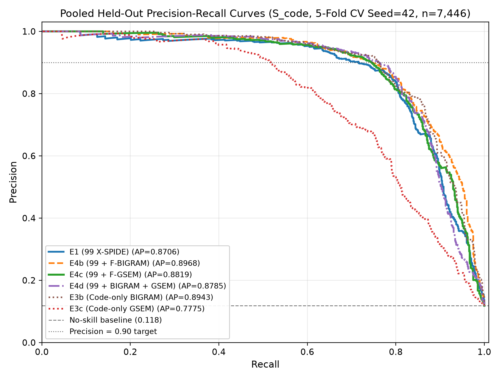
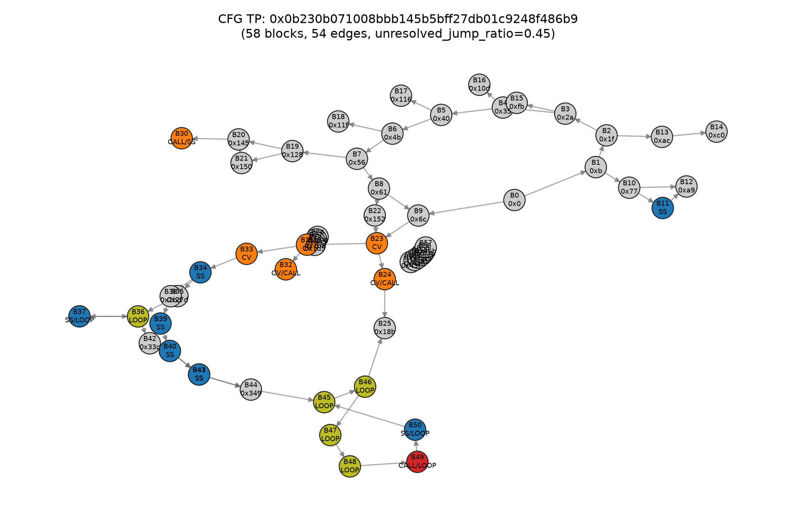
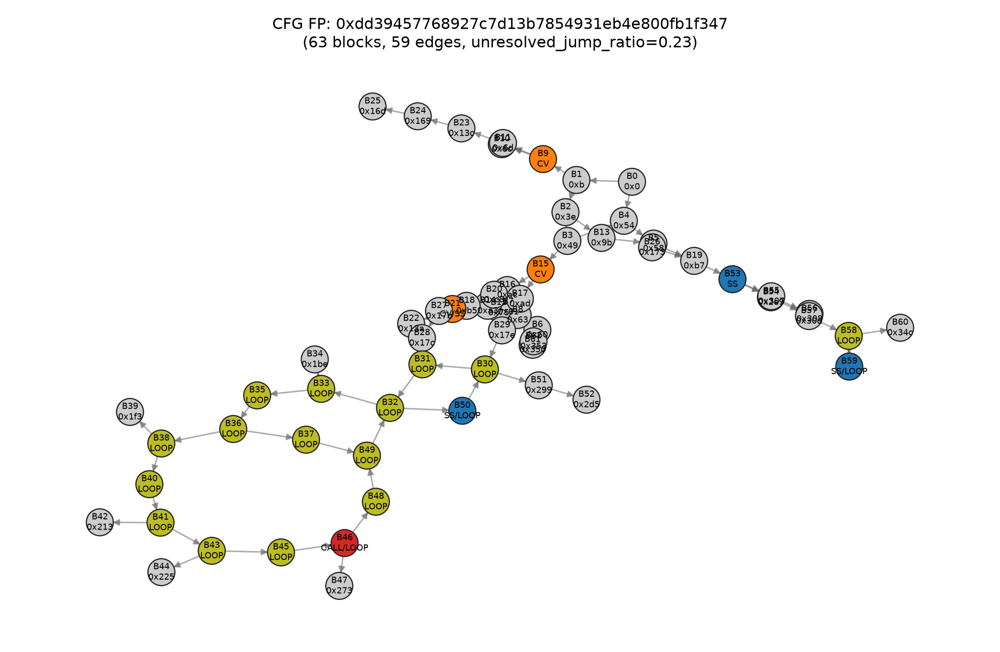

# Phase 4 Results: RQ2 — Static Bytecode Feature Engineering, Statistical Evaluation, Sensitivity Analysis, and Explainability

**Date:** 2026-11-14  
**Scope:** Phase 4 (`E1`–`E4d` main comparison, pre-registered Holm-Bonferroni hypothesis tests, `S1`–`S4` sensitivity checks, conditional `E6` PonziGuard sanity check, feature extraction benchmarking, OOF SHAP explainability, and manual FP/FN error analysis)  
**Benchmark Dataset:** `S_code` (`|S_code| = 7,446` deployed contracts: `880` Ponzi [11.82%], `6,566` Non-Ponzi [88.18%])  
**Evaluation Protocol:** 5-repeat × 5-fold `StratifiedGroupKFold` (`group_near`, 4,711 clusters; seeds `42..46`), 30-trial inner Optuna TPE tuning (3-fold inner `StratifiedGroupKFold`) per outer fold, LightGBM, OOF `F1`-maximizing threshold `tau*` (primary metric: `PR-AUC`, MDE `ΔPR-AUC >= 0.02`, Nadeau–Bengio corrected resampled t-test + Wilcoxon signed-rank + Holm–Bonferroni over 8 pre-registered comparisons per `docs/preregistration.md`).

---

## 1. Executive Summary

1. **Sequential opcode bigrams (`F-BIGRAM`) deliver a confirmed, large improvement over the 99-feature X-SPIDE baseline (`E1`), even without account transaction features:**
   - Adding top-200 in-fold opcode bigrams to `E1` (`E4b`: `PR-AUC = 0.8995 ± 0.0212`, `F1 = 0.8263 ± 0.0269`) achieves a pre-registered **Confirmed Improvement** (`ΔPR-AUC = +0.0227 >= 0.02`, 95% Nadeau–Bengio CI `[+0.0096, +0.0358]`, `NB p = 0.00155`, `Wilcoxon p_Holm = 4.77e-7`).
   - Crucially for **zero-history / pre-deployment detection**, the pure code-only bigram model `E3b` (`200` in-fold bigrams only, `0` account features) attains `PR-AUC = 0.9013 ± 0.0191` (`F1 = 0.8247 ± 0.0241`, `ROC-AUC = 0.9736`), outperforming `E1` (`0.8767`) by `+0.0246` (`95% NB CI [+0.0064, +0.0428]`, auxiliary comparison).
2. **Transparent negative / inconclusive verdict for compact static CFG semantics (`F-GSEM`) relative to `F-BIGRAM`:**
   - Among compact 15–16 feature structural representations without account features, semantic CFG + SCC + opcode PageRank (`E3c`: `PR-AUC = 0.7787 ± 0.0418`) yields a **Confirmed Improvement** over naive transition graph statistics (`E3`: `0.6000 ± 0.0629`, `ΔPR-AUC = +0.1787`, `95% NB CI [+0.1242, +0.2332]`, `p_Holm = 4.77e-7`).
   - However, adding `F-GSEM` to `E1` (`E4c`: `PR-AUC = 0.8825 ± 0.0233`, `Δ = +0.0058`) does **not** achieve statistical significance under Nadeau–Bengio (`95% NB CI [-0.0037, +0.0152]`, `NB p = 0.2200`) and falls short of the pre-registered MDE (`0.02`). Furthermore, `E4c` trails `E4b` (`Δ = -0.0169`, `95% NB CI [-0.0298, -0.0041]`, **Inconclusive** relative to `E4b`), and combining `F-GSEM` on top of `99 + F-BIGRAM` (`E4d`: `PR-AUC = 0.9010 ± 0.0216`) yields virtually no marginal gain over `E4b` (`Δ = +0.0016`, `95% NB CI [-0.0075, +0.0107]`, **No Significant Difference**).
3. **Methodology & Robustness (`S1`–`S4`, `R4`, `R6`):**
   - Naive exact-hash grouping (`S1`: `group_exact`) overestimates performance by `+0.027`–`+0.028` `PR-AUC` (`E1`: `0.9051` vs `0.8767`; `E4c`: `0.9097` vs `0.8825`) due to near-clone leakage across folds.
   - Results are invariant to CBOR metadata stripping (`S2`, `|ΔPR-AUC| <= 0.0028`, all `NB p >= 0.52`) and normalized vs raw mnemonics (`S4`, `|ΔPR-AUC| <= 0.0025`, all `NB p >= 0.59`). `S3` (temporal holdout) is documented as N/A because `block_number` is absent and BigQuery credentials are unavailable locally.
   - GSEM static CFG resolution is healthy (`unresolved_jump_ratio`: median `0.1918`, mean `0.2498`, `526 / 7,446 = 7.06% > 0.50`), so Risk `R4` (`> 0.50` in `> 30%`) is **not** triggered. End-to-end bytecode feature extraction succeeds with `0` errors across all `7,446` contracts (median `16.584 ms/contract`).
   - On external PonziGuard contracts (`E6`), Risk `R6` is triggered (`10` unique non-overlapping Ponzi hashes `< 30`), yielding a wide-CI sanity check of `PR-AUC = 0.6535 [0.3965, 0.9141]`, `F1 = 0.6667 [0.3994, 0.8889]` (`TP=6, FP=2, TN=95, FN=4`).

---

## 2. Main Experiment Comparison on `S_code` (`25`-Fold `StratifiedGroupKFold`)

All 9 main configurations were trained and evaluated on identical `S_code_group_near` 25-fold partitions (`seeds 42..46 × folds 0..4`). No folds triggered the `Recall@P>=0.9` fallback rule (`p90_fallback_folds = 0` across all 225 runs). Source: `results/model_comparison.csv`.

| Config | Feature Set | `n_features` | `PR-AUC` | `ΔPR-AUC vs E1` | `F1` | `P` | `R` | `ROC-AUC` | `Recall@P>=0.9` | Mean Train Time (s) |
|---|---|---:|---:|---:|---:|---:|---:|---:|---:|---:|
| `E1` | 99 X-SPIDE baseline | 99 | `0.8767 ± 0.0254` | `0.0000` | `0.8118 ± 0.0275` | `0.8374` | `0.7909` | `0.9631` | `0.7141 ± 0.0991` | `167.6` |
| `E2` | In-fold RFE over 99 X-SPIDE | `71.4 [39–99]` | `0.8768 ± 0.0237` | `+0.0000` | `0.8095 ± 0.0264` | `0.8392` | `0.7848` | `0.9638` | `0.7148 ± 0.0815` | `148.5` |
| `E3` | `F-GSTAT` transition stats only | 16 | `0.6000 ± 0.0629` | `-0.2767` | `0.5364 ± 0.0703` | `0.5788` | `0.5202` | `0.8402` | `0.2711 ± 0.1296` | `126.7` |
| `E3b` | `F-BIGRAM` opcode bigrams only (top-200) | 200 | **`0.9013 ± 0.0191`** | `+0.0246` | `0.8247 ± 0.0241` | `0.8554` | `0.7982` | `0.9736` | `0.7520 ± 0.0623` | `341.7` |
| `E3c` | `F-GSEM` CFG + SCC + PageRank only | 15 | `0.7787 ± 0.0418` | `-0.0980` | `0.6972 ± 0.0425` | `0.7306` | `0.6739` | `0.9253` | `0.5109 ± 0.0932` | `72.7` |
| `E4` | 99 X-SPIDE + `F-GSTAT` | 115 | `0.8805 ± 0.0242` | `+0.0037` | `0.8140 ± 0.0243` | `0.8398` | `0.7920` | `0.9641` | `0.7241 ± 0.0795` | `387.9` |
| `E4b` | 99 X-SPIDE + `F-BIGRAM` | 299 | `0.8995 ± 0.0212` | **`+0.0227`** | **`0.8263 ± 0.0269`** | **`0.8599`** | `0.7970` | **`0.9738`** | `0.7548 ± 0.0609` | `856.5` |
| `E4c` | 99 X-SPIDE + `F-GSEM` | 114 | `0.8825 ± 0.0233` | `+0.0058` | `0.8125 ± 0.0278` | `0.8451` | `0.7859` | `0.9649` | `0.7361 ± 0.0627` | `418.3` |
| `E4d` | 99 X-SPIDE + `F-BIGRAM` + `F-GSEM` | 314 | `0.9010 ± 0.0216` | `+0.0243` | `0.8259 ± 0.0273` | `0.8517` | **`0.8050`** | `0.9734` | **`0.7634 ± 0.0504`** | `612.8` |

**Note on pooled OOF PR curves (`figures/pr_curves.png`):** Pooled average precision (`AP`) computed after concatenating raw OOF probabilities across seed-42 folds (`E1 = 0.8706`, `E4b = 0.8968`, `E4c = 0.8819`, `E4d = 0.8785`, `E3b = 0.8943`, `E3c = 0.7775`) differs slightly from the mean per-fold `PR-AUC` in the table above (`seed=42` per-fold mean `PR-AUC`: `E1 = 0.8782`, `E4b = 0.8985`, `E4c = 0.8840`, `E4d = 0.8985`). Because Optuna independently selects `imbalance_mode` (`scale_pos_weight`, `is_unbalance`, or `none`) per fold (e.g., `E4d` seed-42 folds used `['is_unbalance', 'none', 'is_unbalance', 'none', 'scale_pos_weight']`), uncalibrated probability scales vary across folds when concatenated globally, whereas within-fold `PR-AUC` and `tau*` thresholding remain unaffected.

---

## 3. Pre-Registered Statistical Hypothesis Tests (`results/stat_tests.csv`)

Statistical inference uses the **Nadeau–Bengio (1999/2003) corrected resampled paired t-test** (`rho = 0.25` for 5-fold CV overlap) together with exact Wilcoxon signed-rank p-values adjusted via **Holm–Bonferroni** across the 8 pre-registered `PR-AUC` comparisons (`docs/preregistration.md`). Under the three-way decision rule, `Confirmed Improvement` requires `ΔPR-AUC >= 0.02` (MDE), `95% NB CI > 0`, and `p_Holm < 0.05`.

### 3.1 Pre-Registered 8-Comparison Holm Family (`PR-AUC`, 25 paired folds)

| Family | Comparison | `mean_a` | `mean_b` | `ΔPR-AUC` (`sd`) | `95% Nadeau–Bengio CI` | `NB t` (`NB p`) | `Wilcoxon p` (`p_Holm`) | Verdict |
|---|---|---:|---:|---:|---:|---:|---:|---|
| `vs_E1` | `E4 vs E1` | `0.8805` | `0.8767` | `+0.0037` (`0.0058`) | `[-0.0027, +0.0102]` | `1.190` (`0.2457`) | `0.00460` (`0.01381`) | **No Significant Difference** |
| `vs_E1` | `E4b vs E1` | `0.8995` | `0.8767` | `+0.0227` (`0.0118`) | `[+0.0096, +0.0358]` | `3.571` (`0.00155`) | `5.96e-8` (`4.77e-7`) | **Confirmed Improvement** |
| `vs_E1` | `E4c vs E1` | `0.8825` | `0.8767` | `+0.0058` (`0.0085`) | `[-0.0037, +0.0152]` | `1.259` (`0.2200`) | `0.00203` (`0.00810`) | **No Significant Difference** |
| `vs_E1` | `E2 vs E1` | `0.8768` | `0.8767` | `+0.0000` (`0.0064`) | `[-0.0070, +0.0071]` | `0.009` (`0.9929`) | `1.00000` (`1.00000`) | **No Significant Difference** |
| `novelty_critical` | `E4c vs E4b` | `0.8825` | `0.8995` | `-0.0169` (`0.0115`) | `[-0.0298, -0.0041]` | `-2.730` (`0.01167`) | `5.96e-7` (`2.98e-6`) | **Inconclusive** (degradation vs `E4b`) |
| `novelty_critical` | `E4d vs E4b` | `0.9010` | `0.8995` | `+0.0016` (`0.0082`) | `[-0.0075, +0.0107]` | `0.356` (`0.7247`) | `0.67208` (`1.00000`) | **No Significant Difference** |
| `code_only` | `E3c vs E3b` | `0.7787` | `0.9013` | `-0.1226` (`0.0317`) | `[-0.1578, -0.0874]` | `-7.188` (`1.99e-7`) | `5.96e-8` (`4.77e-7`) | **Inconclusive** (degradation vs `E3b`) |
| `code_only` | `E3c vs E3` | `0.7787` | `0.6000` | `+0.1787` (`0.0490`) | `[+0.1242, +0.2332]` | `6.766` (`5.35e-7`) | `5.96e-8` (`4.77e-7`) | **Confirmed Improvement** |

**Methodological observation:** In `E4 vs E1` and `E4c vs E1`, naive paired Wilcoxon flags `p_Holm < 0.05` (`0.0138` and `0.0081`) because it treats the 25 repeated 5-fold CV measurements as independent, inflating effective sample size. Accounting for shared training data (`rho = 0.25`), the Nadeau–Bengio 95% CIs cross zero (`[-0.0027, +0.0102]` and `[-0.0037, +0.0152]`), and both effect sizes remain far below the `0.02` MDE threshold.

### 3.2 Selected Auxiliary Comparisons (`PR-AUC` & `F1`, Descriptive Only)

- **Code-only bigrams vs mixed X-SPIDE baseline (`E3b vs E1`, auxiliary `PR-AUC`):** `ΔPR-AUC = +0.0246` (`95% NB CI [+0.0064, +0.0428]`, `NB p = 0.0101`, `Wilcoxon p = 4.17e-7`). Top-200 normalized opcode bigrams alone surpass X-SPIDE's 99 code + account features.
- **Full combination vs baseline (`E4d vs E1`, auxiliary `PR-AUC`):** `ΔPR-AUC = +0.0243` (`95% NB CI [+0.0094, +0.0391]`, `NB p = 0.00249`).
- **`F-BIGRAM` vs `F-GSTAT` among code-only baselines (`E3b vs E3`, auxiliary `PR-AUC`):** `ΔPR-AUC = +0.3013` (`95% NB CI [+0.2377, +0.3649]`).
- **Secondary `F1` comparisons vs `E1`:** `E4b vs E1` achieves `ΔF1 = +0.0145` (`95% NB CI [-0.0055, +0.0345]`, `Wilcoxon p = 0.00063`); `E4d vs E1` achieves `ΔF1 = +0.0141` (`95% NB CI [-0.0160, +0.0442]`).

---

## 4. Sensitivity Analyses (`S1`–`S4`) & Feature Extraction Cost

### 4.1 Sensitivity Summary (`results/sensitivity_summary.csv`)

| Study | Variant | Reference | Paired Splits | Variant `PR-AUC` | Ref `PR-AUC` | `ΔPR-AUC` | Variant `F1` | `ΔF1` | `NB p` (`PR-AUC`) | Interpretation |
|---|---|---|---:|---:|---:|---:|---:|---:|---:|---|
| `S1_split_granularity` | `E1_S1_group_exact` | `E1` | `False` | `0.9051 ± 0.0197` | `0.8767` | `+0.0283` | `0.8379` | `+0.0261` | unpaired | Exact-hash deduplication leaves near-clones across folds (`+0.0283` leakage bias) |
| `S1_split_granularity` | `E4c_S1_group_exact` | `E4c` | `False` | `0.9097 ± 0.0193` | `0.8825` | `+0.0272` | `0.8450` | `+0.0325` | unpaired | Identical near-clone inflation pattern (`+0.0272`) |
| `S2_cbor_metadata` | `E1_S2_cbor_stripped` | `E1` | `True` | `0.8792 ± 0.0258` | `0.8767` | `+0.0024` | `0.8096` | `-0.0022` | `0.5360` | 76 opcodes from stripped bytecode match raw CSV baseline |
| `S2_cbor_metadata` | `E4c_S2_raw_cbor` | `E4c` | `True` | `0.8853 ± 0.0226` | `0.8825` | `+0.0028` | `0.8141` | `+0.0016` | `0.5199` | `F-GSEM` on raw vs stripped bytecode shows negligible difference |
| `S2_cbor_metadata` | `E4c_S2_cbor_stripped` | `E4c` | `True` | `0.8830 ± 0.0236` | `0.8825` | `+0.0005` | `0.8105` | `-0.0020` | `0.8507` | Full CBOR-stripped pipeline preserves `E4c` performance |
| `S3_temporal_holdout` | `N/A` | `E1/E4c` | `False` | `—` | `—` | `—` | `—` | `—` | `—` | **Not feasible:** `block_number` is 100% `<NA>` in X-SPIDE archives and `bq_available=False` locally |
| `S4_mnemonic_norm` | `E4b_S4_raw_opcodes` | `E4b` | `True` | `0.8969 ± 0.0217` | `0.8995` | `-0.0025` | `0.8226` | `-0.0037` | `0.5906` | Normalized opcodes slightly outperform raw (`+0.0025`, n.s.) |
| `S4_mnemonic_norm` | `E4c_S4_raw_opcodes` | `E4c` | `True` | `0.8825 ± 0.0251` | `0.8825` | `-0.0000` | `0.8161` | `+0.0036` | `0.9989` | Opcode PageRank in `F-GSEM` is insensitive to family normalization |

### 4.2 Feature Extraction Latency & Risk `R4` Audit (`results/feature_extraction_cost.csv`)

Measured on `12th Gen Intel(R) Core(TM) i5-12450H` (12 logical threads, `15.63 GB` RAM, Python `3.12.13`) across all `7,446` `S_code` contracts (`0` extraction failures / `0.0%` error rate across all stages):

| Stage | Contracts | Errors | Median (ms) | Mean (ms) | p95 (ms) | Max (ms) | Total (s) | Notes |
|---|---:|---:|---:|---:|---:|---:|---:|---|
| `disasm` | 7,446 | 0 | `3.903` | `6.005` | `14.622` | `88.929` | `44.71` | `truncated_push_contracts=554`, `invalid_opcode_contracts=1163` |
| `bigram` | 7,446 | 0 | `3.611` | `4.424` | `10.878` | `29.100` | `32.94` | Sparse normalized + raw relative frequencies |
| `gstat` | 7,446 | 0 | `1.915` | `2.474` | `5.647` | `59.613` | `18.42` | 16 transition-graph descriptors |
| `gsem` | 7,446 | 0 | `6.640` | `8.599` | `18.674` | `103.038` | `64.03` | 15 CFG descriptors; `unresolved_jump_ratio > 0.50`: `526/7,446 (7.06%)` |
| `end_to_end` | 7,446 | 0 | **`16.584`** | `21.795` | `60.213` | `164.311` | `162.28` | Complete single-pass bytecode pipeline |

`gsem` jump resolution statistics across all `7,446` contracts give `unresolved_jump_ratio` median `0.1918` and mean `0.2498`, with only `7.06%` (`526/7,446`) exceeding `0.50`. Therefore, **Risk `R4`** (triggered if median `> 0.50` in `> 30%` of contracts) is **not triggered**.

---

## 5. Conditional External Cross-Dataset Sanity Check (`E6`, Risk `R6`)

As documented in `reports/data_audit.md` and `reports/data_audit_summary.json`, PonziGuard overlap deduplication against X-SPIDE `S_code` (via `code_hash` and `group_near` Jaccard similarity) leaves **`10` unique non-overlapping Ponzi hashes** and **`97` unique non-overlapping Non-Ponzi hashes** (`n_test = 107`). Because `10 < 30` Ponzi contracts, **Risk `R6`** is triggered (`R6_SANITY_CHECK_ONLY (<30 non-overlapping Ponzi contracts)`): `E6` is restricted strictly to an exploratory sanity check with 1,000-resample stratified bootstrap 95% CIs rather than a formal external generalization claim.

The `E6` code-only model (`291` features: `76` X-SPIDE opcodes + `200` `F-BIGRAM` + `15` `F-GSEM`) was tuned on all `7,446` X-SPIDE `S_code` contracts (`inner_cv_pr_auc = 0.8936`, `tau* = 0.1804`, `train_time = 318.4s`) and evaluated once on the `107` disjoint PonziGuard contracts (`results/E6_sanity_check.csv`, `results/E6_predictions.csv`):

| Metric | Point Estimate | 95% Bootstrap CI (`n_resamples = 1,000`) | Bootstrap Std |
|---|---:|---|---:|
| `PR-AUC` | `0.6535` | `[0.3965, 0.9141]` | `0.1310` |
| `ROC-AUC` | `0.8196` | `[0.6598, 0.9609]` | `0.0770` |
| `F1` | `0.6667` | `[0.3994, 0.8889]` | `0.1287` |
| `Precision` | `0.7500` | `[0.5000, 1.0000]` | `0.1432` |
| `Recall` | `0.6000` | `[0.3000, 0.9000]` | `0.1521` |
| `Accuracy` | `0.9439` | `[0.9065, 0.9813]` | `0.0195` |

- **Confusion Matrix (`TP=6, FP=2, TN=95, FN=4`):**
  - **True Positives (6/10):** `FastRealisticPyramid` (`0.999995`), `test` (`0.999941`), `NiceGuyTax` (`0.999916`), `Coinflip` (`0.997307`), `TheGame` (`0.998745`), `Etheramid2` (`0.753501`).
  - **False Negatives (4/10):** `A_Free_Ether_A_Day` (`2.67e-5`), `Free_Ether_A_Day_Funds_Return` (`4.33e-5`), `Bank_With_Interest` (`3.74e-4`), `Best_Bank_with_Interest` (`4.84e-4`) — notably fixed-interest / time-locked payout schemes assigned sub-`1e-3` probabilities.
  - **False Positives (2/97):** `Ethconomy` (`0.979104`) and `CashBackMoney` (`0.752748`), while `95/97` (`97.9%`) Non-Ponzi contracts are correctly rejected.

---

## 6. Out-of-Fold SHAP Explainability & `F-GSEM` Sanity Check (`Seed=42`, `n=7,446`)

Using LightGBM `TreeExplainer` over held-out test folds for seed `42` (`E1` vs `E4c`), global and `F-GSEM`-specific feature contributions are summarized in `results/xai_gsem_summary.json` and the figures below.

| `E1` Global SHAP Summary | `E4c` Global SHAP Summary |
|---|---|
|  |  |

### `F-GSEM` Ranking and `has_loop_with_call` Directional Sanity Check (`results/xai_gsem_summary.json`)

| Rank | `F-GSEM` Feature | Mean `|SHAP|` | Spearman `ρ(val, SHAP)` | Non-zero Fraction | Mean SHAP (`val > 0`) | Mean SHAP (`val == 0`) |
|---:|---|---:|---:|---:|---:|---:|
| 1 | `call_block_ratio` | `0.2833` | `+0.874` | `85.39%` | `+0.1157` | `-0.5358` |
| 2 | `n_loops_with_call` | `0.2061` | `+0.515` | `9.84%` | **`+1.0520`** | `-0.1138` |
| 3 | `n_blocks_with_call` | `0.1707` | `+0.464` | `85.39%` | `+0.0254` | `-0.2080` |
| 4 | `unresolved_jump_ratio` | `0.1520` | `-0.897` | `99.50%` | `+0.0101` | `+0.3419` |
| 5 | `pagerank_SSTORE` | `0.1084` | `+0.705` | `95.42%` | `+0.0149` | `-0.2499` |
| 6 | `pagerank_CALL` | `0.0928` | `+0.573` | `85.39%` | `+0.0295` | `-0.1785` |
| 7 | `cyclomatic` | `0.0634` | `-0.416` | `42.02%` | `-0.0238` | `+0.0266` |
| 8 | **`has_loop_with_call`** | `0.0589` | `+0.515` | `9.84%` | **`+0.3191`** | **`-0.0305`** |

- **`has_loop_with_call` sanity check passed:** Even though binary `has_loop_with_call = 1` (and `n_loops_with_call > 0`) occurs in only `9.84%` of contracts, its conditional SHAP push toward Ponzi is strongly positive (`+0.3191` vs `-0.0305` for `has_loop_with_call`, and `+1.0520` vs `-0.1138` for `n_loops_with_call`, `Spearman ρ = +0.515`). `call_block_ratio` ranks 5th globally among all 114 features in `E4c` (`mean |SHAP| = 0.2833`), demonstrating that `F-GSEM` structural signals *are* actively leveraged by LightGBM—yet remain redundant with 200 sequential opcode bigrams (`E4b`/`E4d`) for top-line `PR-AUC`.
- **Direction of `unresolved_jump_ratio` (`ρ = -0.897`):** Higher unresolved jump ratios strongly push predictions *away* from Ponzi, reflecting complex dispatcher/library/proxy contracts vs simpler legacy Ponzi schemes.

---

## 7. Qualitative Error Analysis (`Seed=42`: `125` FP, `195` FN; Audited `12` FP + `12` FN Cases)

On `seed = 42` (`E4c` OOF confusion matrix: `TP=685, FP=125, FN=195, TN=6,441`), **14/125 FPs (11.2%)** and **38/195 FNs (19.5%)** fall inside the `24` mixed-label `group_near` clone clusters identified during Phase 1 (`reports/data_audit.md`). We exported and disassembled all `24` extreme error cases in `results/error_analysis_cases.csv` (`12 FP` + `12 FN`) and inspected the canonical `TP` / `FP` / `FN` SHAP waterfalls and CFGs (`figures/shap_waterfall_*.png`, `figures/cfg_*.png`).

| Canonical TP (`0x0b230b0710...`, `p=1.000`) | Canonical FP (`0xdd39457768...`, `p=0.998`) | Canonical FN (`0x4e1833a4a6...`, `p=0.000`) |
|---|---|---|
|  |  |  |
|  |  |  |

### 7.1 Taxonomy of Audited False Positives (`12` high-confidence cases, `y=0`)

1. **`benign_contract_with_payout_loop_motif` (`5/12`):** e.g., `xspide_06872` (`0xdd394577...`, `y_proba=0.9981`, `523` instructions), `xspide_02699` (`0.9996`, `4,936` ins), `xspide_01691` (`0.9982`, `1,513` ins), `xspide_00352` (`0.9858`, `982` ins), `xspide_06838` (`0.9801`, `8,970` ins). Disassembly and CFG recovery confirm authentic `CALL` inside SCC loops (`n_loops_with_call = 1..3`) alongside elevated `SLOAD`, `MUL`, and Byzantium `RETURNDATASIZE`/`RETURNDATACOPY` (`xspide_06838`: `57` `RETURNDATASIZE`; `xspide_02699`: `16`), reflecting benign batch-distribution, refund, or token/dividend contracts whose control-flow topology mimics a pyramid payout loop (`cfg_fp.png`).
2. **`acct_tx_asymmetry_mimicking_ponzi` (`4/12`):** `xspide_03270` (`0.9984`), `xspide_04186` (`0.9937`), `xspide_07193` (`0.9886`), `xspide_06258` (`0.9873`). All four have `n_loops_with_call = 0`, yet `SLOAD`, `MUL`, `CALLDATALOAD`, and `RETURNDATASIZE`/account transaction ratios push log-odds sharply positive.
3. **`mixed_label_near_clone_cluster` (`2/12`):** `xspide_01899` (`0.9976`, `near_01953`, `tx_in=35, tx_out=0, paid_one=0.0`) shares exact bytecode hash `exact_01603` with labeled Ponzi `xspide_02246` (`label=1`) and near-clone `xspide_05297` (`label=1`, identical `tx_in=35, tx_out=0`); `xspide_06801` (`0.9940`, `near_04417`) shares exact hash `exact_01900` with two labeled Ponzi deployments (`xspide_02265`, `xspide_06178`).
4. **`high_unresolved_dynamic_jumps` (`1/12`):** `xspide_07259` (`0xf3021a6c...`, `0.9763`, `7,172` ins) has `unresolved_jump_ratio = 0.929` (generating `-1.375` SHAP from `F-GSEM`), yet `RETURNDATASIZE (+3.076)` and `RETURNDATACOPY (+2.405)` dominate the prediction.

### 7.2 Taxonomy of Audited False Negatives (`12` lowest-probability cases, `y=1`)

1. **`atypical_ponzi_without_static_call_loop` (`9/12`):** `xspide_03775`, `xspide_07419`, `xspide_04028`, `xspide_04097` (canonical `cfg_fn.png`, `341` ins), `xspide_05023`, `xspide_03429`, `xspide_07415` (`SELFDESTRUCT=1`, `NUMBER=3`), `xspide_03510`, `xspide_04235` (`y_proba = 3.4e-6 .. 1.1e-4`). **All 9 have `n_loops_with_call = 0, has_loop_with_call = 0`** and lack Byzantium `RETURNDATASIZE`, while carrying `CALL` (`1`–`13`), `CALLVALUE` (`4`–`52`), and frequently `TIMESTAMP`/`NUMBER` (`7/9`). Because queue-based, single-payout-per-deposit, or time-locked HYIP schemes pay out one address per transaction rather than iterating over an array in a loop, no intra-CFG `CALL` cycle appears, and high `ISZERO` / `SUB` / `AND` frequencies pull SHAP negative.
2. **`mixed_label_near_clone_cluster` (`3/12`):** `xspide_04342` (`near_00207`, `label=1` vs clone `xspide_06255` `label=0`, both `tx_in=1, tx_out=0`), `xspide_01190` (`near_04041`, `exact_01037`, `label=1, tx_in=108` vs identical bytecode `xspide_07093` labeled `0` with `tx_in=1`), and `xspide_07213` (`near_01781`, `CALLCODE=1`, `NUMBER=15`). X-SPIDE's behavioral/post-deployment labeling occasionally assigns `0` to dormant deployments of exact Ponzi codebases, establishing an irreducible label-noise floor on `S_code`.

---

## 8. Synthesis for RQ2 & Implications for Phase 5–6

1. **Pre-deployment static detection (`E3b`):** Normalized opcode bigram frequencies (top-200 fit strictly inside training folds) constitute the strongest single static addition explored (`PR-AUC = 0.9013`, surpassing even the 99-feature mixed code + account X-SPIDE baseline `0.8767`), directly addressing pre-deployment / zero-transaction Ponzi detection without relying on post-hoc transaction counts.
2. **Role of CFG structural features (`F-GSEM`):** While 15-dimensional static CFG descriptors strongly improve low-dimensional structural detection (`E3c = 0.7787` vs `E3 = 0.6000`) and exhibit clear domain-consistent SHAP behavior (`call_block_ratio`, `n_loops_with_call`, `has_loop_with_call`), simple loop-free queue/single-payout Ponzi schemes (`9/12` sampled FNs) and loop-bearing benign distributors (`5/12` sampled FPs) limit pure topological gains over dense opcode bigrams.
3. **Dataset integrity:** Near-clone leakage inflates naive exact-deduplicated baselines by `~+0.028` `PR-AUC`, and mixed-label exact/near-clone deployments account for nearly a fifth (`19.5%`) of seed-42 false negatives.
