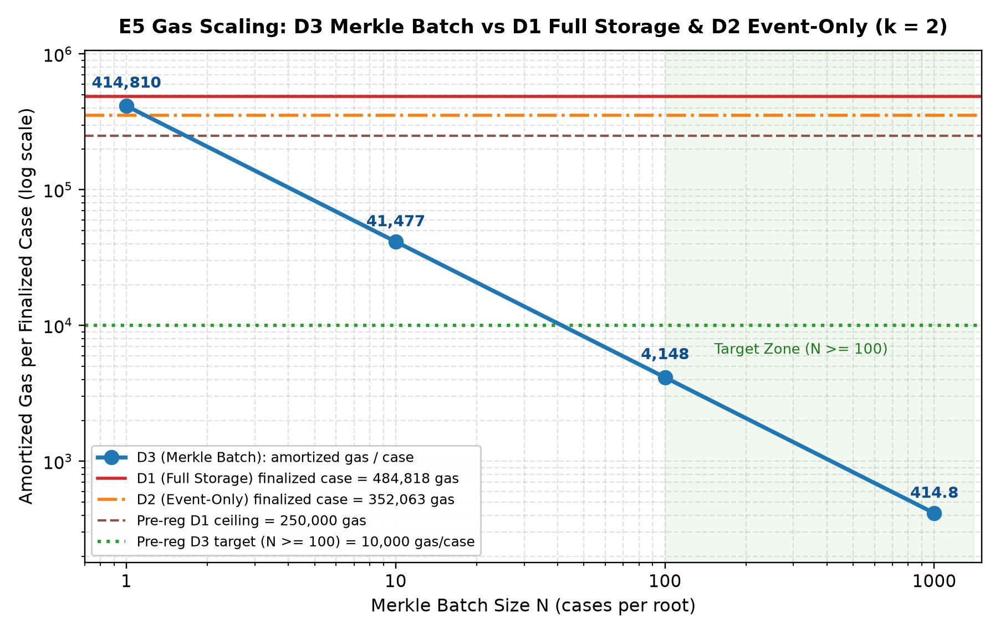

# RQ3 Report: On-Chain Evaluation & Architectural Trade-Offs (Phase 7 / Experiment E5 — v1.1)

**Project:** X-SPIDE-G — Blockchain-Backed Auditable Explainable AI Governance for Financial Fraud & Default Risk  
**Experiment ID:** E5 (`scripts/run_phase7_e5.py`, `src/contracts/e5_benchmark.py`, contracts `v1.1`)  
**Evaluation Timestamp (UTC):** `2026-11-21T14:09:18Z`  
**Git Baseline Commit:** `9f9a032a39f7abfa62ece4437883a5a12efa43d0` (v1.1 Phase 4 live redeploy & re-benchmark)  
**Artifact Links:**  
- Gas & Cost Dataset: [`results/E5_gas.csv`](../results/E5_gas.csv)  
- Latency Dataset: [`results/E5_latency.csv`](../results/E5_latency.csv)  
- Execution Manifest & Proof Index: [`results/E5_summary.json`](../results/E5_summary.json)  
- Gas Scaling Curve: [`figures/gas_vs_batch.png`](../figures/gas_vs_batch.png) & [`paper/figures/gas_vs_batch.pdf`](../paper/figures/gas_vs_batch.pdf)

---

## 1. Executive Verdict Against Pre-Registered E5 Thresholds

Every pre-registered acceptance threshold defined in [`docs/preregistration.md`](../docs/preregistration.md) (§5) is evaluated honestly below on **v1.1 contracts** (enforcing per-case `required_threshold` snapshotting, `created_roster_nonce` Sybil isolation, tie-safe `STATUS_DISPUTED`, and permissionless `revoke_removed_auditor_vote`) across deterministic Cancun-equivalent `Anvil` (`PyEVMBackend`), live Ethereum Sepolia (`11155111`), and live Arbitrum Sepolia (`421614`).

| Pre-Registered Criterion | Target | Measured Result (`v1.1`) | Verdict |
| --- | --- | --- | --- |
| **D1 Finalized Case Gas** (`register_case + 2 attest`, $k=2$) | $\le 250{,}000$ gas/case | **Anvil (Cancun):** `484,818` gas (`+93.93%` over ceiling) **Arbitrum Sepolia (live):** `484,830` gas **Sepolia (live EIP-8037):** `1,881,226` gas | **FAIL** |
| **D3 Amortized Case Gas** ($N \ge 100$, Merkle batch finalized) | $\le 10{,}000$ gas/case | **Anvil $N=100$:** `4,148.10` gas/case (`-58.52%` below ceiling) **Anvil $N=1000$:** `414.82` gas/case (`-95.85%`) **Arbitrum Sepolia $N=100$:** `4,148.10` gas/case **Sepolia (live EIP-8037) $N=100$:** `15,474.70` gas/case *(passes ceiling at $N \ge 155$, e.g., $N=1000 \approx 1{,}547$)* | **PASS** *(Cancun / Arbitrum Sepolia)*; **Conditional** *(Sepolia EIP-8037 requires $N \ge 155$)* |
| **Sepolia Receipt Confirmation Latency** (`D1.attest`, $n=30$ sequential txs) | Median $\le 2$ blocks | **Sepolia ($n=30$):** Median `1.00` block (`p95 = 1.00`, `min = 1`, `max = 1`); Median `10.560 s` (`p95 = 11.699 s`) | **PASS** |
| **Mainnet Baseline USD Reference Anchoring** | Logged fixed-date calculation | `0.971057 gwei` median gas price (Mainnet blocks `26463858..26463957`), `ETH = $1,704.05` (`2026-11-21T14:04:49Z`) | **PASS** *(Logged & Verified)* |

**Core RQ3 Finding (`v1.1`):** Hardening the on-chain state machine with per-case threshold snapshotting and roster-nonce Sybil isolation (`T13`) adds `+57,357` Cancun gas per finalized lifecycle (`+48,424` on registration for two extra cold storage words plus `+4,415`/`+4,518` on the two cold attestations). Single-case full-storage governance (`D1`) consumes `484,818` Cancun gas (`1,881,226` gas on Sepolia EIP-8037), remaining above the `250,000` ceiling. Event-only storage (`D2`) trims Cancun finalized case gas by **27.38%** (`352,063` gas) and EIP-8037 gas by **35.11%** (`1,220,763` gas), still above `250,000`. Only Merkle batch anchoring (`D3`) satisfies the $\le 10{,}000$ gas/case budget on Cancun/Arbitrum (`4,148.10` gas/case at $N=100$, a **116.88×** / **99.14%** reduction vs `D1`; `414.82` gas/case at $N=1000$, a **1,168.74×** / **99.91%** reduction). Separate single-transaction receipt-inclusion benchmarks on `D1.attest` ($n=30$) confirm `1.00` block median on Sepolia (`10.560 s` median) and `1.212 s` median on Arbitrum Sepolia (`4.0` L2 blocks).

---

## 2. Deterministic Gas & Batch Scaling Analysis (`Anvil / PyEVMBackend`, `v1.1`)

Local Windows App Control restricts native `anvil.exe`, so deterministic EVM execution used `eth-tester` `PyEVMBackend` (Cancun hardfork rules) seeded identically across `D1` (`RiskAttestationRegistry.vy`), `D2` (`D2_EventOnly.vy`), and `D3` (`D3_MerkleBatch.vy`). Cold first-write calls and warm replacement updates are strictly separated.

### 2.1 Deployment & Governance Setup Gas (Cancun vs. Arbitrum Sepolia vs. Sepolia EIP-8037)

| Operation | Storage Mode | Anvil (Cancun) | Arbitrum Sepolia | Sepolia (EIP-8037) |
| --- | --- | ---: | ---: | ---: |
| `D1 deploy` | Contract creation | `1,400,866` | `1,400,866` | `9,751,010` |
| `D2 deploy` | Contract creation | `1,393,682` | — | `9,699,930` |
| `D3 deploy` | Contract creation | `1,480,957` | `1,480,957` | `10,321,937` |
| `add_auditor` #1 | `cold_first_write` | `113,841` | `113,841` | `459,821` |
| `add_auditor` #2 / #3 | `cold_mapping_warm_count` | `79,629` / `79,641` | `79,641` / `79,641` | `263,981` / `263,969` |
| `set_threshold(2)` | `warm_update` | `29,165` | `29,165` | `23,165` |
| `remove_auditor` (a3 removal) | `warm_update` | `32,542` (`D1/D2/D3`) | — | `36,584` (`D1` live T13) |
| `revoke_removed_auditor_vote` (`v1.1`) | `warm_update` | `46,864` (`D1/D3`), `41,821` (`D2`) | — | `63,402` (`D1` live T13) |

> [!NOTE]
> **Glamsterdam / EIP-8037 State-Creation Repricing on Sepolia:** Ethereum Sepolia activated the Glamsterdam upgrade (including EIP-8037 state-creation gas repricing) on October 6, 2026. Creating new contract bytecode or allocating zero-to-non-zero storage slots incurs **~3.47×–6.97×** higher gas on Sepolia than on Cancun (`PyEVMBackend`) or Arbitrum Sepolia Nitro, whereas warm non-zero storage overwrites such as `set_threshold(2)` are slightly cheaper (`23,165` vs `29,165`). This strengthens the architectural motivation for `D2` and `D3` under future L1 state-gas repricing.

### 2.2 Per-Case Lifecycle Gas Breakdown (`D1` vs. `D2` vs. `D3`, $k = 2$ of $3$, `v1.1`)

| Variant | Operation | Mode | Anvil (Cancun) | Arbitrum Sepolia | Sepolia (EIP-8037) |
| --- | --- | --- | ---: | ---: | ---: |
| **D1** | `register_case` | `cold_first_write` | `220,978` | `220,990` | `918,026` |
| **D1** | `attest` #1 (`Open -> Open`) | `cold_first_write` | `129,627` | `129,627` | `475,707` |
| **D1** | `attest` #2 (`Open -> Approved`) | `cold_first_write` | `134,213` | `134,213` | `487,493` |
| **D1** | **`finalized_case_total`** | **`aggregate` ($k=2$)** | **`484,818`** | **`484,830`** | **`1,881,226`** |
| **D1** | `attest` #3 (extra vote) | `cold_first_write` | `129,605` | — | — |
| **D1** | `attest_warm_replace` | `warm_update` | `68,974` | `86,134` | `204,154` |
| **D2** | `register_case` | `cold_first_write` | `132,509` | — | `477,889` |
| **D2** | `attest` #1 (`Open -> Open`) | `cold_first_write` | `107,484` | — | `365,544` |
| **D2** | `attest` #2 (`Open -> Approved`) | `cold_first_write` | `112,070` | — | `377,330` |
| **D2** | **`finalized_case_total`** | **`aggregate` ($k=2$)** | **`352,063`** | — | **`1,220,763`** |
| **D2** | `attest_warm_replace` | `warm_update` | `63,931` | — | `191,911` |
| **D3 ($N=100$)** | `register_batch` | `cold_first_write` | `152,530` (`1,525.30`/case) | `152,530` (`1,525.30`/case) | `585,830` (`5,858.30`/case) |
| **D3 ($N=100$)** | `attest_batch` #1 | `cold_first_write` | `128,847` (`1,288.47`/case) | `128,847` (`1,288.47`/case) | `474,927` (`4,749.27`/case) |
| **D3 ($N=100$)** | `attest_batch` #2 | `cold_first_write` | `133,433` (`1,334.33`/case) | `133,433` (`1,334.33`/case) | `486,713` (`4,867.13`/case) |
| **D3 ($N=100$)** | **`batch_finalized_total`** | **`aggregate` ($k=2$)** | **`414,810` (`4,148.10`/case)** | **`414,810` (`4,148.10`/case)** | **`1,547,470` (`15,474.70`/case)** |

*Minor `12` gas variations across identical Cancun calls (e.g., `220,978` vs. `220,990` on `register_case`) reflect zero vs. non-zero bytes in random `bytes32` digests (`4` vs. `16` calldata gas per byte). On Sepolia and Arbitrum Sepolia spot-checks, `attest_warm_replace` transitioned `reject_count` from `0 -> 1` (`Approved -> Disputed`) because only 2 cold `Approve` calls preceded it, incurring one zero-to-nonzero `SSTORE` allocation compared to the Anvil sequence where the 3rd cold auditor had already voted `Reject` (`reject_count = 1`) before Auditor 1's replacement (`1 -> 2`).*

### 2.3 Merkle Batch Scaling Curve (`D3` across $N \in \{1, 10, 100, 1000\}$)

| Batch Size $N$ | `register_batch` | `attest_batch` #1 | `attest_batch` #2 | Total Batch Gas | Amortized Gas / Case | `attest_warm_replace` | `verify_inclusion` `estGas` (Proof Len) | `verify_case_inclusion` `estGas` |
| ---: | ---: | ---: | ---: | ---: | ---: | ---: | ---: | ---: |
| **1** | `152,530` | `128,847` | `133,433` | `414,810` | `414,810.00` | `85,354` | `36,993` (`len=0`) | `38,004` |
| **10** | `152,518` | `128,835` | `133,421` | `414,774` | `41,477.40` | `85,342` | `39,040` (`len=4`) | `40,051` |
| **100** | `152,530` | `128,847` | `133,433` | `414,810` | **`4,148.10`** | `85,354` | `40,551` (`len=7`) | `41,563` |
| **1000** | `152,542` | `128,847` | `133,433` | `414,822` | **`414.82`** | `85,354` | `42,110` (`len=10`) | `43,134` |

On-chain write gas stays completely flat at **`~414,810` gas per batch** ($O(1)$) regardless of batch size $N$, while off-chain read verification via `verify_inclusion` scales logarithmically ($O(\log_2 N)$) from `36,993` to `42,110` estimated gas (`0` RPC transaction fee as a pure `eth_call`).

---

## 3. Fixed-Date Ethereum Mainnet USD Cost & Arbitrum Sepolia Fee Receipts

### 3.1 Mainnet Reference Anchor (Logged `2026-11-21T14:04:49Z`)

- **Mainnet Block Window:** `26463858..26463957` (100 blocks via `https://ethereum-rpc.publicnode.com` `eth_feeHistory`, p50 priority)
- **Median Base Fee:** `0.862457 gwei` | **Median Priority Fee:** `0.119199 gwei`
- **Median Total Gas Price:** **`0.971057 gwei`** *(cross-check: Etherscan v2 GasOracle `ProposeGasPrice` = `0.726795 gwei`)*
- **ETH / USD Spot Rate:** **`$1,704.05`** *(Source: Etherscan v2 `stats.ethprice`)*
- **Formula:** $\text{USD}_{\text{ref}} = \text{gas\_used} \times 0.971057 \times 10^{-9} \times 1{,}704.05$

### 3.2 Mainnet Reference Cost & Gas-Price Sensitivity (Cancun Baseline, `v1.1`)

Using deterministic Cancun `PyEVMBackend` gas counts per finalized case ($k=2$), per-case costs across observed (`0.9711 gwei`) to congested (`30 gwei`) L1 conditions are:

| Variant | Gas / Finalized Case | `@ 0.971057 gwei` (Observed Anchor) | `@ 1.0 gwei` | `@ 5.0 gwei` | `@ 15.0 gwei` | `@ 30.0 gwei` |
| --- | ---: | ---: | ---: | ---: | ---: | ---: |
| **D1 (Full Storage)** | `484,818` | **$0.802243** | `$0.826154` | `$4.130771` | `$12.392312` | `$24.784623` |
| **D2 (Event-Only)** | `352,063` | **$0.582569** | `$0.599933` | `$2.999665` | `$8.998994` | `$17.997989` |
| **D3 ($N=100$)** | `4,148.10` | **$0.006864** | `$0.007069` | `$0.035343` | `$0.106029` | `$0.212057` |
| **D3 ($N=1000$)** | `414.82` | **$0.000686** | `$0.000707` | `$0.003534` | `$0.010603` | `$0.021206` |

*(If EIP-8037 state-gas repricing applies equally on L1 in the future, Sepolia spot-check ratios imply L1 USD figures would scale by **3.88×** for `D1`, **3.47×** for `D2`, and **3.73×** for `D3`, making `D1` at `30 gwei` cost ~`$96.17`/case vs. `D3 (N=1000)` at ~`$0.079`/case.)*

### 3.3 Actual Arbitrum Sepolia Fee Receipts (Testnet Reference-Only)

| Variant | Scope | Total L2 Gas | Effective L2 Gas Price | Actual ETH Fee | Actual Testnet Fee (USD `@ $1,704.05`) | Per-Case USD |
| --- | --- | ---: | ---: | ---: | ---: | ---: |
| **D1** | Finalized case (`reg + 2 att`) | `484,830` | `0.020006–0.020164 gwei` | `0.000009737536 ETH` | `$0.016593` | **`$0.016593`** |
| **D3 ($N=100$)** | Finalized batch (`reg + 2 att`) | `414,810` | `0.020000–0.020236 gwei` | `0.000008343278 ETH` | `$0.014217` | **`$0.000142`** |

> [!WARNING]
> **Testnet Fee Caveat:** Arbitrum Sepolia receipt inspection (`gasUsedForL1 = 0x0`, `effectiveGasPrice ≈ 0.020 gwei`) confirms that testnet Nitro receipts currently charge negligible L1 data-posting fees due to minimal Sepolia blob/basefee pricing and subsidized testnet conditions. These USD numbers are **strictly reference-only** and must not be extrapolated directly to Arbitrum One mainnet under active L1 blob contention.

---

## 4. Sequential `attest` Receipt Inclusion Latency ($n = 30$ per Chain)

Thirty sequential `D1.attest(...)` transactions (`15` `cold_first_write` calls across 5 fresh cases, followed by `15` `warm_update` overrides toggling decision `1 -> 3`) were submitted on both live testnets from in-memory ephemeral benchmark auditor keys and confirmed to 1 inclusion block (receipt inclusion latency, not L1 economic finality).

### 4.1 Overall Latency & Gas Distribution ($n = 30$ per Network)

| Network | $n$ | Median Latency (s) | p95 Latency (s) | Min / Max (s) | Median Blocks | p95 Blocks | Min / Max Blocks | Total Fee (ETH / USD) |
| --- | ---: | ---: | ---: | ---: | ---: | ---: | ---: | --- |
| **Sepolia (`11155111`)** | `30` | **`10.560`** | **`11.699`** | `7.670 / 12.070` | **`1.00`** | **`1.00`** | `1 / 1` | `0.00214556 ETH` / `$3.6561` *(priority tip `0.25 gwei`)* |
| **Arbitrum Sepolia (`421614`)** | `30` | **`1.212`** | **`1.756`** | `1.078 / 1.776` | **`4.00`** | **`6.00`** | `3 / 6` | `0.00005887 ETH` / `$0.1003` |

*Target Check:* Sepolia achieved **`1.00` block** median (`100%` of transactions confirmed in the very next block, beating the pre-registered $\le 2$ blocks threshold). Arbitrum Sepolia confirms in **`1.212 s` median** (`3–6` fast ~250 ms L2 blocks including JSON-RPC polling RTT).

### 4.2 Cold vs. Warm Separation Within the Latency Sweep ($n=15$ each)

| Network | Write Mode | $n$ | Gas Range (`min..max`, `median`) | Median Latency (s) | Median Blocks |
| --- | --- | ---: | --- | ---: | ---: |
| **Sepolia (`11155111`)** | `cold_first_write` | `15` | `377,713 .. 487,493` *(med `475,707`)* | `10.600` | `1.0` |
| **Sepolia (`11155111`)** | `warm_update` | `15` | `84,736 .. 194,201` *(med `96,599`)* | `10.530` | `1.0` |
| **Arbitrum Sepolia (`421614`)** | `cold_first_write` | `15` | `112,441 .. 134,213` *(med `129,627`)* | `1.171` | `4.0` |
| **Arbitrum Sepolia (`421614`)** | `warm_update` | `15` | `61,540 .. 83,381` *(med `66,215`)* | `1.271` | `5.0` |

*Gas pattern note:* On `warm_update` (`decision = 1 -> 3`, i.e., `Approve -> NeedsReview`), the first auditor's replacement on each case increments `review_count` from `0 -> 1` (a zero-to-nonzero storage write), creating a higher gas tier (`194,201` on Sepolia EIP-8037; `83,369–83,381` on Arbitrum Sepolia) than the 2nd (`review_count: 1 -> 2`, `96,599` / `66,203–66,215`) and 3rd (`approve_count: 1 -> 0` refund + `review_count: 2 -> 3`, `84,736` / `61,540–61,552`) warm overrides.

---

## 5. Live Security, Integrity & Quorum Isolation Verification on Sepolia (`T1`, `T6`, `T8`, `T13`)

In addition to the offline automated contract suite (`T1–T13`, 100% revert branch coverage across 20/20 guards on `D1`/`D2` and 18/18 on `D3`), core role-isolation (`T1`, `T6`), canonical payload integrity (`T8`), and `v1.1` quorum-rotation/Sybil-isolation (`T13`) assertions were executed directly on live Sepolia:

1. **`T1` Non-Auditor Access Rejection (on main verified Sepolia `D1` `0x9E01ed5Aa19f0758d8dEc7C461dc374AcDA52Fad`):**
   - Sender: Ephemeral non-auditor `0x76dd3661708982Fc51B0e6f0D35FC8Df63b187f7`
   - `register_case(...)`: On-chain revert `status = 0`, block `12182210`, gas `31,640`, revert message `"Only auditor"`, tx [`0xe2beb043a6021edde8b9e9b91bc542502722713661901d32a4b96ff3f6cf482c`](https://sepolia.etherscan.io/tx/0xe2beb043a6021edde8b9e9b91bc542502722713661901d32a4b96ff3f6cf482c)
   - `attest(...)`: On-chain revert `status = 0`, block `12182211`, gas `21,400`, revert message `"Only auditor"`, tx [`0x04727e454a7ecb66a755ab6be00175757a17c00670995aa68eef6b2d9ce0b867`](https://sepolia.etherscan.io/tx/0x04727e454a7ecb66a755ab6be00175757a17c00670995aa68eef6b2d9ce0b867)
2. **`T6` Owner Separation-of-Duties Enforcement (on main verified Sepolia `D1` `0x9E01ed5Aa19f0758d8dEc7C461dc374AcDA52Fad`):**
   - Sender: Deployed contract owner `0x950e0416b13153d542d07Bf7f9AB586B0e903465`
   - `register_case(...)`: On-chain revert `status = 0`, block `12182207`, gas `31,640`, revert message `"Only auditor"`, tx [`0x34248ef97307e6bcab05ce915d180b2b8a54d22060135fce6118ff8dbb55f6ec`](https://sepolia.etherscan.io/tx/0x34248ef97307e6bcab05ce915d180b2b8a54d22060135fce6118ff8dbb55f6ec)
   - `attest(...)`: On-chain revert `status = 0`, block `12182208`, gas `21,400`, revert message `"Only auditor"`, tx [`0x686750805433fec3bb239b722b384d9be211c08789616ccbe83a70ff9d8d208a`](https://sepolia.etherscan.io/tx/0x686750805433fec3bb239b722b384d9be211c08789616ccbe83a70ff9d8d208a)
   - `add_auditor(owner)`: On-chain revert `status = 0`, block `12182209`, gas `18,090`, revert message `"Owner cannot be auditor"`, tx [`0x45b4df6d141db654699cafb09fdcc5daa5b04f990f1cd0da3cc58f582db78a5c`](https://sepolia.etherscan.io/tx/0x45b4df6d141db654699cafb09fdcc5daa5b04f990f1cd0da3cc58f582db78a5c)
   - **Main `D1` Non-Pollution Verification:** `state_unchanged_verified = true` (`auditor_count = 3`, `threshold = 2`, `CaseRegistered = 0` after all security checks).
3. **`T8` Canonical Evidence Integrity & 1-Byte Tamper Rejection (on Sepolia benchmark `D1` `0x5E7CA7Bd284e2A598F4844af403d2f106c52dbA6`):**
   - Registered case ID: `0x4f059ee606addf455d91f363dd2d2017e92b7bdcde58a7ca30730b3d8e053311`, register tx [`0xf2bffdf48f743f3ef068856634c85da87a14db45c1cebc5b9865be1950baf330`](https://sepolia.etherscan.io/tx/0xf2bffdf48f743f3ef068856634c85da87a14db45c1cebc5b9865be1950baf330)
   - Exact canonical JSON `keccak256`: `0x8d13b1201fa73ff33261d0beebb571e2f2e3cef1a59f076504e8bc14952653f9` -> local canonical check `True`, on-chain `verify_evidence == True`.
   - 1-byte perturbed `score` JSON `keccak256`: `0xc82b12805f4ee81c7379915ee746d21c977b42b34ae2b607c959ce21427b9607` -> local canonical check `False`, on-chain `verify_evidence == False`.
4. **`T13` Quorum Threshold Snapshot, Sybil Isolation & Vote Revocation (on Sepolia benchmark `D1` `0x5E7CA7Bd284e2A598F4844af403d2f106c52dbA6`):**
   - Open case `0x5bd5629a1127c277a37bc9c9ce75c77bac6bc76ea8bc2eb494782844e19eb968` registered at `k=2, roster_nonce=3` (tx [`0x59a22a5b9f6a26efb3a0cc1ff81b2b4f39985280677258ef07a609a5ee4d5193`](https://sepolia.etherscan.io/tx/0x59a22a5b9f6a26efb3a0cc1ff81b2b4f39985280677258ef07a609a5ee4d5193)); `auditor 3` attested `Approve` (tx `0x8d7d201949a7b06fd172b0eda634df4c99237c99c525517ca6ebab6902d1e261`).
   - Owner lowered `set_threshold(1)` (tx `0xeb09f2937c5d72a7cd5113ea95f75375afe3a5684948b3bce996b0f1e907858b`) and added Sybil auditor `0x7Dc8fb20CcB4Cf47094d95f7b4bd6177fb7D45b5` (tx `0x6d1e42c89c77f03b75af3cd2c8227a752794ba2b304a6e60a5956211140aacd0`); pre-existing case retained `required_threshold = 2` and `created_roster_nonce = 3`.
   - Sybil auditor's `attest(...)` reverted on-chain (`status = 0`, block `12182281`, gas `25,371`, `"Auditor added after case creation"`, tx [`0x56d73080cfed7bb139bb14cdd7dd6a02d9473ba2b49edc95c1842e200fc0957d`](https://sepolia.etherscan.io/tx/0x56d73080cfed7bb139bb14cdd7dd6a02d9473ba2b49edc95c1842e200fc0957d)).
   - After `remove_auditor(auditor 3)` (tx `0xba4c4e92850306d86f4b14ec116d4409d69c920b749ef38eef9d3168ca2282d7`, `36,584` gas), `revoke_removed_auditor_vote(...)` succeeded on-chain (tx [`0xcdf735c325aa0ef7034e6824f48e7e0bc6c347c4a607e0a0a02ebd99c216737e`](https://sepolia.etherscan.io/tx/0xcdf735c325aa0ef7034e6824f48e7e0bc6c347c4a607e0a0a02ebd99c216737e), `63,402` gas), resetting `approve_count = 0`, `decision = 0`, `revision = 2`, `status = STATUS_OPEN (0)`.
5. **`D3` Live Merkle Inclusion Proof Check:** Both Sepolia (`D3` `0x9f9Ef34F5afe6c59677BB19A93F095dE4ccd05b1`) and Arbitrum Sepolia (`D3` `0xdf0d0e3F1E862CFe095E6Fa98aA67f9B60270894`) verified `verify_inclusion(leaves[0], proof0, root) == True` on finalized `N = 100` batches.

---

## 6. Architectural Trade-Off Matrix (`D1` vs. `D2` vs. `D3`, `v1.1`)

| Dimension | `D1` (`RiskAttestationRegistry.vy`) | `D2` (`D2_EventOnly.vy`) | `D3` (`D3_MerkleBatch.vy`) |
| --- | --- | --- | --- |
| **Storage Strategy** | Full per-case & per-auditor structs in storage (`cases`, `attestations`) + snapshotted `required_threshold` / `created_roster_nonce` | Compact counter/status + threshold/roster snapshot struct in storage; metadata emitted in events only | Batch root + compact consensus + threshold/roster snapshot struct (`batches`, `attestations`) |
| **Gas / Finalized Case (Cancun / L2)** | `484,818` (`deploy: 1,400,866`) | `352,063` (`-27.38%`, `deploy: 1,393,682`) | `414,810 / N` -> **`4,148.10`** at `N=100`, **`414.82`** at `N=1000` |
| **Gas / Finalized Case (Sepolia EIP-8037)** | `1,881,226` (`deploy: 9,751,010`) | `1,220,763` (`-35.11%`, `deploy: 9,699,930`) | `1,547,470 / N` -> **`15,474.70`** at `N=100`, `~1,547` at `N=1000` |
| **Direct On-Chain Queryability** | **Complete** (`get_case`, `get_attestation`, `verify_evidence`) | **Partial** (`get_case`, `verify_evidence` via hash match; history requires event log indexer) | **Batch + Proof-Based** (`verify_inclusion`, `verify_case_inclusion` require off-chain Merkle tree proofs) |
| **Receipt Inclusion Latency** | Per-tx 1-block receipt confirmation (`1.212 s` L2 / `10.560 s` L1 per `D1.attest` tx; not L1 economic finality) | Per-tx 1-block receipt confirmation | Delayed by off-chain batch collection window + batch-level `k`-of-`m` sign-off |
| **Best Deployment Fit** | High-value / disputed Tier-1 credit or fraud escalations needing direct on-chain state | Moderate-volume deployments with dedicated Subgraph / log indexer | High-throughput daily institutional batch auditing (`10^2–10^3+` cases/day) |

**Recommended Hybrid Production Pattern:** Anchor routine scored transactions nightly/hourly in **`D3` Merkle batches** (`$0.006864`/case on L1 `@ 0.9711 gwei`, `$0.000142`/case on L2 testnet), while escalating contested or regulator-flagged cases directly into **`D1`** for granular per-case smart-contract inspection.

---

## 7. Qualitative Positioning vs. `ProvAuditChain` [4] *(Non-Head-to-Head)*

In published prior art, **`ProvAuditChain` [4]** reports **`~173,000` gas per audit cycle**, **`~$0.05` USD per cycle**, and **`~6 audits/min`** on Arbitrum Sepolia. Because the open-source contract bytecode, exact transaction sequence, and historical L1/L2 gas-price regime of [4] differ from X-SPIDE-G's `k`-of-`m` governance protocol, the comparison below is strictly **qualitative and non-head-to-head**:

- **Operation Granularity:** `ProvAuditChain`'s `~173,000` gas/cycle is comparable to a single X-SPIDE-G `D1.register_case` call (`220,978` gas Cancun / `220,990` Arbitrum Sepolia including v1.1 threshold & roster snapshotting). However, X-SPIDE-G `D1` deliberately enforces cryptographic multi-party quorum ($k=2$ independent auditor signatures + owner/auditor separation + Sybil roster isolation), bringing total 3-transaction case finalization to `484,818` Cancun gas (`D2`: `352,063` gas).
- **Throughput & Cost Scaling:** Where single-record logging yields `~6 audits/min` (`~$0.05`/cycle in [4]), X-SPIDE-G sequential `attest` transactions average `1.212 s` median on Arbitrum Sepolia (ceiling `~49 txs/min` sequentially, or `~16 finalized D1 cases/min` across 3 txs), while **`D3` Merkle batching amortizes cost by >116×** (`4,148.10` gas/case at $N=100$; `414.82` gas/case at $N=1000$, `$0.000142` actual Arbitrum Sepolia testnet fee/case at $N=100$).

---

## 8. Benchmark Traceability, Wallet Hygiene & Residual Limitations

1. **Main Verified `v1.1` Contracts (`deployments.json`, all `"Pass - Verified"` on Etherscan v2, untouched state):**
   - Sepolia `D1`: `0x9E01ed5Aa19f0758d8dEc7C461dc374AcDA52Fad` (`CaseRegistered = 0`, `auditors = 3`, `threshold = 2`, `owner_type = eoa_demo_limit`)
   - Sepolia `D2`: `0x33f7f3369A7b1fe3326032FeEbbdE873bD1E3f24` | Sepolia `D3`: `0xe71C0468c32bC8ae555624b07e4B3CFDE3fb88e0`
   - Arbitrum Sepolia `D1`: `0x8D757ED6419C30117c497a921ee6b685995C96B7` | Arbitrum Sepolia `D3`: `0x93C99e7F0fe273fa9d9e45f43D4d24Fc8C6c70Ee`
2. **Dedicated E5 Live Benchmark Contracts (`results/E5_summary.json`):**
   - Sepolia: `D1 = 0x5E7CA7Bd284e2A598F4844af403d2f106c52dbA6`, `D2 = 0xCCA071A7f0aaE055F39961b415ed6476C5Ab77BC`, `D3 = 0x9f9Ef34F5afe6c59677BB19A93F095dE4ccd05b1`
   - Arbitrum Sepolia: `D1 = 0x5CA73970D602A05B0451b1434f4c2E0C66f42dFE`, `D3 = 0xdf0d0e3F1E862CFe095E6Fa98aA67f9B60270894`
3. **Ephemeral Auditor Keys & Sweep:** All benchmark auditors, Sybil test keys, and non-auditor test keys were generated strictly in RAM, never saved to disk or logs, and remaining testnet balances were swept back to `0x950e0416b13153d542d07Bf7f9AB586B0e903465` (`0.011705 ETH` remaining on Sepolia; `0.019555 ETH` remaining on Arbitrum Sepolia).
4. **Governance & Environment Scope:**
   - **On-Chain Quorum Invariants Enforced (`v1.1` / `T13`):** Threshold snapshotting (`required_threshold`), Sybil roster isolation (`created_roster_nonce`), symmetric tie handling (`STATUS_DISPUTED`), and permissionless vote revocation on non-finalized cases (`revoke_removed_auditor_vote`) are all enforced directly in Vyper bytecode across `D1`, `D2`, and `D3`.
   - **Residual Operational Limit (`eoa_demo_limit`):** The testnet owner remains a single deployer EOA for reproducibility; production deployment should replace the EOA owner with a multisig + timelock governance contract.
   - **Testnet Divergence:** Sepolia runs EIP-8037 state-gas repricing ahead of Mainnet/Arbitrum, and Arbitrum Sepolia charges near-zero `gasUsedForL1`. On-chain USD feasibility should therefore be judged from the anchored L1 sensitivity matrix (§3.2) rather than raw testnet ETH expenditure alone.
